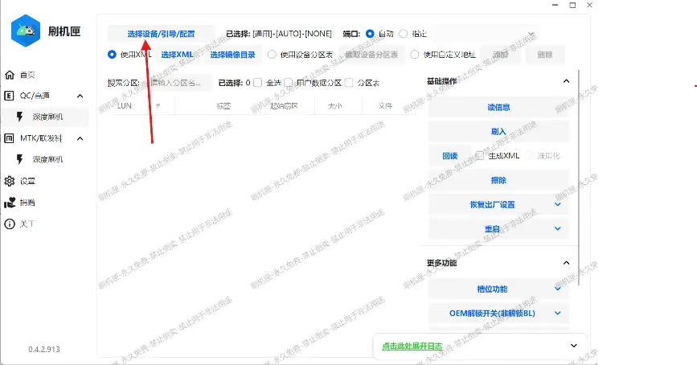
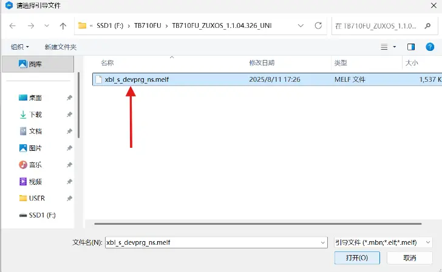
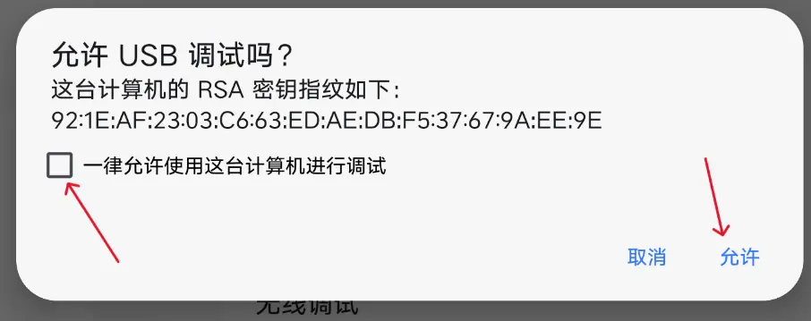
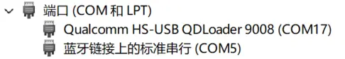
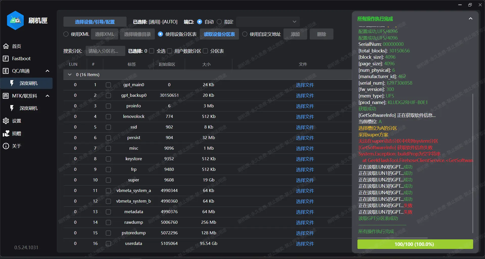
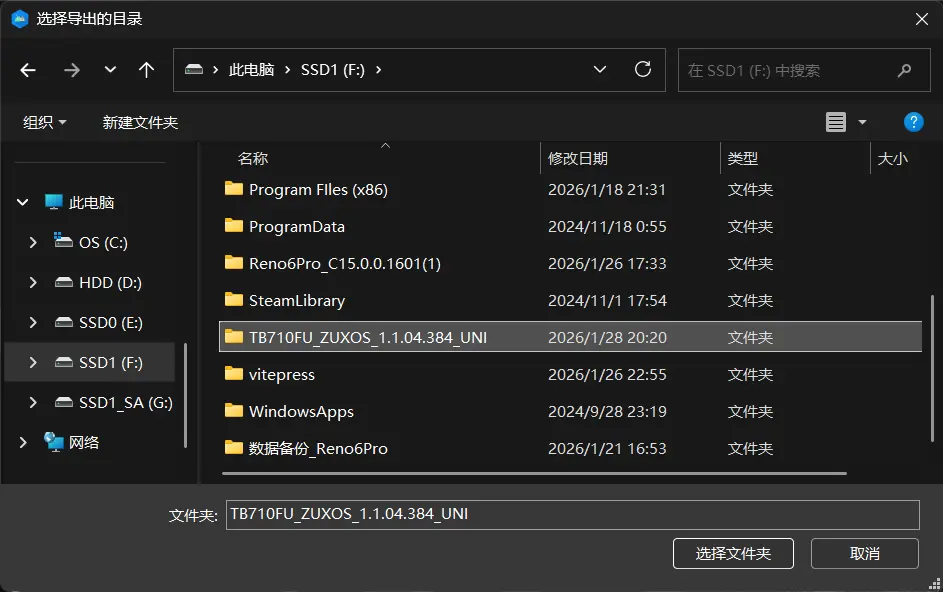

# 进行任何刷机操作之前我应当怎么做？

装驱动、备份、保证电量充足。

安装 9008驱动 建议直接使用匣完成或者使用 _Windows Update_ 。

> [!note]
> 仅针对使用来自以上两个渠道的驱动的用户回答问题。

保证电量充足我没法教你。

所以这里只讨论备份。

备份分为两个部分：设备底层分区，以及用户数据。我们讨论底层备份。

## （1）备份设备底层分区

使用 9008 模式可以读取设备几乎全部的分区，用于备份底层分区再合适不过。这里我们选择图形界面更加友好的匣作为备份工具。接下来是详细步骤：

1. [安装ADB工具](./flash_unlocked_device.md#Install_ADB)并打开平板的[USB调试](./flash_unlocked_device.md#USB_Debugging)。

2. 从群文件夹**搞机工具**下载群内的 9008 工具"匣"；从群文件夹**神秘引导文件**下载 `xbl_s_devprg_ns.melf` 引导文件。解压到容易找到的非中文目录。

3. 打开"刷机匣"主程序，启动后的主界面如下：


如果是第一次使用，先点击 1 箭头指向的按钮安装刷机驱动，否则，直接点击 2 箭头指向的`深度刷机`，打开如下页面。接下来，请按照图片箭头指示操作，直到文字提示再次出现。



完成下一张图操作后回到本页面点击确定。



4. 将设备重启到 9008：确保之前的步骤都已经完成，然后用 USB 线将平板连接到电脑，在电脑上打开终端，并输入以下命令：

```
adb reboot edl
```

此命令会让平板重启到 9008 模式。如果是初次使用某台电脑进行 adb 命令有关的操作，需要进入平板的主页面，等待 USB 调试授权窗口弹出，并点击"允许"

> [!tip]
> 提示 `error: no devices/emulators found` ？
> 
> 检查： 1. 数据线 2. 驱动 3. 尾插 4. USB 5. 电脑 6. 前面执行的操作



允许后，平板应当在几秒钟后黑屏，此时打开电脑端的设备管理器，应当能看到以下画面：



只要存在 9008 一项且没有感叹号，就证明电脑和平板的连接状态良好，驱动程序工作正常。否则，请根据 Windows 报错检查 Windows 端问题，或者自行排查其他原因。

5. 在"匣"中点击**选择设备/引导/配置**按钮，选中刚刚下载的引导文件，然后点击`读信息`。完成后应当出现这样的窗口，日志中存在图中报错是正常的：



6. 把日志页面收起，按照下面的要求选择配置：

- `已选择` 复选框中勾选 `全选` 和 `分区表`，不要勾选 `用户数据分区`；

- `基础操作` 区勾选 `生成XML` ，不要勾选 `通用化` 。

也就是下图所示。此时应该选择了 **120个** 分区。


7. 点击`回读`按钮。

8. 在弹出的窗口中选择适合的目录，用于保存读出的镜像文件，并`选择文件夹`。确认后就会自动开始回读。



> [!tip]
> 如果你的电脑 _有 USB3 端口_ 、手头 _有 USB3 电缆_ ，并且平板在使用 USB3 线和 USB3 端口时能和电脑正确连接和通信，那么建议使用 USB3 进行备份，速度会快很多。

9. 等待进度条走完，检查一下备份的文件夹。里面应当包括下面提及的，共120个文件：

- 102 个以 `.img` 结尾的镜像文件。

> [!note]
> 如果你启用了 "隐藏已知文件类型的扩展名"，那么看不到 `.img` 是正常的。不过这些文件在 `Windows 10` 及以上系统会显示一个带有**光碟**的图标来标记其类型。
>
> 无论如何，建议打开显示文件扩展名的选项。

- 12 个以 `.bin` 结尾的二进制文件，也就是 `gpt_main0.bin` 到 `gpt_main5.bin` ，以及 `gpt_backup0.bin` 到 `gpt_backup5.bin`。

- 6 个 XML文件，也就是 `rawprogram0.xml` 到 `rawprogram5.xml` 。

确认上述文件都存在后，底层备份工作就完成了。要知道怎样使用备份，请跳转到 [刷入第三方ROM或者备份](./flash_3rd_party_rom.md)。

> [!tip]
> 可以在这里找到[通用救砖包的制作方法](./make_generic_pc_firmware.md)。

## （2）用户数据备份

如果你获取了 Root 权限，请使用"数据备份"APP，否则自行解决。
