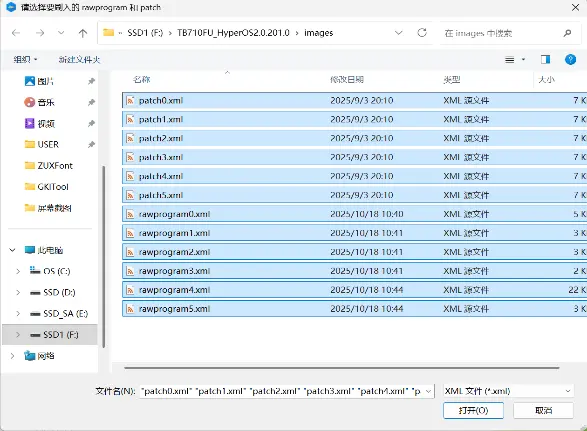
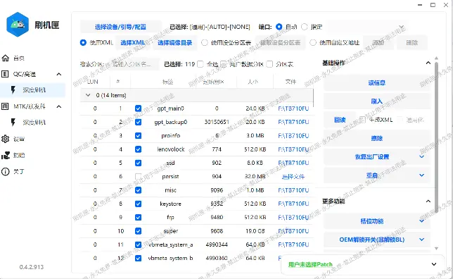

# 刷入第三方 ROM、救砖包，和自己创建的备份

> [!warning]
> 您是否已经阅读了 [重要警告](./important_warns.md) 和 [刷机必修一](./flash_unlocked_device.md)？

> [!note]
> 下面的教程均建立在你安装好了 9008 驱动的前提下，如果你不会安装，跳转到 [安装驱动](./flash_unlocked_device.md#Install_Driver) 进行学习。

## 总而言之......
由于无法解锁 BootLoader，目前的刷机包均以 9008 刷机包形式提供，并且都是从设备存储内回读制成的。

关于第三方 ROM 的信息，请跳转 [第三方 ROM 信息汇总](./appendix_3rd_party_roms.md) 进行查询。

对于其他方向，无论是**刷第三方系统**、**回到原系统**或者**救砖**，均遵循以下步骤：

## **Step 1**:
平板 `进入 9008 模式`，电脑 `安装好刷机驱动`，解压刷机包并放在一个合适的位置。打开匣，**选择引导文件**，用 `读信息` 按钮确定设备和引导文件状态正常。

> [!note]
> 如果你看不明白以上任何一步的内容，跳转到 [刷机前准备](./before_flashing.md)来学习。

## **Step 2**:
在匣的主页面，找到 `选择 XML` 按钮。点击打开二级页面。

## **Step 3**:
在打开的二级页面中，找到你解压刷机包的目录，里面应当存在 `rawprogram.xml` 和 `patch.xml`，将它们**全部选中**，并点击打开：

> [!note]
> 如果没有 patch.xml，从群文件夹 `刷机包` 中下载`patch_xml_官方_297.zip`后解压到刷机包所在文件夹中，然后在匣选中 `rawprogram.xml` 和 `patch.xml` 即可

打开之后检查匣是否正确加载了镜像文件，正确的情况就像 *下面* 这样：

如果镜像文件路径不正确，用 `选择 XML` 按钮右侧的 `选择镜像目录` 手动指定镜像的存储位置

## **Step 4**:
现在可以开始刷机了，点击主界面上的 `刷入` 按键，耐心等待进度条走完。

> [!tip]
> 使用 USB3 传输效果更佳 —— 如果你有合适的设备！

## **Step 5**:
进度条走完后，点一次 **重设当前槽位**

## **Step 6**:
最后，点击 **恢复出厂设置** 中的 **通用**，平板会自动重启到 `Recovery` 模式。

## **Step 7**:
在 `Recovery` 模式中，点击 `Wipe` 按钮（中文界面中的"清除"），然后点击 `Format data`（中文界面中的 `格式化 data 分区`），最后用键盘输入 `yes`，点击右下角的 `√ 按钮`，即可顺利清除分区，重启到系统。

## **Step 8**:
如果过程中出现了任何意外，或者想回到原版系统，`参照本教程` 刷入你的备份即可。如果没有备份，刷群里提供的 **大于等于你刷三方系统之前的 ZUXOS 版本** 的救砖包，刷完之后：

1. 进入设置，输入`####2222#`查看 `SN` 和 `PN` 状态。

2. 如果当中的任意一个处于未知状态，则进入 9008 模式刷入 `persist` 镜像备份，重启即可。

3. 如果连 `persist` 备份都没有，那刷入群内提供的名为 `GSNFix` 的模块可以部分解决问题。（当然这代表着必须保持 `Root` 状态了）
