# 刷写 GKI Root

GKI Root 对于官方和第三方 ROM 都适用。

> [!warning]
> 您是否已经阅读了 [重要警告](./important_warns.md) 和 [解锁 Bootloader 刷机](./flash_unlocked_device.md)？

> [!important] 一个时代结束了...
> [1.5.04.445 修复了免解锁漏洞](./faq.md#注释-3-关于免解锁刷机)，如果可能，请解锁刷机。

> [!danger] 弃用提示
> KernelSU 官方维护的 GKI 内核已经停止更新。
>
> 小新 Pad Pro GT 刷入 GKI 内核进行 Root 后，在恢复出厂时可能会出现卡第一屏 / 第二屏的问题。要解决这个问题，请将活动插槽的 `boot` 镜像替换为原厂镜像。
>
> 基于以上考虑，我们不再推荐使用 GKI 作为设备获取 Root 的方式。请参考 [Root 导航](./state_machine.md) 中使用 LKM 模式获取 Root 的教程获取 Root ，或者对于**已经使用 GKI 获取 Root 的用户**，先参考还原原厂 `boot` 镜像的 [教程](./unroot_gki.md) 还原镜像，然后使用 LKM 获取 Root 。

## **Step 0**:

从本站 [下载页](./resource_download.md) 下载下列文件：

1. 刷机工具：刷机匣
2. `boot` 镜像（`GKI` 内核）：建议选择 `KernelSU` 或者 `KernelSU Next` 文件夹中的镜像（单个镜像大小约为 `96MiB`）。
3. Root 管理器：根据你使用的 `boot` 镜像自行选择匹配的分支 **和** 版本。

## **Step 1**:
设备关机，按音量上键 **不松手**，插入数据线。先是出现电池标，后屏幕直接黑掉，电脑发出设备插入提示音。

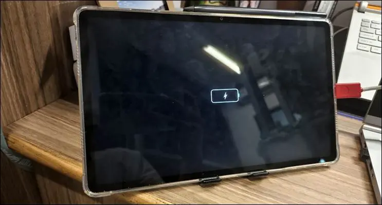

> [!tip]
> 如果上面的步骤不生效，将平板开机，[打开 USB 调试](./flash_unlocked_device.md#USB_Debugging)，电脑[安装 ADB 工具](./flash_unlocked_device.md#Install_ADB)，然后在电脑端按组合键 `Win+R` 打开"运行"对话框，输入 `cmd`，打开命令提示符，输入`adb reboot edl`，即可重启到 9008 模式。

设备管理器出现如下图红线划出的 `9008 结尾的设备`就证明进入 9008 模式成功。
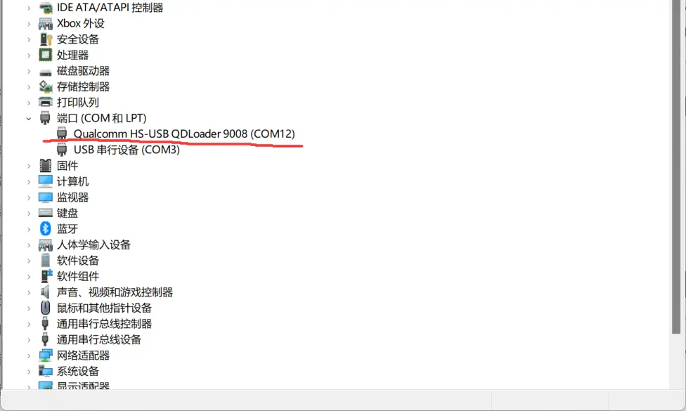

## **Step 2**:
打开刷机匣，点击 `选择设备/引导/配置`，选择引导文件`xbl_s_devprg_ns.melf`如下图

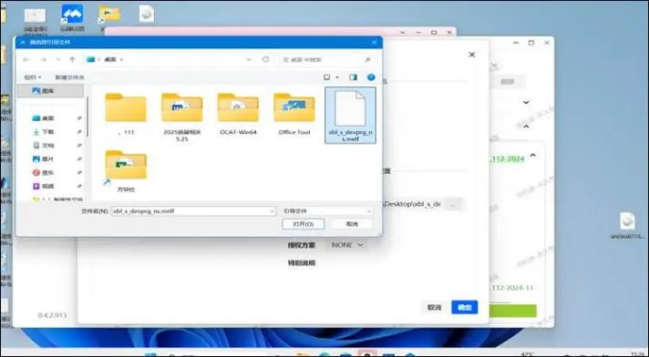

## **Step 3**:
然后刷机匣点击右侧 `读信息` 按钮，如下图

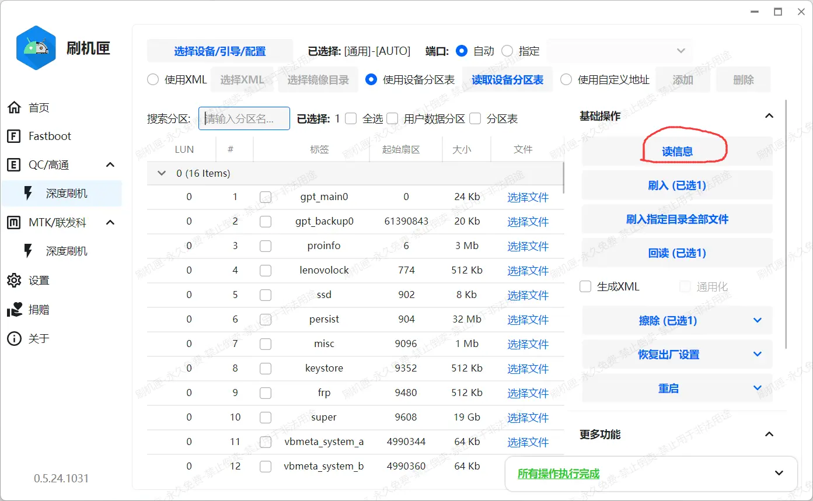

弹出下图内容后证明读取成功。如不同，按 `电源键 + 音量下键` 强制重启，重新进入 9008 模式，并且重新从 *步骤2* 开始

## **Step 4**:
按 `槽位功能 -> 查看当前槽位` 来确定槽位。如下图

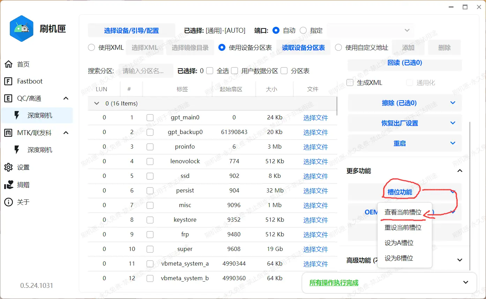

可以看到我的机器是 B 槽位，如下图（记住这个槽位号，不同批次设备槽位可能不同，**看到是哪个槽位等会就刷哪个槽位的 boot**）

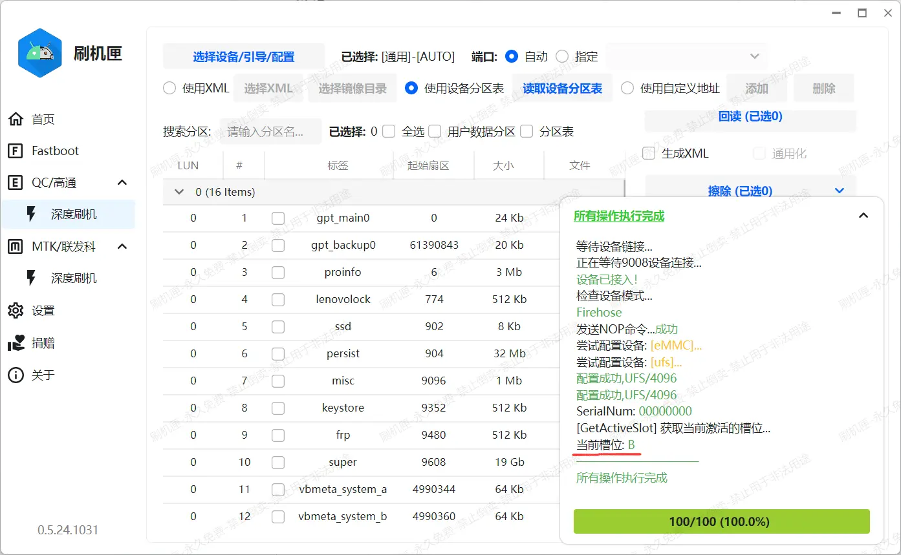

## **Step 5**:
然后在对应分区名（`A 槽`为 `boot_a`, `B 槽`为 `boot_b`）后面点击选择文件，如下图

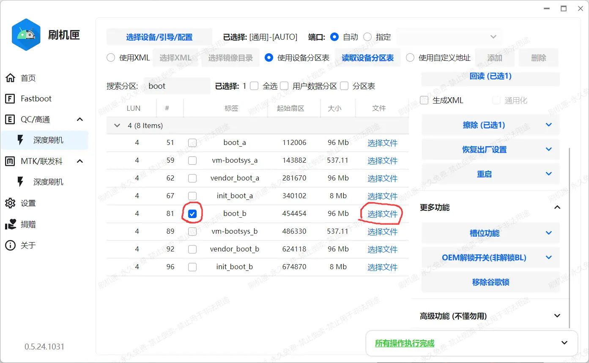

选择刚才下载的 `boot` 镜像

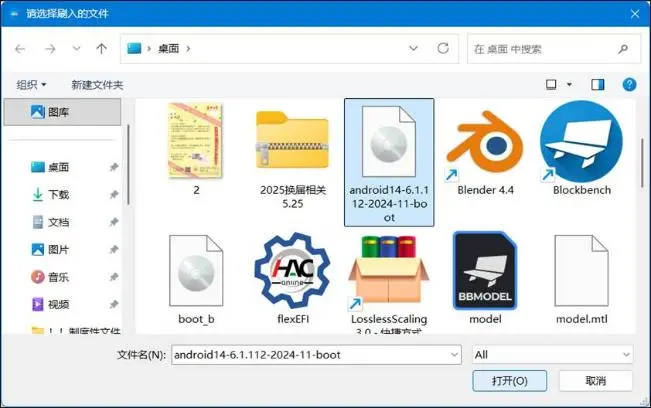 

## **Step 6**:
点击基础操作栏目中的刷入，将 `boot` 镜像烧录到平板中；

## **Step 7**:
点击刷机匣右侧界面 `更多功能` 里的 `槽位功能`，然后点击 **重设当前槽位**，如下图；

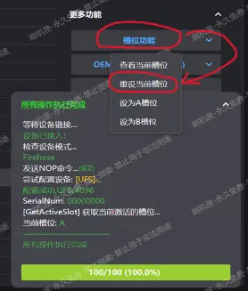

## **Step 8**:
完成上述步骤后，在刷机匣找到如下图选项，点击 `重启 -> 系统` 即可重启到 `Android 系统`。

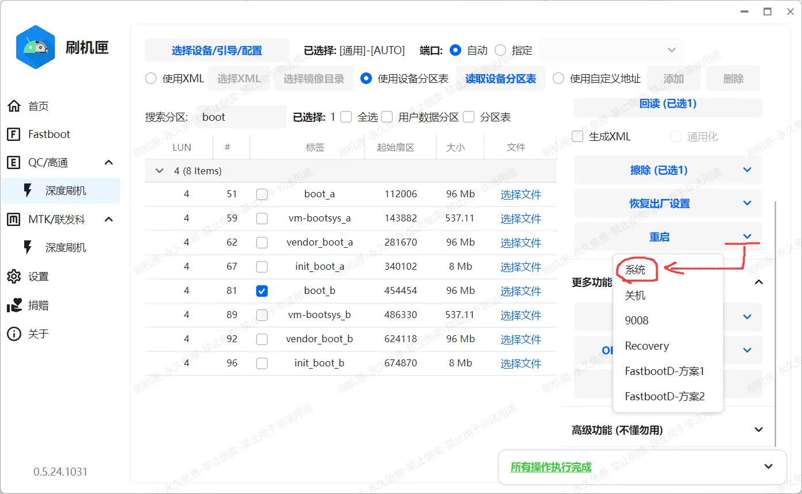

## **Step 9**:
设备应当正确启动。启动后请安装合适的 Root 管理器（例如作者使用 `KernelSU GKI, 那么安装 KernelSU），此时应当在看到管理器里显示工作中\<GKI>，如下图所示

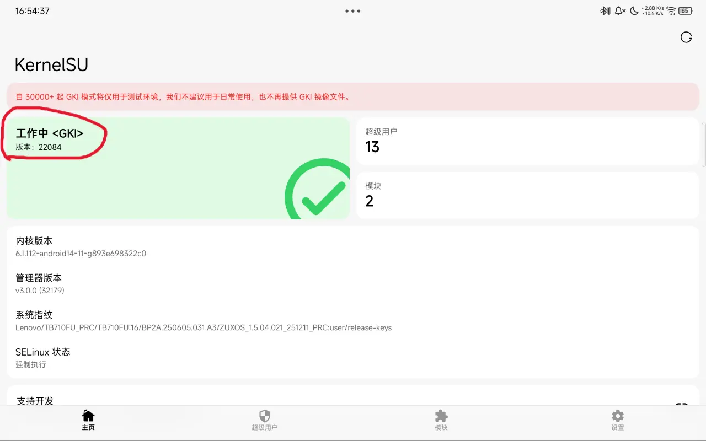

确认管理器提示 "工作中" 后 **请关闭管理器中的"检查更新"选项**，位置位于 `设置 -> 检查更新`，请参考下图

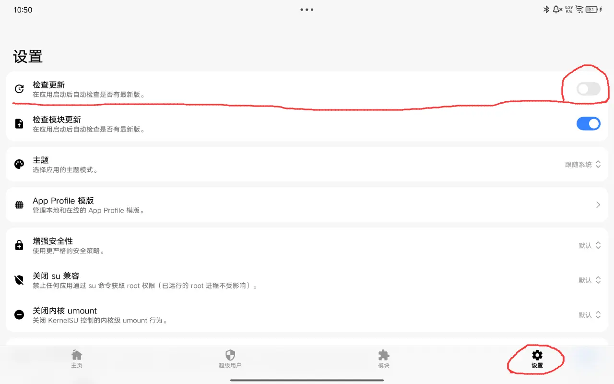 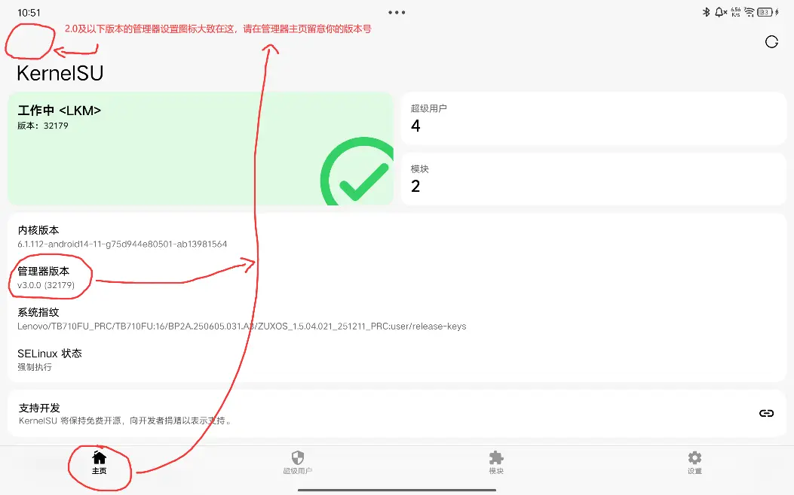
