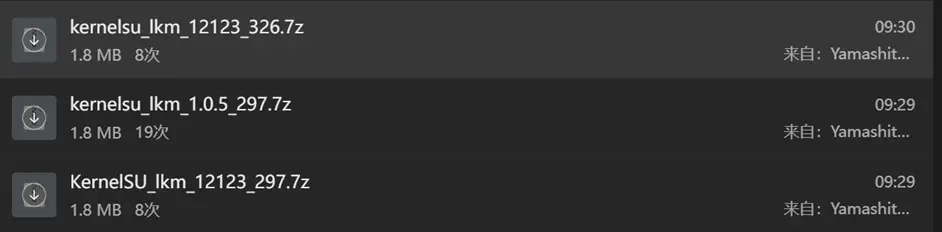
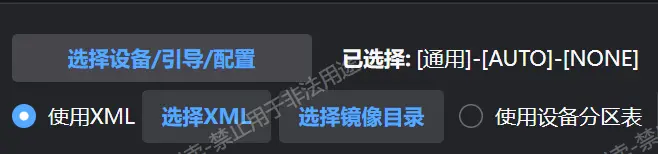
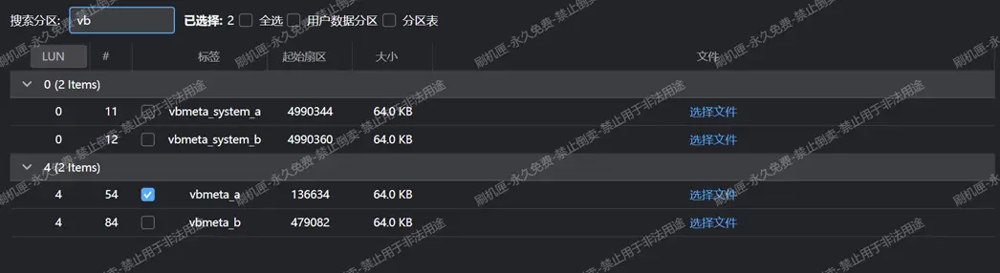
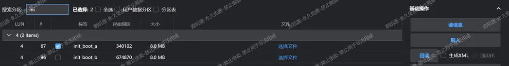
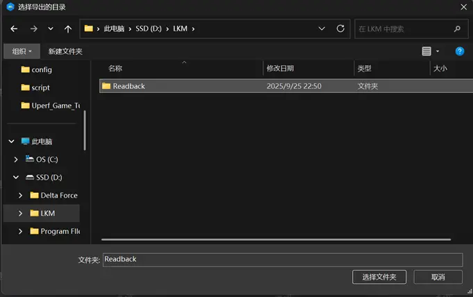
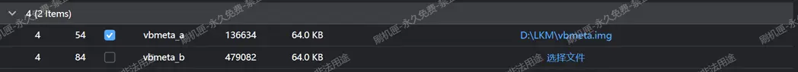
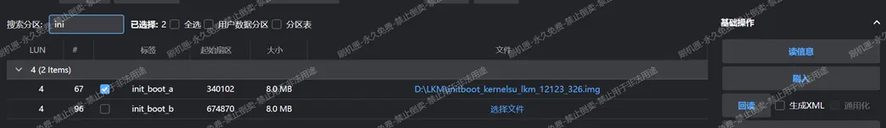
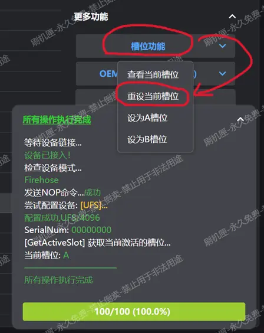
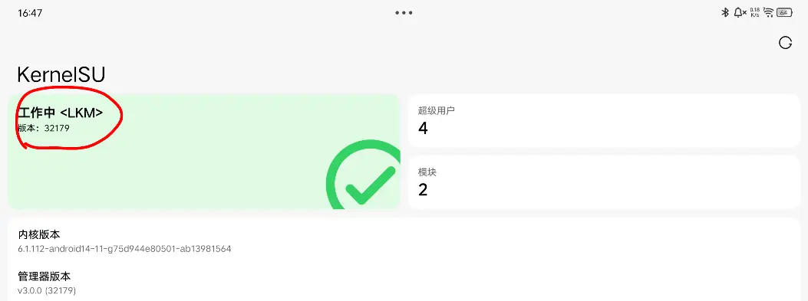
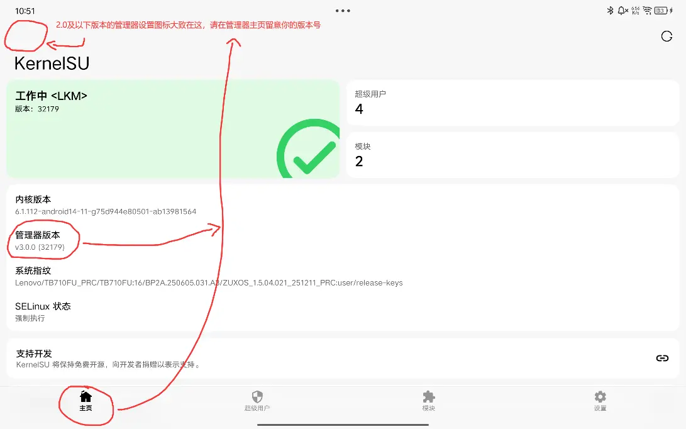

# 刷写 LKM Root - 使用 9008

> [!important]
> 如果你在页面 wasddestroy.site 看到了这段文字，说明作者临时上传了一个尚在编写中的文档副本。
>
> 此副本可能未经插图、含有晦涩难懂的语言表达、甚至可能含有作者未察觉的逻辑冲突和事实错误。
>
> 请谨慎对待这样的页面，并提醒作者尽早完成增补。

> [!warning]
> 您是否已经阅读了 [重要警告](./important_warns.md) 和 [刷机必修一](./flash_unlocked_device.md)？

## **Step 0**:

自己下载群文件夹中合适的文件：

1. 刷机工具：位于 `搞机工具` 文件夹中的 `刷机匣`；
2. 引导文件：位于 `神秘引导文件` 文件夹中的 `xbl_s_devprg_ns.melf`
3. 签名工具：位于 `AVB2.0相关` 文件夹中的 `一键签名工具.rar`
4. Root 管理器：位于 `管理器合集` 文件夹中，根据你准备使用的实现自行选择。推荐 `KernelSU`

确保电脑安装了 Python 3 环境，推荐 Python 3.13。如果没有，请前往这里下载：[Python 3, Windows 发行版下载](https://www.python.org/downloads/windows/)。

> [!note]
> 事实上可以使用 Microsoft Store 内提供的 Python ；如果在未安装 Python 的 Windows 电脑上打开终端并输入 Python ，它会自动打开这个商店页面。

## **Step 1**:

将设备重启到 9008 模式：关机， **按住** 音量加，并插入数据线，设备应当先显示充电符号，并在几秒钟后黑屏，且电脑发出插入设备的提示音。这时可以 **松开音量键** ，准备在电脑端发送引导。

> [!tip]
> 如果无法进入，参考 [常见问题解答 - 进入 9008](./faq.md#问-1怎么进入-9008-模式) 中提供的操作逐个尝试即可。

发送引导方式：

1. 点击 `选择设备/引导/配置`

2. 在弹出的窗口中，点击 `引导文件` 处右侧的 `...` 按钮，并在弹出的对话框选择从群文件夹 `神秘引导文件` 下载的 `xbl_s_devprg_ns.melf` 文件，并点 `打开` 选择它，最后在刷机匣的对话框点击 `确认` 。

3. 现在回到刷机匣的主界面，点击 `读信息` ，确认一下设备连接是否正常，如果正常，应当能够读取到分区信息。注意日志页面中有当前活动插槽的信息，**记住此信息，稍后有用**。

> [!note]
> 日志内有上图所示的错误信息是正常的

## **Step 2**:

读取活动插槽的 `vbmeta` 和 `init_boot` 。

勾选**正确槽位**的 `init_boot` 和 `vbmeta` 两个分区后，按右侧的回读按键从设备读出分区，记得选择容易记忆且有区分度的目录，例如作者选择将回读的文件存储在 `D:\LKM\Readback` 中。

点击 `重启` 按钮，选择重启到 `系统` 。

## **Step 3**:

安装 Root 管理器，修补 `init_boot` 。

将刚才准备的 Root 管理器传输到平板并安装。将刚刚读取的 `init_boot` 镜像也传输到平板上。打开 Root 管理器，点击 `未安装` ，然后选择刚刚传输到平板的镜像。管理器会自动进行修补。

> [!tip]
> 如果管理器提示选择 KMI ，则应选择 `android14-6.1` 。

修补完成的镜像会存储到平板内置存储中的 `Download` 文件夹中。留意管理器输出中提供的文件名，在电脑上导航到 `Download` 文件夹，找到这个文件并传输到电脑上。（此文件的名字通常包含 `kernelsu_patched` 或者 `magisk_patched` 等字样，以 `.img` 扩展名结尾）。

> [!tip]
> 如果在电脑上找不到 `Download` 文件夹中对应的 `.img` 文件，拔插一次 USB 线一般可以解决。

## **Step 4**:

签名 `init_boot` 并重建 `vbmeta` 。

解压一键签名工具。

将刚刚**回读的**`vbmeta_<slot>.img` 重命名为 `vbmeta.img` ，放置到工具中含有 *非链式* 字样的 `.bat` 文件的目录中。

将**修补好的**`init_boot_<slot>.img` （现在应该名为 `kernelsu_patched_<some_numbers>.img`）重命名为 `init_boot.img`，放置到和上面的 `vbmeta.img` 相同的目录中。

双击 `非链式.bat` ，等待工具自动操作。刚刚放置到 `.bat` 文件相同目录下的两个镜像文件现在应该已经完成了签名。

> [!important]
> 推荐检查工具的结果，确认工具是否正确签名了 `init_boot` 并重建对应的 `vbmeta` 。

将工具生成的 `backup` 文件夹中的镜像妥善保存，以备后续系统更新时还原使用。

## **Step 5**:

刷入 `init_boot` 和 `vbmeta` 。

将平板重启到 9008 模式。在刷机匣中选择正确的引导文件后点击 `读信息` 。

为**活动插槽（就是刚才要求记住的插槽）的 **`init_boot` 和 `vbmeta` 分区选择刚刚签好名的对应文件，并点按 `刷入` 按钮。

## **Step 6 （非常重要）**:

点击刷机匣右侧界面 `更多功能` 里的 `槽位功能` ，然后**点击"重设当前槽位"**，如下图；

完成上述步骤后，在刷机匣找到如下图选项，点击 `重启 -> 系统` 即可重启到系统界面，开机后安装和所用镜像 `匹配` 的 Root 管理器（例如刷入的是 `KernelSU` 的镜像就安装 `KernelSU` 的管理器，其他同理），完成全流程。

## **Step 7**:

设备应当正确启动。启动后应当看到管理器中显示工作中\<LKM>，如下图所示：

## **Step 8**:

确认管理器处于工作中后请关闭管理器中的 `检查更新` 选项~~以防忍不住点了直接安装~~，此选项位于 `设置` 选项卡，请参考下图

 

## **注意事项**:

> [!danger]
> 严禁使用管理器的 `直接安装` 和 `安装到另一个槽位` 功能。管理器不知道设备没有解锁，不会重建 `vbmeta` 结构。这么做会导致**设备AVB校验不通过，无法开机**，表现为提示红色感叹号，后续启动时只能卡在 `BootLoader模式` 。
>
> 严禁使用管理器 `卸载` （注意：**不是**`卸载模块`）功能。这么做也会破坏 `vbmeta` 结构，造成和上面的行为相同的后果。