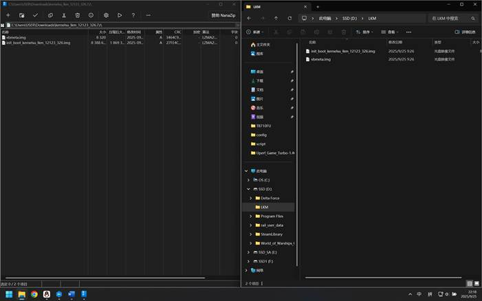

# 刷写 LKM Root - 使用 9008

> [!warning]
> 您是否已经阅读了 [重要警告](./important_warns.md) 和 [刷机必修一](./flash_unlocked_device.md)？

## **Step 0**:

自己下载群文件夹中合适的文件：

1. 刷机工具：刷机匣，位于 `搞机工具`文件夹中；
2. 镜像文件压缩包（带 `LKM` 字样）：选择 `KernelSU` 文件夹中的 `7z` 文件（单个压缩包大小为 **10MiB 以内**），并请注意文件末尾的版本号数字，您应当使用与自己的平板当前运行的 **ZUXOS** 版本号 **一致** 的文件；
3. Root 管理器：根据你使用的镜像自行选择。

## **Step 1**:

作者设备运行的 `ZUXOS` 版本为 `326`，因此下载群文件中的`kernelsu_lkm_12123_326.7z`。把其中的文件解压缩到方便找到的目录，例如`D:\LKM`

## **Step 2**:

现在将设备重启到 9008 模式：关机， **按住** 音量加，并插入数据线，设备应当先显示充电符号，并在几秒钟后黑屏，且电脑发出插入设备的提示音。这时可以 **松开音量键** ，准备在电脑端发送引导。

> [!tip]
> 如果无法进入，将平板开机，[打开 USB 调试](./flash_unlocked_device.md#USB_Debugging)，电脑上[安装 ADB 工具](./flash_unlocked_device.md#Install_ADB)，然后在电脑上输入命令`adb reboot edl`即可进入 9008 模式。

发送引导方式：

1. 点击 `选择设备/引导/配置`

2. 在弹出的窗口中，点击 `引导文件` 处右侧的 `...` 按钮，并在弹出的对话框选择从群文件夹 `神秘引导文件` 下载的 `xbl_s_devprg_ns.melf` 文件，并点 `打开` 选择它，最后在刷机匣的对话框点击 `确认` 。

3. 现在回到刷机匣的主界面，点击 `读信息` ，确认一下设备连接是否正常，如果正常，应当能够读取到分区信息。

> [!note]
> 日志内有上图所示的错误信息是正常的

## **Step 3**:

现在可以准备正式刷入 `vbmeta` 和 `init_boot` 了，先**备份对应分区。**

勾选正确槽位的 `init_boot` 和 `vbmeta` 两个分区后，按右侧的回读按键从设备读出分区，记得选择容易记忆且有区分度的目录，例如作者选择将回读的文件存储在 `D:\LKM\Readback` 中。

## **Step 4**:

正式刷入 `init_boot` 和 `vbmeta` ，为两个分区选择对应的、已经过 Root 管理器修补并利用 `avbtool.py` 签名的文件，并点按 `刷入` 按钮

## **Step 5**:

点击刷机匣右侧界面 `更多功能` 里的 `槽位功能` ，然后**点击"重设当前槽位"**，如下图；

完成上述步骤后，在刷机匣找到如下图选项，点击 `重启 -> 系统` 即可重启到系统界面，开机后安装和所用镜像 `匹配` 的 Root 管理器（例如刷入的是 `KernelSU` 的镜像就安装 `KernelSU` 的管理器，其他同理），完成全流程。

## **Step 6**:

设备应当正确启动。启动后**请安装合适的 Root 管理器**（例如作者使用 `KernelSU LKM`, 那么安装 `KernelSU`），此时应当看到管理器中显示工作中\<LKM>，如下图所示：

## **Step 7**:

确认管理器处于工作中后请关闭管理器中的 `检查更新` 选项，此选项位于 `设置 -> 检查更新`，请参考下图

 
