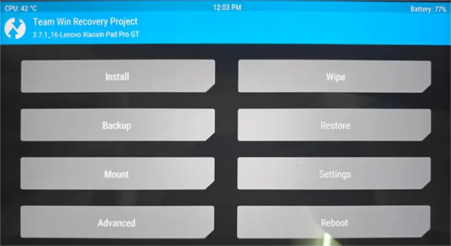

# 刷写 LKM Root - 使用 TWRP 刷入 KernelSU LKM

> 如同题目提示的一样，这个方法目前暂时只支持刷写 KernelSU LKM。
>
> 对于其他 Root 实现的支持：
>
> APatch - 等待适配
>
> 其他 KernelSU 分支 - 等待适配
>
> Magisk - 不会适配，Recovery 模式无法正确识别设备信息。
>
> 要使用本方法必须先 [刷入TWRP](./flash_twrp.md) 。

> [!warning]
> 如果你希望从 GKI 模式 转到 LKM 模式 ，先还原 `boot` 分区，然后再使用此方法。
>
> 如你不确定如何还原 `boot` 分区，请参考[解除 Root - GKI Version](./unroot_gki.md#Restore_boot) 。

下面开始正式教程：

## **Step 1**:

平板进入 Recovery 模式，下面两种方法可供随意选择：

- 平板关机，按住 `电源键` 、 `音量+键` 、 `音量-键` ， 屏幕亮起后松开 `电源键` ， 出现TWRP启动的画面后即可松开 `全部` 按键。

- 平板关机，按住 `电源键` 、 `音量+键`， 进入 `Fastboot (BootLoader)` 模式，然后用 `音量键` 移动光标，找到选项 `Boot to recovery` ，按 `电源键` 确认，即可进入 `TWRP`。

## **Step 2**:

进入 `TWRP` 后，会看到下面的界面：

> [!note]
> 如果你设置了密码，会先看到一个带有数字或者其他形式键盘的页面，输入锁屏密码即可解密 `/data` 分区。
>
> 不过在本教程中，你可以直接选择 `Cancel` 跳过解密 `/data` 的流程。

## **Step 3**:

点击 **Advanced** 按钮，进入二级界面，找到右侧的 **Install ksu lock-bl** 按钮。点击它，然后将滑块滑到右侧，即可自动安装。

## **Step 4**:

安装完毕，重启平板即可。
