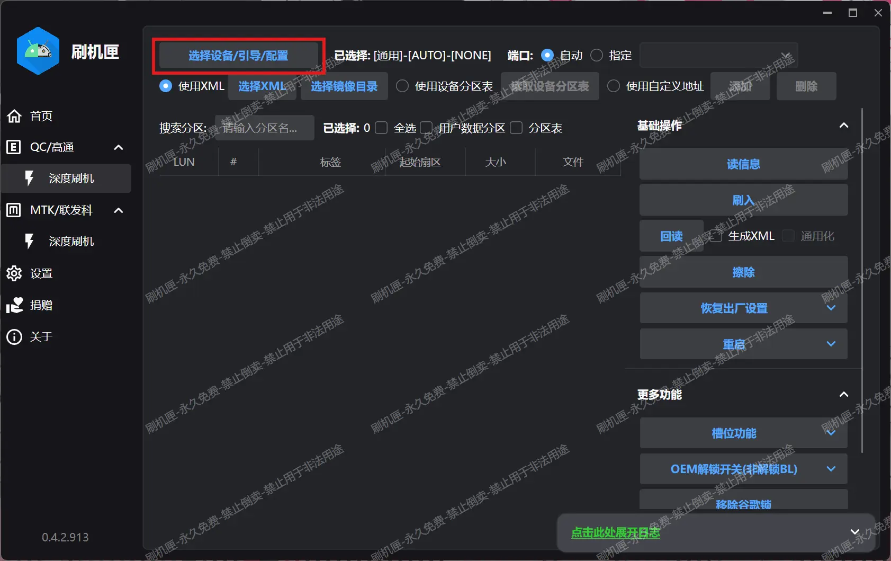
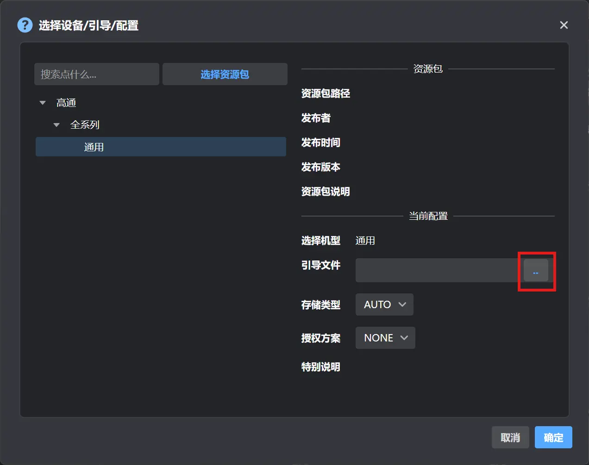
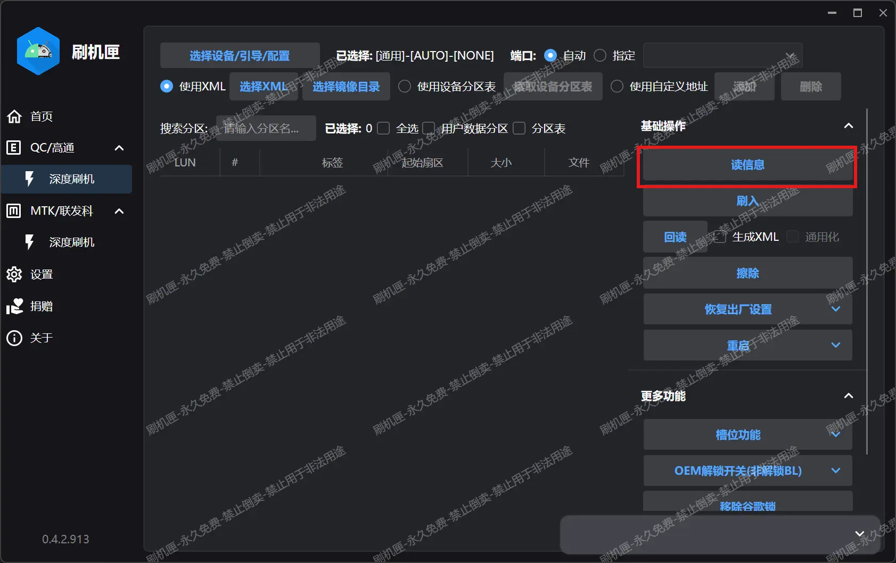
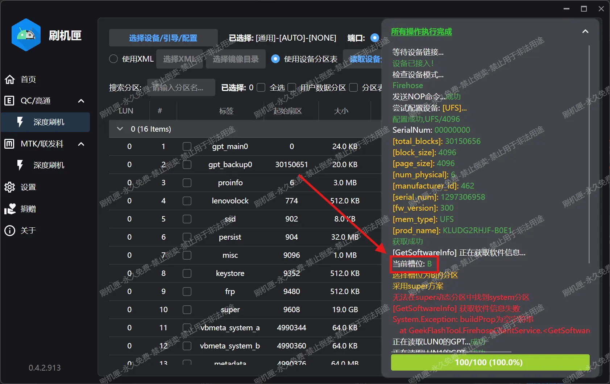
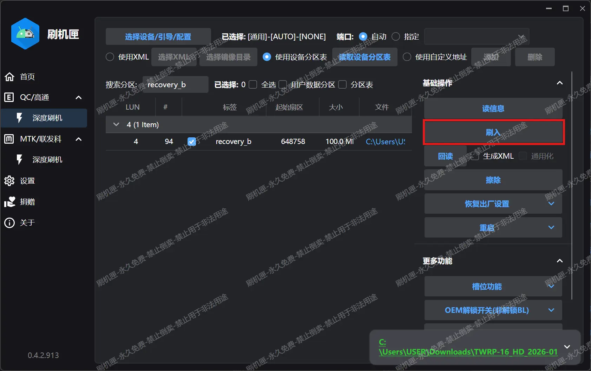
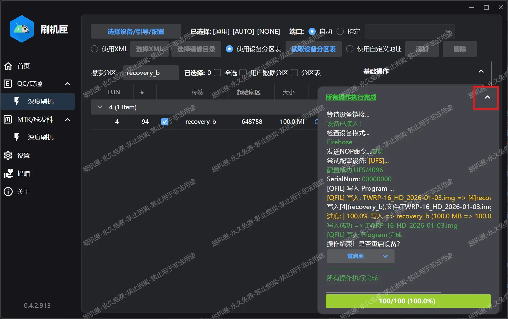
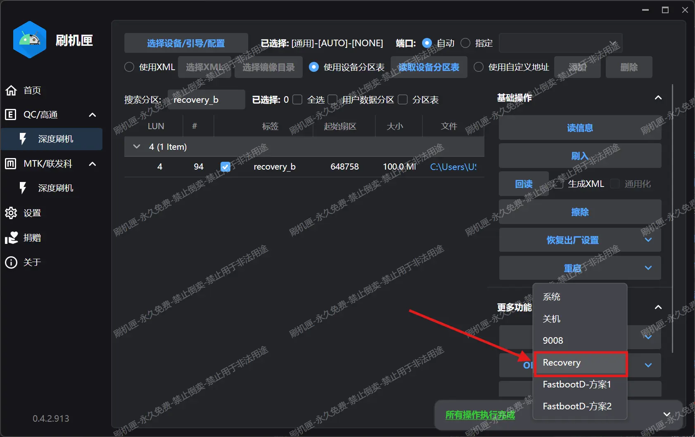

# 欲一键安装 LKM，先刷入 TWRP

> [!warning]
> 您是否已经阅读了 [重要警告](./important_warns.md) 和 [解锁 Bootloader 刷机](./flash_unlocked_device.md)？

> [!important] 一个时代结束了...
> [1.5.04.445 修复了免解锁漏洞](/faq.md#注释-3-关于免解锁刷机)，如果可能，请解锁刷机。

下面开始正式教程：

## **Step 1**:

下载 TWRP 。本站现在无权转载此 TWRP 文件。

## **Step 2**:
平板进入 9008 模式，可以依次试试下面三种方法：

1. 直接使用按键组合进入 9008，部分系统版本和活动槽位可能无效。
   
   - 平板关机，断开数据线。
   
   - 按住平板的 `音量+` 按钮。
   
   - **保持按钮按住**，这时插入数据线。
     
     > [!tip]
     > 不要松开按键！很多用户有意无意的松开了按键导致无法通过此方法进入 9008。
   
   - 成功：平板应当显示一段时间的充电画面之后黑屏，电脑发出设备接入的提示音。
   
   - 失败：平板显示第一屏画面。（恭喜你中奖辣！换用下一种方法）

2. 使用 `ADB` 命令进入 9008。
   
   - 平板处于操作系统，打开 `USB 调试` 。如果是 ZUXOS，将 USB 连接模式切换为 **仅充电** 或者 **不用于数据传输**。
   
   - 电脑端按 `Win + R` ，输入 `cmd` 打开命令提示符，然后输入下面的命令：
     
     ```shell
     adb reboot edl
     ```
   
   - 现在平板应该进入了 9008 模式，电脑上能看到对应的设备出现。

3. 使用二代高通工程线进入 9008，我们的终极杀招。
   
   - 情况 1：平板可以完全关机。
     
     - 将平板关机。
     
     - 工程线插入电脑，然后按住 **工程线上的按钮**，插入平板。
     
     - 成功：电脑响起设备接入的提示音，可以松开按钮了。
     
     - 失败：电脑无反应。线材质量不佳，考虑退换。
   
   - 情况 2：平板无法关机。
     
     - 工程线插入电脑，另一头连上平板。
     
     - 同时按住**平板的 电源键** + **平板的 音量- 按钮** + **工程线上的按钮**，等待平板黑屏。
     
     - 成功：电脑响起设备接入的提示音，可以松开全部按钮了。
     
     - 失败：电脑无反应。可能是线材质量不佳，考虑退换。

## **Step 3**:
电脑打开刷机匣，执行刷写步骤：

1. 点击 `选择设备/引导/配置` ：
   

2. 点击红框处的按钮，在弹出的窗口选择从下载页下载的引导文件 `xbl_s_devprg_ns.melf` ，点击确定。
   

3. 回到主界面，选择 `读信息` ：
   

4. 观察输出的日志，确定活动槽位 **（见红框）**，稍后只需要向活动槽位的 `recovery` 分区刷入镜像即可：
   
   
   > [!note]
   > 提示“无法在 `super` 动态分区中找到 `system` 分区”、“读取 `LUN6` 的 `GPT`...失败”和“读取 `LUN7` 的 `GPT`...失败”是正常的，不需要理会。

5. 根据刚刚确定的槽位找到对应的 `recovery` 分区，并选择镜像：
   
   - `当前槽位：A`对应 `recovery_a` 分区，`当前槽位：B`对应 `recovery_b` 分区。
   
   - 在红框框出的搜索栏输入对应的分区名，例如对我来说应当输入 `recovery_b` ，系统会自动找到对应分区：
     
   
   - 点击“选择文件”，选择刚刚下载的 `TWRP` 镜像：
     
   
   - 文件选择完毕后，点击 `刷入`：
     
   
   - 刷入完成，将日志窗口折叠起来，然后点击 `槽位功能` 打开二级菜单，然后**点击“重设当前槽位”**：
     
     
   
   - 完成后点击 `重启` 打开二级菜单，重启到 `Recovery` 或者 `系统` 都行：
     
   
   - 至此 `TWRP` 刷入完毕。
     
     > [!tip]
     > 如果需要刷回原厂 `Recovery` ，步骤也是 *类似的*。
