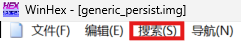
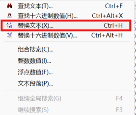
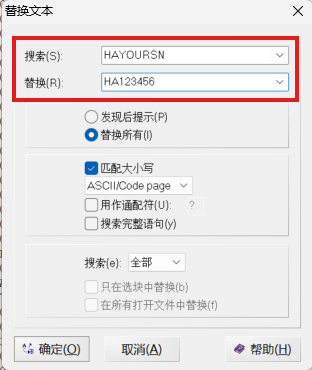
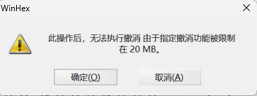
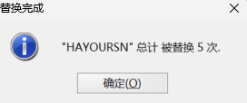
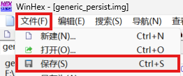
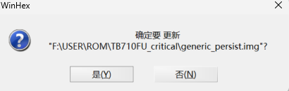

# 修复 GSN

> 关联关键词：修复 `Persist`、修复串号

`GSN` 是联想平板设备存储在 `persist` 和 `devinfo` 分区的一个序列号，用于在线壁纸、AI 服务等场景中识别设备身份。刷机，尤其是刷写第三方 ROM 和官方救砖包时有丢失 `persist` 分区数据的风险。轻则导致无法使用上述在线服务，重则无法开机卡在第一屏。下面的教程通过提供通用的 `persist` 镜像和 WinHEX 十六进制编辑器来帮助修复 `GSN` 和 `persist` 分区。

> [!important]
> 如果您丢失的是 `PSN` ，本教程很遗憾无法帮上您，目前没有已知的修复 `PSN` 的方式。

## Step 1

获取修复所需的工具和文件：[通用 persist 镜像和 WinHEX](https://wwapb.lanzout.com/b004je5qwh) ，访问密码 `hpwx` 。

> [!tip]
> 如果您只需要令设备恢复至可以开机的状态而无需恢复 `GSN` ，可以直接使用官方救砖包内的 `persist` 镜像并刷入。

## Step 2

在平板背面或者包装盒处找到 8 位的、以字母 `HA` 开头的 SN 号码，例如 `HA123456` 。

## Step 3

用 WinHEX 编辑器打开下载的 `generic_persist.img` 。

点击工具栏的 `搜索` 。

找到并打开下拉菜单中的 `替换文本` 选项。

## Step 4

在替换文本的对话框中有 `搜索` 和 `替换` 两个输入框，在 `搜索` 框填入 `HAYOURSN` ， `替换` 框输入你设备的 SN ，例如 `HA123456` ，然后点击确定。

弹出的警告信息直接点击确定。

成功对话框应当提示替换了 5 次。

这样就完成了替换 SN 的操作，记得保存文件。

弹出的对话框直接点击 `是` 。

## Step 5

使用 9008 工具刷入修改好的 `generic_persist.img` 。刷机工具教程：[匣使用说明](../../generic_knowledge/geekflashtool.md) ，可以参考本站的 Root 教程学习如何刷入分区。