# 为您的联想小新 Pad Pro GT 解锁 Bootloader

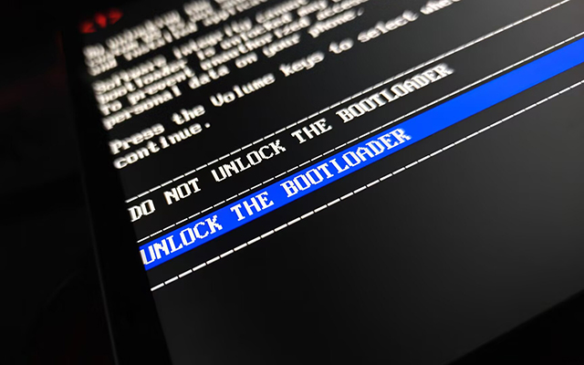

> [!important] 约定
>
> 1. 你知道终端、命令提示符、命令行指的是在 Windows 电脑上的 `cmd` 或者类似物。就是输入文字命令，例如 `fastboot --version` 能得到文字结果的一个软件。
>
> 2. 你能保证按照顺序阅读本教程，懂得使用页面内的快速跳转（手机点右上角展开，电脑上就展示在浏览器窗口当中的右侧）
>
> 3. 文本中的尖括号<>的意思是“你需要把尖括号里面的文字连同这一对尖括号替换成实际需要的东西”，比如将 fastboot flash unlock <path_to_your_sn.img> 替换成 fastboot flash unlock D:\sn.img

## 前言

关键概要：用 Y900 通道申请解锁。以下是正文。

众所周知的，1.5.04.445 修复了免解锁漏洞，解锁刷机会是我认为比较正式的途径。而除了 1.5.04.424（未公开发版），其余版本均可以解锁 Bootloader 。

怎么恢复免解锁和是否有必要以保修为代价解锁、解锁之后[保修政策](https://www.lenovocare.com.cn/ServicePolicy.aspx)到底怎样、回锁情况如何等，这些都不是本文讨论的话题，本文讨论的是用邪修方法解锁 Bootloader 喵~

## 准备

1. 一台正常工作的 Windows 电脑，建议 Windows 11 ，并保证 USB 可靠
2. 一条能正常**传输数据**的可靠的 USB 电缆
3. **保证头脑清醒和一定动手能力**

## 打开 USB 调试

<a id="unlock-usb-debugging"></a>

在平板上完成这些基本准备步骤：

1. 打开设置，找到 **关于平板电脑**
2. 滑动右侧页面找到 **ZUXOS 版本**，狂点直到系统提示 **您已处于开发者模式**
3. 转到 **通用设置**
4. 滑动右侧页面最下方找到 **开发者选项**
5. 滑动右侧页面找到 **USB 调试**，打开这个选项。
6. USB 调试选项需要在稍后再允许调试，按照下图来选择：


## 打开 OEM 解锁

1. 在刚才一步的右侧界面中找到 **OEM 解锁**（在 USB 调试上面），打开这个开关

> [!tip]
> 另一个效果一样的方法是 9008 回读 `frp` 分区，将分区的最后一位从十六进制 00 改成 01 后重新用 9008 刷回设备。对于已经变砖的机器，这一招可能很有效。

## 安装刷机驱动

<a id="unlock-install-driver"></a>

从别的地方找驱动也行，不一定要用我的，但是不保证正常工作。

刷机驱动：[蓝奏云](https://wwapb.lanzout.com/it1WR3pkt04h) ，密码:gy8y

下载后双击打开有绿色 OPPO 标志的程序文件，一路点击下一步即可。最后请求重启时事实上不需要重启电脑。

## 安装 ADB 工具

<a id="unlock-install-adb"></a>

> [!note]
> 你当然可以用任何你喜欢的带命令行功能的第三方工具箱来代替 adb 工具，比如紫罗兰工具箱和搞机助手。如果你打算这么做，可以跳过本步。不过，我无法对你使用的工具箱负责，无法解答你因为使用工具箱提出的问题。

1. 下载 adb 工具包：[Android Developers](https://googledownloads.cn/android/repository/platform-tools-latest-windows.zip)
2. 解压 platform-tools-latest-windows.zip 得到 platform-tools 文件夹，先放到一个不容易记错的地方。
3. 将 platform-tools 文件夹中的所有文件复制到系统文件夹（也就是 Windows 文件夹）下的 `System32` 和 `SysWOW64` 文件夹中，也就是路径形如 `C:\Windows\System32` 和 `C:\Windows\SysWOW64` 的文件夹中。

    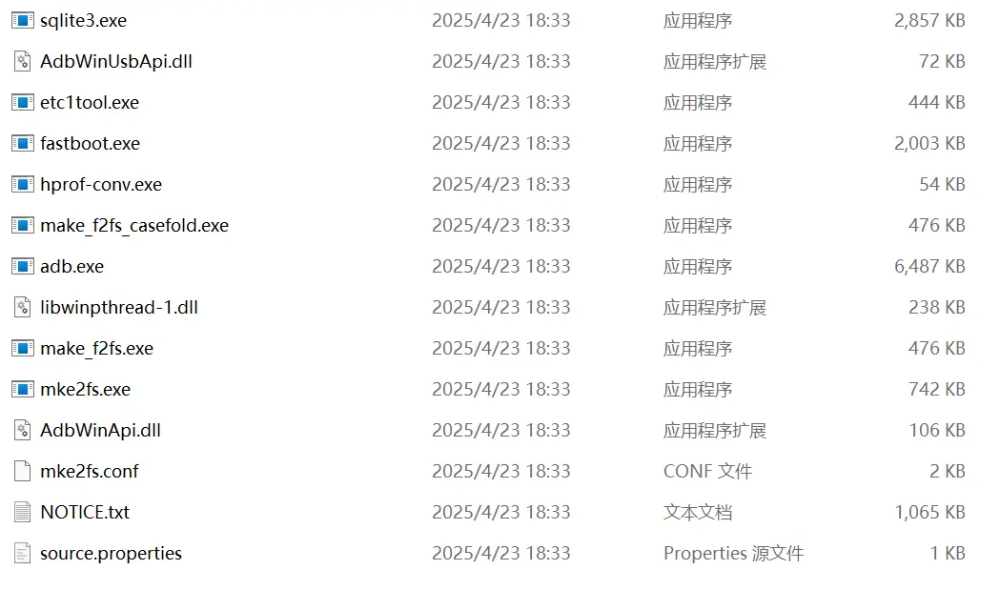

    

    

    > [!tip]
    > 如果你会设置环境变量，一个很好的办法是把 platform-tools 文件夹放到一个你认为合适的地方后将 platform-tools 的路径添加到 `Path` 中。这样就可以在不污染系统保护目录的情况下使用 adb 工具了。
    >
    > 另一个办法是在你的 platform-tools 文件夹中打开终端，然后输入命令 .\adb 和 .\fastboot 来调用本文件夹内的工具。

4. 打开一个终端界面，可以使用快捷键 `Win + R` 打开运行对话框然后输入 `cmd` ，也可以按快捷键 `Win + X` 然后按 `I` 打开。
5. 输入 `adb --version` ，如果能正常显示 adb 工具的版本和安装位置就说明工具安装成功了。就像下图这样：
   
6. 别关命令行窗口，等会解锁还有用。

## 申请解锁 Bootloader

登录联想解锁申请网站 [ZUI官网 - 解锁](https://www.zui.com/iunlock) ，在 **拯救者Y700 第五代 & 联想平板拯救者 Y900 13** 的入口提交解锁申请。要提交解锁申请，需要下面的信息：

1. 8位设备串号，或者叫做 GSN
2. Bootloader SN
3. 一个有效的邮箱，建议网易 163 邮箱，成功率最高
4. 一个尚有解锁次数剩余（理论上一个账号一年有三次解锁机会）的联想账号

### 获取上述信息

1. 获取 GSN ，以下方法任选一种：
   - 从平板的包装盒标签获得
   - 从平板背面的标签获得
    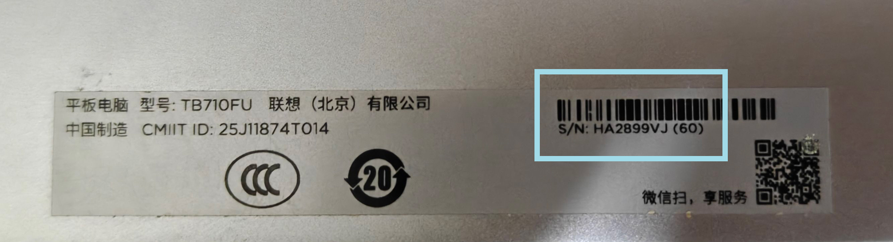
   - 从平板的设置中获得：设置 -> 关于平板电脑 -> 状态信息
    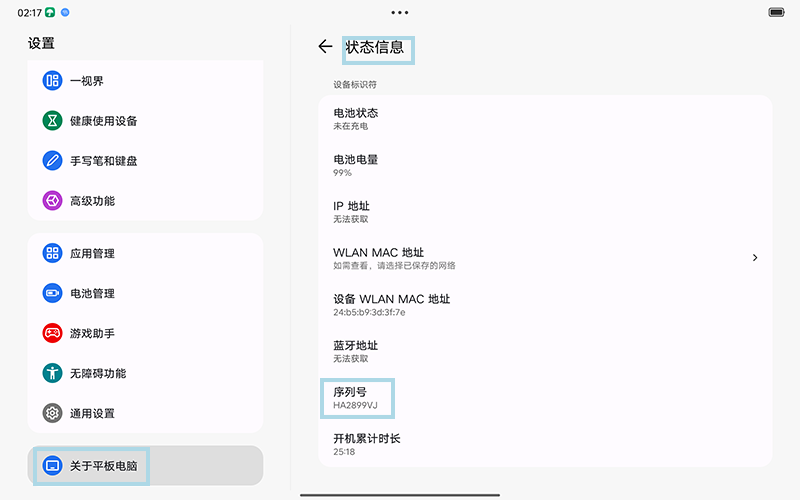
   - 使用 adb shell 命令：

     ```batch
     adb shell "getprop ro.odm.lenovo.devinfo.gsn"
     ```

     会呈现如下图的结果，`HA2899VJ` 就是我的 GSN。
    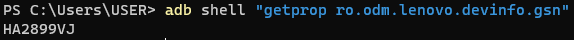
   - 从平板的 Bootloader 画面中获得： SERIAL NUMBER - 你的8位串号
    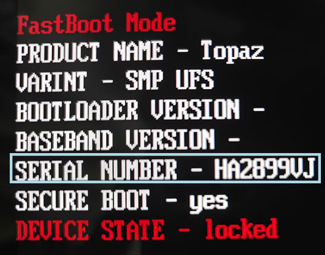
2. 获取 Bootloader SN ，官网提供的方法不一定好用，按我这个来：
   - 重启到 Bootloader 模式：`adb reboot bootloader` 或者在关机状态按住电源键和音量上键
   - 依次输入下面两条命令，不要把减号也一起敲进去：

     ```batch
     fastboot getvar Bootloader_SN_Part1
     fastboot getvar Bootloader_SN_Part2
     ```

     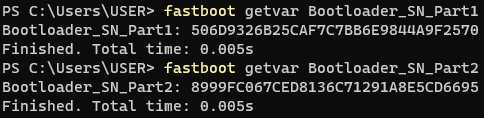
   - 把上面两条命令的结果拼接起来。例如：
     - 第一条命令输出了 *506D9326B25CAF7C7BB6E9844A9F2570*
     - 第二条输出了 *8999FC067CED8136C71291A8E5CD6695*
     - 应该把他们这样拼起来：*506D9326B25CAF7C7BB6E9844A9F25708999FC067CED8136C71291A8E5CD6695* 。
   - 拼接得到总共 64 个英文字符，不确定的话可以把拼接的结果复制进记事本或者 Word 检查下，如果拼接起来的字符串长度不是 64 就说明拼接错了。
3. 获得邮箱和联想账号（略）

### 申请解锁

1. 访问联想解锁申请网站 [ZUI官网 - 解锁](https://www.zui.com/iunlock) 。

> [!tip] 移动端访问
> 移动端访问解锁申请站点会被重定向到 m.zui.com/iunlock ，这个针对移动设备优化的网址不包含最近更新的一些设备的解锁通道。移动端访问，需要先打开浏览器的电脑模式，然后手动把网址的 m.zui.com 改成 <www.zui.com> 。
> 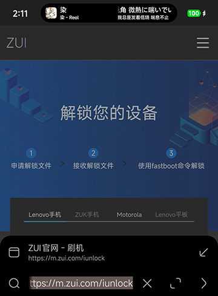

1. 选择入口 **拯救者Y700 第五代 & 联想平板拯救者 Y900 13** 。
2. 先登录联想账号，不然都是白填。
3. 仔细填写信息：
   - 第一空，填写刚刚获取到的 GSN ，就是长度为 8 的那串编码。
   - 第二空，填写拼接完成的 Bootloader SN ，就是长度为 64 的那串编码。不要用文本识别、不要手敲，老老实实复制粘贴！
   - 第三空，填写一个网易 163.com 或者 126.com 的邮箱，其他邮箱极大概率收不到解锁文件
   - 第四空，填写一个简单的验证码
   - 勾选“我已了解...”旁的复选框
    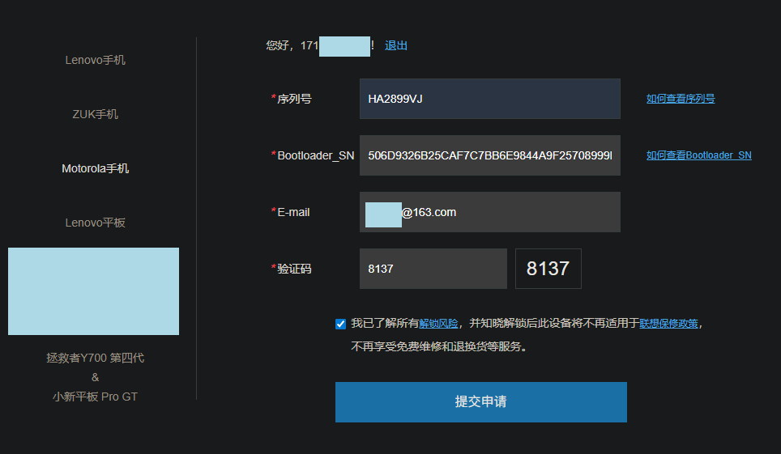
4. 点击“提交申请”，会得到提交成功的提示信息。
    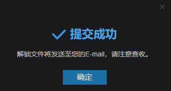

> [!note]
> 如果你不慎使用 Pro GT 的申请入口填写和提交了申请，在点击提交按钮后会被提示“您的爱机版本暂不支持解锁”等搪塞字样。
>
> 由于每日解锁人数变化，当日的名额消耗速度可能会非常快。如果你发现网页提示本日名额已满，建议在第二天中午之前再试。

## 获取解锁授权文件 sn.img

> [!important]
> 正确的解锁文件是一个大小只有 356 字节的小文件。

### 正常渠道获取 sn.img

一般来说申请解锁后的 10 分钟内解锁文件的获取邮件会发到你的邮箱。在邮箱中找到来自 `devworld@lenovo.com` 的邮件，点击邮件中的链接就可以下载到 sn.img 了。

### 如果没收到这封邮件

如果没有收到这封邮件，可能有下面的原因：

1. 解锁申请因为邮箱问题没收到（被放到垃圾邮件文件夹、使用了外区邮箱、QQ 邮箱等）
2. 根本没生成解锁文件（真的，没开玩笑，最好还是用 163 邮箱吧，成功率最高）。

碰到这种情况时请试用下面的邪修办法：

正常解锁邮件的 sn.img 从这个网页链接获得：

```text
http://cdn.zui.lenovomm.com/developer/enhancedboot/<填入你的 bootloader_sn>/sn.img
```

其中 Bootloader SN 就是刚才拼接的 64 长度的字符串。

比如我们刚刚获取到了 64 长度的 Bootloader SN 是 *506D9326B25CAF7C7BB6E9844A9F25708999FC067CED8136C71291A8E5CD6695* ，那就应该写：

```text
http://cdn.zui.lenovomm.com/developer/enhancedboot/506D9326B25CAF7C7BB6E9844A9F25708999FC067CED8136C71291A8E5CD6695/sn.img
```

把填写好的链接复制到浏览器的地址栏中回车：

- 假如文件已经生成了，那么这个链接会自动触发浏览器的下载功能。
- 假如文件没有生成，会提示 404 。
- 假如你发现错误码是 403 ，说明等待时间实在太短（少于 1 分钟）或者填错网址了！

如果等了 15 分钟以上，此网站还是提示 404 ，建议换一个 163 邮箱重新申请。

## 正式解锁

将平板重启到 Bootloader 模式，可以用指令 `adb reboot bootloader` ，也可以在关机之后按住电源键和音量上键进入。

### 刷入解锁文件

命令原型：`fastboot flash unlock <sn.img>` 。实际使用时应当学这个样子来写： `fastboot flash unlock C:\Users\WASDDestroy\Downloads\sn.img`。

不知道怎么写 sn.img 的路径该怎办呢？请看下面：

1. 先在命令行中敲 `fastboot flash unlock`，unlock 后面记得敲空格。或者复制下面的命令（同样不要忘了最后的空格）：

   ```batch
   fastboot flash unlock 
   ```

2. 将你的 `sn.img` 用鼠标拖到命令行窗口中
3. 回车执行

如果一切正常，会有类似下面的输出：

```batch
PS C:\Users\USER> fastboot flash unlock F:\USER\TB710FU_critical\UBL_SN.img
Warning: skip copying unlock image avb footer (unlock partition size: 0, unlock image size: 356).
Sending 'unlock' (0 KB)                            OKAY [  0.001s]
Writing 'unlock'                                   OKAY [  0.000s]
Finished. Total time: 0.036s
```

没刷进去？检查你的 sn.img 大小是不是 356 字节吧！

### 发送解锁命令

在命令行输入下面的命令：

```batch
fastboot oem unlock-go
```

如果一切正常，会有类似下面的输出：

```batch
PS C:\Users\USER> fastboot oem unlock-go
OKAY [  0.033s]
Finished. Total time: 0.033s
```

> [!note] 故障排除
>
> 1. 终端输出如下：
>
> ```batch
> PS C:\Users\USER> fastboot oem unlock-go
> FAILED (remote: 'oem unlock fail, VERIFY')
> fastboot: error: Command failed
>  ```
>
> 分析：刷入的 sn.img 文件无效！排查下面的原因：
>
> - 文件不是来自官方解锁申请网站，例如使用了 lenovobl.neko.ink 生成的文件
> - 文件生成有误，如果是早期通过人工审核分发 sn.img 的用户容易碰到这个问题。此外，注意检查你申请解锁时填写的表单是否有误
> - 忘记了刷解锁文件，或者解锁文件没刷进去喵~
>
> 1. 终端输出如下：
>
> ```batch
> PS C:\Users\USER> fastboot oem unlock-go
> FAILED (remote: 'Device dose not allow unlock')
> fastboot: error: Command failed
>  ```
>
> 分析：忘记打开 OEM 解锁了！重启到系统，然后遵循步骤[打开 OEM 解锁](./flash_unlocked_device.md#打开-oem-解锁)后重试！
>
> 1. 终端输出如下：
>
> ```batch
> PS C:\Users\USER> fastboot oem unlock-go
> FAILED (remote: 'unknow command')
> fastboot: error: Command failed
>  ```
>
> 分析：联想封堵解锁了，需要降级 abl 。

### 确认解锁

设备在上一步如果成功触发了解锁流程，电脑命令行上会显示 `[OKAY]` 字样。平板上会显示下面的画面：

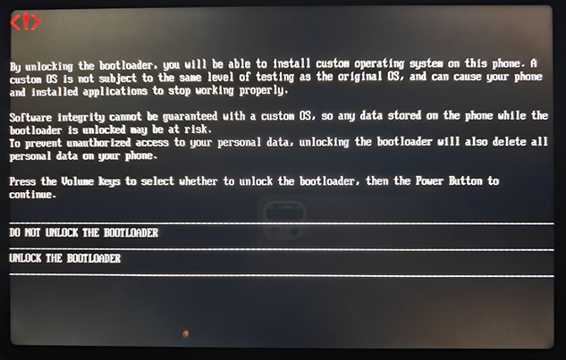

现在尝试按音量键，会发现屏幕上出现了蓝色的底色，用来指示目前某个选项正在被选中。用音量键将蓝色底色移动到 `UNLOCK THE BOOTLOADER` 后按电源键就可以解锁了。

如果不想解锁，将选项移动到“DO NOT UNLOCK THE BOOTLOADER” 后按电源键确认就可以终止解锁流程，正常启动操作系统。

## 如何锁定 Bootloader ？

参阅 [锁定 Bootloader](./lock_bootloader.md)
