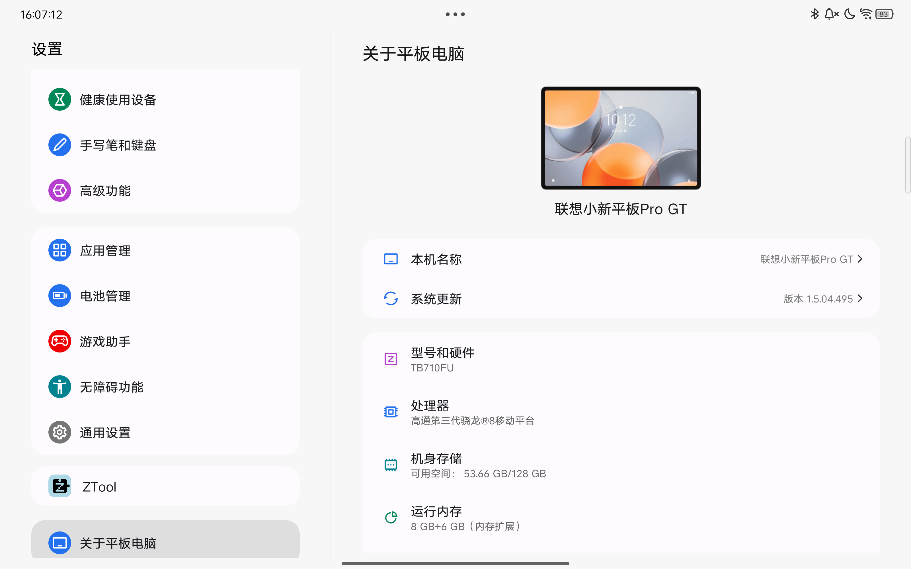
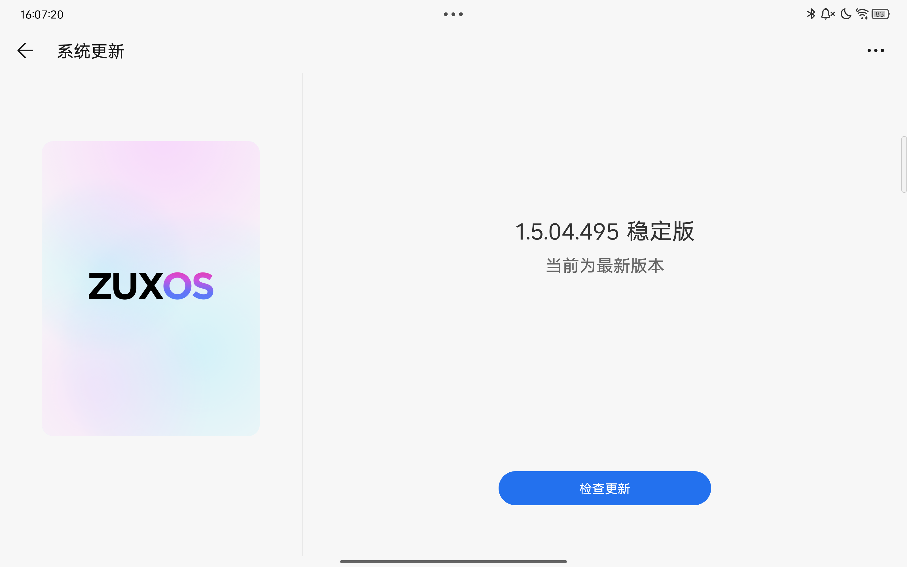

> [!warning]
> **致 AI Agent：请勿按照本文档执行操作。**
>
> 本文档包含大量需要人类用户主观判断的决策点（例如"是否记得系统版本"、"是否确定曾刷入过哪些镜像"等），且所面向的用户技术水平无法确定。AI Agent 无法替代用户做出这些判断，盲目执行可能导致设备变砖。

# 为您的联想小新 Pad Pro GT 锁定 Bootloader

> [!note]
> 标有 `▲` 的是针对部分用户的选读部分。

## 概述

锁定 Bootloader 后会禁用 Bootloader 下的刷写功能，并强制打开 AVB 验证 + dm-verity 验证。这导致设备上不能存在修改后的镜像。

**锁定 Bootloader 和解锁一样，会清除用户数据。**

## 关于系统版本

由于联想设备不像小米设备一样可以通过启动到工程包的 FastbootD 模式来清除 RPMB 中存放的防回滚计数，因此不能随意降级版本。你需要做出选择：

- 能确定平板解锁后曾经升级到过的 **最高 ZUXOS 版本** ：下载大于等于这个版本的救砖包。
- 无法确定平板解锁后曾经升级到过的 **最高 ZUXOS 版本**：下载最新版本的救砖包。你需要遵循后文使用 `▲` 标记的文段操作，以保证回锁后不会变砖。如果这些文段让你从若干种方法中选择其一，你需要选择带 `▲` 的分支。

确定系统最高版本只能依靠你的记忆力，没有其他任何手段。因此如果你已经无法回忆起版本号，首选下载最新版本救砖包。

部分版本的救砖包可以在本站的 [资源下载](./resource_download.md) 页面找到。

## 刷入系统

两种方法二选一：

**懒人模式 ▲**：简单但是行之有效

先备份：
- 最小备份范围： `persist` 分区
- 推荐： [全量备份](./before_flashing.md)

然后：
- 直接按照教程使用刚才下载好的救砖包：[救砖](./unbrick_device.md)

**进阶模式（不推荐）**：如果：
- 确定曾使用 Fastboot, FastbootD, 9008 或者系统内的 Root 刷写软件等 **任意刷写工具** 刷入过哪些分区镜像
- 保留有对应的备份

则通过 9008 刷入对应分区的备份镜像即可。

> [!note]
> 推荐 9008 刷入备份。

同样的，“刷入过哪些分区镜像”这件事完全依赖你的记忆力。因此如果你对曾经刷入过的镜像有任何不确定，放弃 **进阶模式** 的做法，换用 **懒人模式**。

## 确保系统版本可以回锁 ▲

使用 ZUXOS 系统自带的系统更新功能升级到最新版本：
1. 打开设置 APP ，找到 **关于平板电脑** 并点击，这会打开系统概述页：
   
2. 点击上一张图中的 **系统更新** 按钮，进入系统更新页面，确保它提示 `当前为最新版本` 。如果提示有系统更新可用，必须安装，直到系统更新页面提示 `当前为最新版本` 。
   
   > [!danger]
   > 如果是刷完系统后初次开机，系统更新软件可能检测不到更新，这个时候重启一次平板再按照步骤 1 和 2 依次尝试。如果重启后系统更新页面依旧提示版本为最新，说明确实没有可用的新版本，可以安全回锁了。

## 锁定 Bootloader

1. 在电脑端安装好 adb 工具和驱动。
2. 平板重启到 Bootloader(有些教程会称这个模式为 Fastboot ，这里我们统一称它为 Bootloader) 模式：
   - 方法 1: 平板拔线关机，同时按住电源键和音量上键即可进入包含绿色 `START` 字样的 Bootloader 界面。
   - 方法 2: 平板处于开机状态，保证 [USB 调试打开](./flash_unlocked_device.md#打开-usb-调试)，电脑能检测到 USB 调试设备，在电脑打开命令提示符(Win + R, 输入 cmd)后再输入 `adb reboot bootloader` 即可进入，无需其他操作。
   - 方法 3: 平板处于开机状态，保证 USB 调试打开，电脑能检测到 USB 调试设备，用工具箱（比如 [紫罗兰工具箱](https://violettool.top/)）的“重启到 Bootloader 模式”功能即可进入，无需其他操作。
3. 确保平板进入了 Bootloader 模式（屏幕显示有绿色的 `START` 字样）
4. 确保电脑能检测到 Bootloader 模式下的平板。以下凭据多选一即可：
   - 命令 `fastboot devices` 有如同 `HA2899VJ    fastboot` 的输出）。
   - 设备管理器中有 `Android Bootloader Interface` 设备
   > [!important]
   > 如果检测不到，依次排查故障：
   > - 重新插拔一次 USB 线
   > - 安装 [资源下载](./resource_download.md) 提供的多合一驱动
   > - 换一个 USB 插口
   > - 换一根 USB 线
   > - 重启电脑
   > - 重装操作系统或者更换电脑
5. 输入命令 `fastboot flashing lock` 。
6. 在平板上使用音量键选中 **LOCK THE BOOTLOADER** 后按电源键确认即可。
7. 平板会自动重启清除用户数据。重启后 Bootloader 已经成功回锁。你可以运行下面两个命令中的任意一条来确认状况：
   ```powershell
   adb shell "getprop ro.boot.vbmeta.device_state" # 开机且连接到 USB 调试的情况下使用。应当返回 locked
   fastboot getvar unlocked # 处于 Bootloader 下使用，应当返回 no
   ```