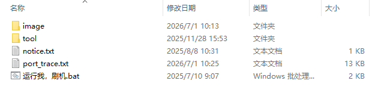
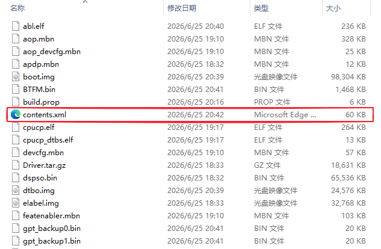

# 救砖

> [!warning]
> 极度推荐优先使用自己的备份进行恢复操作，[点我阅读教程](../without_unlock/flash_3rd_party_rom.md) 。
>
> 本教程旨在应对没有备份，必须使用救砖包的情况。
> 
> 本教程适合自制救砖包和官方救砖包。救砖包请从下载页查找。
>
> 由于压缩包文件体积较大且 123 云盘存在已知技术问题，建议下载后先验证压缩包完整性。
>
> 鉴于 123 云盘开始收费，现正在征集适合国内访问的云存储解决方案。如您有合适的方案，欢迎联系文档维护者（联系方式见前言）。

## 确定救砖包类型

请依次参考下面的判据：

1. 下载的压缩包文件名是否包含某些字样？如包含 `Tool` 字样，则它可能是官方救砖包。
2. 压缩包是否有密码保护？如果有，且密码为 `FC(fv:SknR` ，则它是官方救砖包；如果没有密码保护或者使用的不是这个密码，则它可能不是官方救砖包。
3. 压缩包内的文件是怎样组织的？如果包含文件 `运行我，刷机.bat` 和文件夹 `images`
      
4. 且 `images` 文件夹中有文件 `contents.xml` 和 `rawprogram_unsparsed0-half.xml` ，则它是官方救砖包
    
    
5. 如果没有上述文件结构，则它不是官方救砖包。

## 官方救砖包

> [!important]
> 如果您需要保留用户数据进行刷机，需要手动编辑 rawprogram0_unsparsed_half.xml
>      
> 移除所有刷入 `metadata` 和 `userdata` 的行。
>       
> 或者配合刷机匣，**删除 `rawprogram_unsparsed0.xml`** 并移除 `images` 文件夹中所有名字带有 `metadata` 和 `userdata` 的镜像后刷机。如果你需要使用刷机匣，请参考下面段落中的指导。

1. 使用上面提到的密码解压这个压缩包，请确保磁盘空间充足。
2. 在下载页提供的链接中下载 9008 驱动并安装。
3. 将平板启动到 9008 模式，参考 [常见问题解答 - 启动到 9008 模式](./faq.md#问-1怎么进入-9008-模式)。
4. 在设备管理器中确定 9008 设备的端口号，例如 `COM3`。
5. 双击启动 `运行我，刷机.bat` ，按照指示输入 9008 端口号后开始自动刷机。

如果刷机失败，将设备重新启动到 9008 模式，使用 `刷机匣` 选择 `images` 文件夹中的引导文件和合适的 XML 文件后刷机：

选择的 XML：
- rawprogram_unsparsed0-half.xml （非常重要，此文件保证不会刷写 `persist` 分区，从而确保串号状态正常）
- rawprogram1.xml 到 rawprogram5.xml
- patch0.xml 到 patch5.xml

选择的引导文件：
- xbl_s_devprg_ns.melf

刷机匣刷入救砖包的方法请参阅 [刷入第三方 ROM](../without_unlock/flash_3rd_party_rom.md) ，除了应该选择上面提及的 XML 之外，其他步骤大同小异。**如果您需要保留用户数据，重启时不要选择重启到 Recovery ，直接重启到系统即可。**

## 非官方救砖包

1. 解压救砖包中随附的匣压缩包，或者对于没有附带刷机匣的救砖包，在下载页刷机工具链接下载匣的压缩包并解压。解压完成后打开刷机匣。
2. 按照刷入第三方 ROM 的 [教程](../without_unlock/flash_3rd_party_rom.md) 刷入救砖包。**如果您需要保留用户数据，重启时不要选择重启到 Recovery ，直接重启到系统即可。**