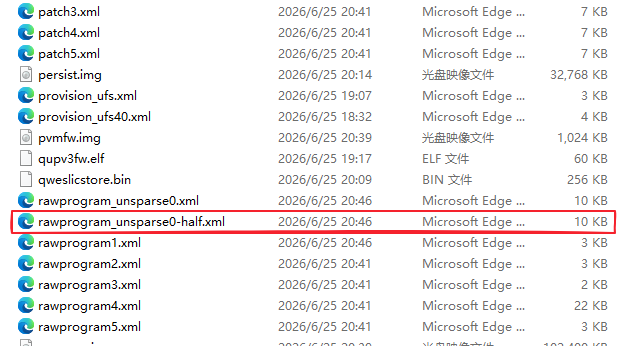
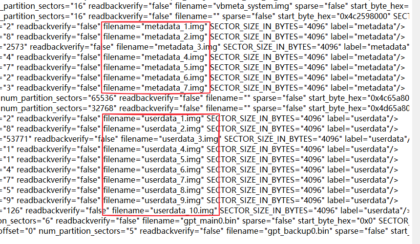

# 救砖

> 本教程由以下作者参与共建：hhc883(酷安 [@吗喽哥布林](https://www.coolapk.com/u/14252596))

本教程旨在应对没有备份，必须使用救砖包的情况，适合自制救砖包和官方救砖包。救砖包请从下载页查找。如果你按照本教程的 [刷机前准备](./before_flashing.md) 留有一份你设备当前版本的备份镜像，极度推荐优先使用自己的备份进行恢复操作，[点我阅读备份恢复教程](../without_unlock/flash_3rd_party_rom.md) 。

## 确定救砖包类型

请依次参考下面的判据：

1. 下载的压缩包文件名是否包含某些字样？如包含 `Tool` 字样，则它可能是官方救砖包。
2. 压缩包是否有密码保护？如果有，且密码为 `FC(fv:SknR` ，则它是官方救砖包；如果没有密码保护或者使用的不是这个密码，则它可能不是官方救砖包。
3. 压缩包内的文件是怎样组织的？如果包含文件 `运行我，刷机.bat` 和文件夹 `images`
      
4. 且 `images` 文件夹中有文件 `contents.xml` 和 `rawprogram_unsparsed0-half.xml` ，则它是官方救砖包
    
    
5. 如果没有上述文件结构，则它不是官方救砖包。

## 官方救砖包

### 使用救砖包

1. 使用上面提到的密码解压这个压缩包，请确保磁盘空间充足。
    > [!important]
    > 官方救砖包支持保留用户数据进行刷机。但是只有下面两种情况能保留数据，且情况 2 只推荐经验丰富的用户操作：
    > 1. 用 9008 刷机包升级系统
    > 2. 用 9008 刷机包救援变砖前处于 ZUXOS 的设备（只推荐经验丰富的用户操作，救砖操作如果再引入“修改救砖包”这一变量，将进一步阻碍排障。）
    > 
    > 要尝试保留用户数据请按照你使用的工具从下面两种方法二选一：
    > 1. （官方刷机脚本等）手动编辑 rawprogram_unsparsed0-half.xml
    >      
    > 移除所有刷入 `metadata` 和 `userdata` 的**行，然后保存文件**。
    >       
    > 2. （刷机匣）**删除 `rawprogram_unsparsed0.xml`** 并移除 `images` 文件夹中所有名字带有 `metadata` 和 `userdata` 的镜像后刷机。如果你需要使用刷机匣，请参考下面段落中的指导。
2. 在下载页提供的链接中下载 9008 驱动并安装。
3. 将平板启动到 9008 模式，参考 [常见问题解答 - 启动到 9008 模式](./faq.md#faq-enter-9008)。
4. 在设备管理器中确定 9008 设备的端口号，例如 `COM3`。
5. 双击启动 `运行我，刷机.bat` ，按照指示输入 9008 端口号后开始自动刷机。

### 处置刷机失败
先将设备重新启动到 9008 模式：
1. 长按 **电源 + 音量下**，直到设备管理器中的 9008 设备消失。
2. 拔下平板端的数据线。
3. 依据设备状况处理：
  - 如果设备没有亮屏，则跳过这一步；
  - 如果设备进入了 Fastboot/Bootloader 模式：按音量键移动选项，找到红色的 `Power off` 后按电源键确认关机；
  - 如果设备进入了 Recovery 模式：按音量键移动选项到 `power off` 后按电源键确认关机；
  - 如果设备进入了 FFBM 测试模式，按电源 + 音量下组合键再重启一次，当设备黑屏时立马松手，然后重新回到本步骤开头。
4. 参照 [常见问题解答](./faq.md) 重新进入 9008 模式。

然后重新尝试一次使用 `运行我，刷机.bat` 刷机。如果还是失败，使用 `刷机匣` 选择 `images` 文件夹中的引导文件和合适的 XML 文件后刷机：

选择的 XML：
- rawprogram_unsparsed0-half.xml （非常重要，此文件保证不会刷写 `persist` 分区，从而确保串号状态正常）
- rawprogram1.xml 到 rawprogram5.xml
- patch0.xml 到 patch5.xml

严禁选择 rawprogram_unsparsed0.xml ，这会导致你的 GSN 丢失，影响你申请和执行 Bootloader 解锁，并导致包括系统更新在内的联想在线服务不可用或不可靠。如果你已经使用这个文件指导刷机软件刷入了相关镜像，考虑参考 [修复 GSN](./fix_gsn.md) 这篇文章进行应急修复。

选择的引导文件：
- xbl_s_devprg_ns.melf

刷机匣刷入救砖包的方法请参阅 [刷入第三方 ROM](../without_unlock/flash_3rd_party_rom.md) ，除了应该选择上面提及的 XML 之外，其他步骤大同小异。**如果您需要保留用户数据，重启时不要选择重启到 Recovery ，直接重启到系统即可。**

## 非官方救砖包

1. 解压救砖包中随附的匣压缩包，或者对于没有附带刷机匣的救砖包，在下载页刷机工具链接下载匣的压缩包并解压。解压完成后打开刷机匣。
2. 按照刷入第三方 ROM 的 [教程](../without_unlock/flash_3rd_party_rom.md) 刷入救砖包。**如果您需要保留用户数据，重启时不要选择重启到 Recovery ，直接重启到系统即可。**