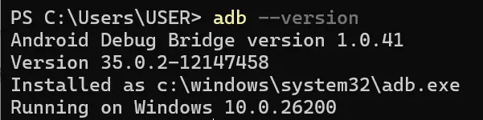
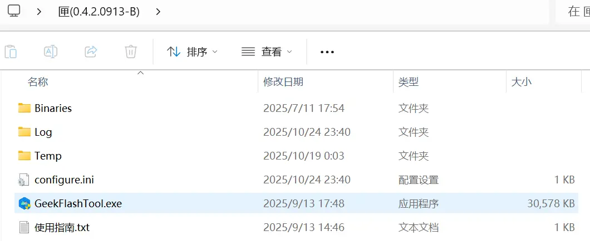
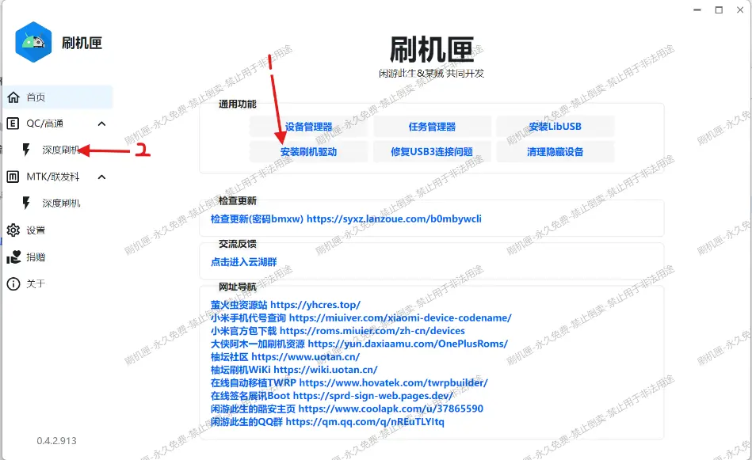
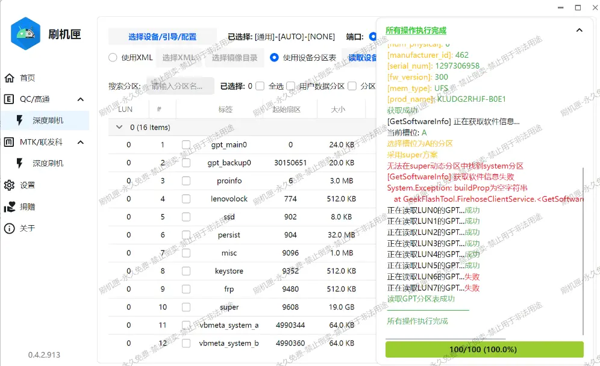
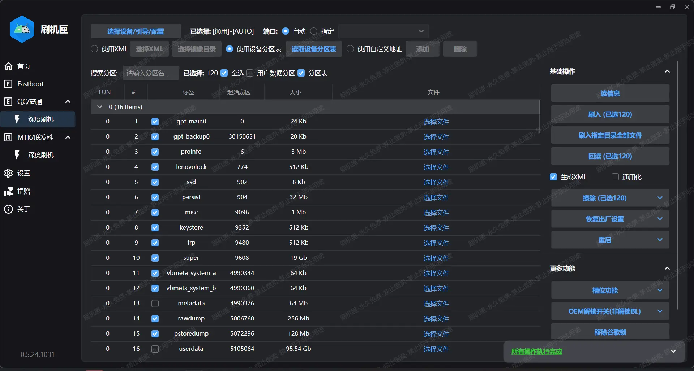

# 进行任何刷机操作之前我应当怎么做？

装驱动、备份、保证电量充足。

安装驱动建议直接使用匣完成或者使用 *Windows Update* 。

> [!note]
> 仅针对使用来自以上两个渠道的驱动的用户回答问题。

保证电量充足我没法教你。

所以这里只讨论备份。

备份分为两个部分：设备底层分区，以及用户数据。我们讨论底层备份。

（1）备份设备底层分区

使用 9008 模式可以读取设备几乎全部的分区，用于备份底层分区再合适不过。这里我们选择图形界面更加友好的匣作为备份工具。接下来是详细步骤：

<a id="USB_Debugging"></a>在平板上**打开 USB 调试**：打开设置 → 关于平板电脑，连续点击右侧页面中的"软件版本"直到系统提示"您已处于开发者模式"。转到"通用设置"，滑动找到"开发者选项"，在"开发者选项"中找到"USB 调试"开关，打开，弹出的"是否允许 USB 调试"对话框请选择确认。

<a id="Install_ADB"></a>**安装 ADB 工具**：在群文件夹"搞机工具"或者靠谱的站点下载`platform-tools-latest-windows.zip`，`匣(0.4.2.0913-B).zip`，它们分别是 ADB 工具包和 9008 刷机工具。此外，还需要下载群文件夹"神秘引导文件"中的`xbl_s_devprg_ns.melf`。下载完成后，将文件解压到一个方便记忆的目录。

第一个压缩包，也就是 ADB 工具解压后应当得到`platform-tools`文件夹，打开能看到以下文件：


全选这些文件并复制，将它们粘贴到`Windows`文件夹下的`System32`和`SysWOW64`文件夹中，例如：Windows 安装在 C 盘，则应当复制到以下图片中所示的目录：


现在 ADB 工具应当已经完成安装，要测试是否正确安装，按`Win+X`打开超级菜单，然后选择`Windows Powershell`或者`命令提示符`或者`终端`，打开后输入以下命令：

```
adb --version
```

应当得到类似以下的输出：



这说明 ADB 工具已经正确安装。

第二个压缩包，也就是 9008 工具"匣"，解压后应当得到以下文件：



双击其中的`GeekFlashTool.exe`，打开"刷机匣"主程序，启动后的主界面如下：



如果是第一次使用，先点击 1 箭头指向的按钮安装刷机驱动，否则，直接点击 2 箭头指向的"深度刷机"，打开如下页面。接下来，请按照图片箭头指示操作，直到文字提示再次出现。


完成下一张图操作后回到本页面点击确定。


现在将设备重启到 9008：确保之前的步骤都已经完成，然后用 USB 线将平板连接到电脑，在电脑上打开终端，并输入以下命令：

```
adb reboot edl
```

此命令会让平板重启到 9008 模式。如果是初次使用某台电脑进行 adb 命令有关的操作，需要进入平板的主页面，等待 USB 调试授权窗口弹出，并点击"允许"


允许后，平板应当在几秒钟后黑屏，此时打开电脑端的设备管理器，应当能看到以下画面：


只要存在 9008 一项且没有感叹号，就证明电脑和平板的连接状态良好，驱动程序工作正常。否则，请根据 Windows 报错检查 Windows 端问题，或者自行排查其他原因。

现在在"匣"中选择"读信息"，完成后应当出现这样的窗口，右侧日志中存在图中报错是正常的：



把日志页面收起，按照下图选择配置，并最后点击"回读"按钮：



在弹出的窗口中选择适合的目录，用于保存读出的镜像文件，并"选择文件夹"。确认后就会自动开始回读。


> [!tip]
> 如果 USB3 可以连上平板，建议使用 USB3 进行备份，速度会快很多。

等待进度条走完，底层备份工作就完成了。要知道怎样使用备份，请跳转到 [常见问题解答](./faq.md#FAQ)。

（2）用户数据备份：如果你获取了 Root 权限，请自行使用"数据备份"APP，否则自行解决。
