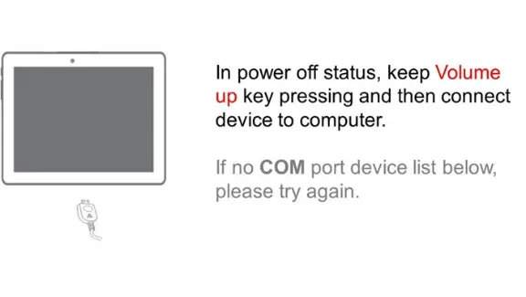
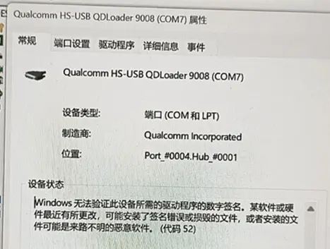
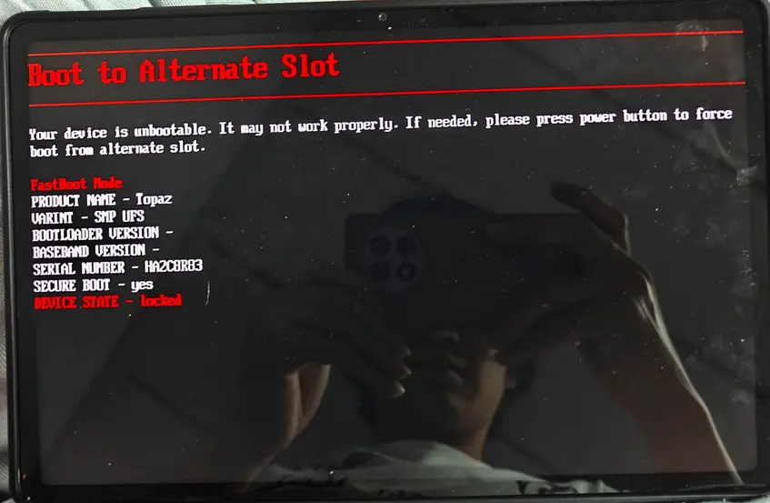

# 常见问题速查

## **问 1：怎么进入 9008 模式？**

答：共有以下几种办法：

1. 使用 PC 端工具重启至 9008，需要平板能正常启动至操作系统，并保证 USB 调试状态正常（**必须**在平板上将 USB 用法设置为`仅充电`方可正常使用 USB 调试）；

2. 使用 adb 命令重启至 9008 模式，需保证设备能正常启动至操作系统，并保证 USB 调试状态正常。具体的命令为 `adb reboot edl`；

3. **关机**状态下使用按键：确保设备**完全关机**，然后按住 `音量+` 不放，随后插入 USB 线，设备应当先亮起充电符号，然后灭屏，随即进入 9008 模式。此时电脑上应当能够检测到 9008 端口，这时可以松开按键了；

_图 1：来自国际版刷机包的 9008 进入方法说明_

4. 使用工程线，各大电商平台均有售，约 10 元即可购得，请务必认准**二代**等字样，这标志着这些线内置了一个小阻值电阻，适合骁龙 855 及以后机型使用。

> 用法：确保平板**完全关机**，**按住工程线上的按键**并连接平板，即可进入 9008 模式。

_所有方法已测试可用，如果仍旧遇到问题请继续读下一问_

---

## **问 2：_[按照上一问方法操作后]_**，电脑没有识别到 9008 端口，应当怎么做？_（最常被提及的问题）_

答：请依次检查以下项目：

1. 驱动程序是否已正确安装？如果已经正确安装，并且设备管理器中的"端口（COM 和 LPT）"一项中曾存在*带感叹号*的 9008 设备，且详细信息如下图，就要关闭电脑的"驱动程序强制签名"[_[注释 1]_](#Appendix1Note1)。
   
   _图 2：Windows 驱动程序签名异常的报错_

> [!tip]
> 建议使用刷机匣提供的驱动，它不会产生签名问题。
>
> 如果你不会安装，跳转到 [安装驱动](./flash_unlocked_device.md#Install_Driver) 进行学习。

2. 设备是否已经完全关机？请使用组合键**电源+音量减**强制重启设备。

3. 如果以上任何措施均无法解决问题，找售后。没有解锁的前提下仍旧享有保修。

---

## **问 3: 这是什么情况？**

_与Sahara模式握手失败，重置设备状态_

答: 忘记发送引导了，参考下一问来修正这个问题。

---

## **问 4：9008 刷机出错后（例如忘记发送引导），如何强制重启到其他操作模式，如 fastboot？**

答：无需断开和电脑的连接，请按住 `电源键` 和 `音量 -` 键，即可强制重启，令设备退出 9008 模式。稍后即可通过组合键进入 `Fastboot`, `Recovery` 或系统。

> [!tip]
> **电源 + 音量**减是通用的强制重启按键，可以解决 99%的"我的平板黑屏了，怎么办"类问题

---

## **问 5：我可能在 9008 刷机时刷入了错误的内容，导致平板无法正常工作，我应当怎么做？**

答：没必要每逢变砖就刷入全分区备份。请用刷入之前提取的备份分区镜像依次对应刷入被修改的分区，以恢复它们至原来的状态，请参考 _问 1_ 和 _问 3_ 以重新进入 9008 模式。

**请保持观察设备管理器，如果 Windows 提示有 900e 设备连接，说明设备分区受到了严重损坏，且此时按键组合很可能无法令设备进入 9008 模式。请使用工程线强制进入 9008 模式，通过刷入备份的镜像恢复设备。**

**如果你没有备份，恭喜你，你死了。**

---

## **问 6：应当向哪个槽位刷入群内的 boot 镜像，以实现 Root？**

答：你需要先确定 _活动槽位_。

方法 1：将平板重启到 `fastboot` 模式（对应的 `adb` 命令为`adb reboot bootloader`）使用命令`fastboot getvar current-slot`获取活动槽位，向活动槽位的 `boot` 分区刷入即可。不建议盲目同时刷入双槽位。

方法 2：重启到 9008 模式，在刷机匣中配置好引导，利用**槽位工具 -> 获取当前槽位**得到槽位号。

方法 3：在平板上的终端模拟器（可能是 `MT管理器`, `Termux` 或者其他软件）输入`getprop ro.boot.slot_suffix`

例：获取到当前活动槽位为 `B`，则在高通工具箱中，发送引导后选择"刷入单个分区"，并填写分区名为`boot_b`，选择镜像刷入。或者在匣中配置好引导，勾选`boot_b`分区，并选择`boot`分区文件刷入。

**对于 LKM 方法，刷入`init_boot`和`vbmeta`时用同样的方法确定槽位。**

---

## **问 7：群文件内的几个 GKI 内核文件应当如何选择？**

答：没有什么讲究，随意选择。话虽这么说，但是 `SukiSU` 建议选择修复 0 宽字符提权[_[注释 2]_](#Appendix1Note2)的版本，其他方案建议选择版本较高的。

---

## **问 8：Root 后，刷入模块有何需要注意的事项？**

答：正常刷入即可，**但解除 Root 之前必须关闭或者卸载模块，以绝后患。**

---

## **问 9：当前流行的调度优化模块、线程放置模块和 Scene 能否使用？**

答：Uperf 已更新，支持了六核骁龙 8 Gen 3.可以正常使用。但不建议安装其附带的 A-SOUL 线程优化。Scene 本体可用，但是不能使用其附带的调度。

---

## **问 10：更新系统或者刷了第三方系统后还能使用同样的方法获取 Root 吗？刷入 Root 后是否会导致系统更新安装失败？**

答：`GKI` 可以，`Android` 的内核是可拆装的（在 `GKI 2.0` 铺开后这一点更容易被玩机用户感知到），只要 `Android` 仍支持此版本的 `Linux` 内核且联想不封堵此方式[_[注释 3]_](#Appendix1Note3)，那么理论上群文件里的 `GKI` 内核都能使用。

> [!warning]
> Android 16 用户在 Root 后可能无法回到官方内核，表现为 _卡第一屏_ 或者 _卡第二屏_ **且** `logcat` 捕获到大量关于 `PERF-GLUE-LAYER` 的错误信息。

`LKM` 模式建议配合 `TWRP` 内置的一键脚本食用。不过目前只支持原版 `KernelSU`。~~在做了在做了~~

> [!danger]
> **切莫使用各大 Root 管理器中内置的“直接安装”和“安装到另一个槽位”功能，会导致设备更新后无法开机，直接提示红感叹号（AVB 校验出错）！**
>
> **切莫使用各大 Root 管理器中内置的“直接安装”和“安装到另一个槽位”功能，会导致设备更新后无法开机，直接提示红感叹号（AVB 校验出错）！**
>
> **切莫使用各大 Root 管理器中内置的“直接安装”和“安装到另一个槽位”功能，会导致设备更新后无法开机，直接提示红感叹号（AVB 校验出错）！**

---

## **问 11：为何我在获取 Root 权限后无法安装新的应用程序，或提示软件包管理程序已停止运行？**

答：如观察到此问题，请依次做以下检查：

1. 您是否在刷机前没有退出 Google 账号？如果是，请擦除 `frp` 分区或者登出谷歌账号；

2. 如果问题仍旧无法解决，请多次重启设备，并在每次重启后重新尝试安装。

3. 系统安装器偶有崩溃现象，可以试试使用 `adb` 命令进行安装

> 用法：`adb install \<file_directory\>`
>
> 示例：`adb install D:\MyFile\KernelSU.apk`

---

## **问 12：现在有处于"可用"水平的第三方系统吗？**

答：什么是“可用”？ ~~普通和理所当然到底是什么呢~~

我只知道能刷 ColorOS 15、16 和 HyperOS 2.0、3.0，但是都有 bug。如有需要请在群文件中自取，教程请看本文档前面的部分。如果刷入适合 347 及以后版本的包，那么压缩包的根目录也内置了教程。

---

## **问 13：我可以切换到我喜欢的 Root 管理器吗？比如 APatch？**

答：你得会用 avbtool.py 给生成的镜像签名。强行刷入不被 BootLoader 认可其签名的镜像将导致平板无法开机。

---

## **问 14：我卡在了 fastboot 模式，我应当怎么做？**

答：如果没有看到一个包含**红色感叹号**的页面，那么多半是因为设备当前**所处槽位不正确**。依次尝试以下项目：

1. 在 `fastboot` 中尝试找到这个选项，按电源键确认。重复 2 次此操作。（多半是找不到的）

_图 3：fastboot 选项中的"启动到另一个替代槽位"_

2. 令设备进入 9008 模式，使用匣中的**槽位工具 -> 重设当前槽位**后重启设备

---

## **问 15：我卡在了第二屏，救我！**

1. 如果是**刷入模块后**卡第二屏，按照以下步骤操作：

(1) 同时按下电源和音量下，直到设备黑屏后松开

(2) 当 Logo 亮起时，至少快速按 3 次音量下，`KernelSU`（及其分支）会进入安全模式，停用所有模块，现在应当能够进入系统桌面

(3) 打开你的 Root 管理器，卸载有问题的模块

2. 如果是**刷入第三方系统后**卡第二屏，说明恢复出厂这步存在问题，刷回原系统或放弃数据并按照以下步骤操作：

(1) 同时按下电源和音量下，直到设备黑屏后松开

(2) 立刻再按下音量上，也就是电源、音量下、音量上三个按键同时按下，设备应当进入了 `Recovery` 模式

(3) 用音量键切换选项到正数第七个，也就是`Wipe data/ factory reset`，按电源键确认，进入二级菜单

(4) 在二级菜单中，按一次音量下，将光标移动到第二个选项，按电源键确认

(5) 现在系统会自动执行恢复出厂，并返回 `Recovery 主界面`。按电源键就能执行光标目前位于的 `Reboot to system` 选项，成功启动三方系统。

> [!note]
> 第五步中系统自动恢复出厂时，你可能会看到以下两条*错误日志*：
>
> ERROR: logwrapper: Cannot log to file /data/fscklogs/log
>
> ERROR: recovery: Open failed: /metadata/ota: No such file or directory

这些是正常的，无需理会。

---

## **问 16：欸，怎么我 ADB 命令全报错了？怎么执行了之后没反应？**

先看看 `ADB` 和 `fastboot` 工具是不是没装上，[这里](./flash_unlocked_device.md#Install_ADB)有详细的 `ADB` 安装步骤。

如果 `ADB` 已正确安装，检查一下命令是否错误，再看看 USB 连接是否正常， [USB 调试](./flash_unlocked_device.md#USB_Debugging) 是否开启。

---

## **注释 1：**

如何关闭 Windows 的"驱动程序强制签名"？

Windows 10: 打开设置，进入"Windows 更新 -> 恢复 -> 高级重新启动"，并左键点击立即重启。在稍后弹出的页面依次选择"疑难解答 -> 启动设置（更改 Windows 的启动行为）-> 重启"，并在稍后用数字键或 F1 到 F12 选择"禁用驱动程序强制签名"

Windows 11: 打开设置，进入"Windows 更新 -> 高级选项 -> 恢复 -> 高级重新启动"，弹出确认对话框并选择立即重启后，进入和 Windows 10 类似的蓝色页面，同样选择"疑难解答 -> 启动设置"，并参考上述适用于 Windows 10 的步骤来关闭驱动程序强制签名。

---

## **注释 2：**

0 宽字符提权是一个在 2025 年 12 月底暴露到公共互联网的漏洞（在此之前早被各路需要环境检测的 APP 使用），通过在路径`/sdcard/Android/data`的"/"和"data"之间加上一个`Unicode零宽连接符(Unicode \u200d)`([这是什么？](https://symbl.cc/cn/200D/))，可以绕过 Android 对这一目录的访问限制，进而不使用 `Root 权限 或者 ADB 权限` 就可以遍历得到 data 文件夹中所包含的文件夹的名称（事实上这些文件夹的名称也就是 `应用包名`，例如`com.qimian233.ztool`），间接实现查询应用列表。这是春秋检测 APP“试图隐藏应用”词条的一个成因。

---

## **注释 3：**

免解锁 BootLoader 并 Root 依赖于联想的签名漏洞。高通处理器的熔丝（QFUSE，更通用的说法为 eFUSE）可以被运行在 TEEOS 的程序修改，在后续系统更新里联想可能通过此方式禁止普通用户将设备启动到 9008 模式。
