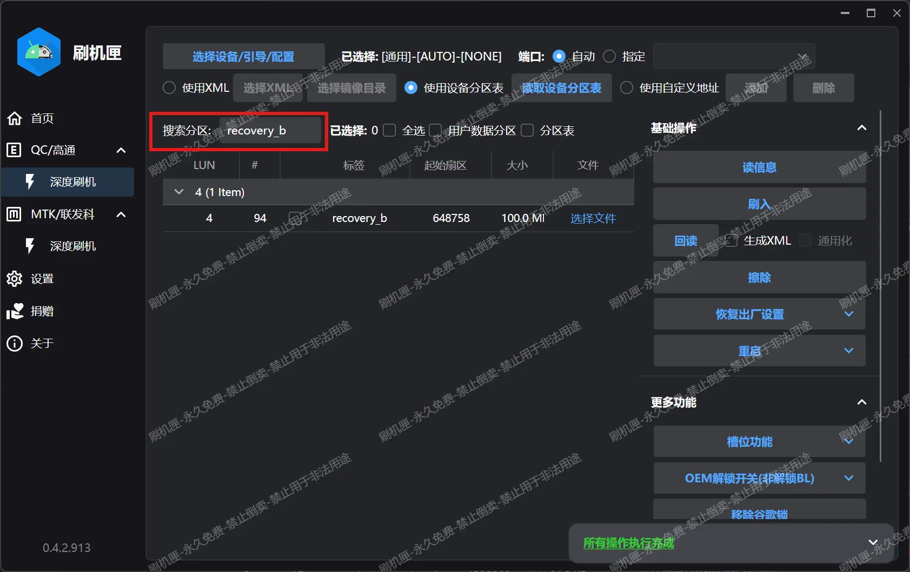
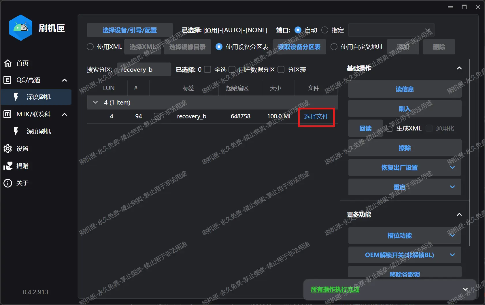
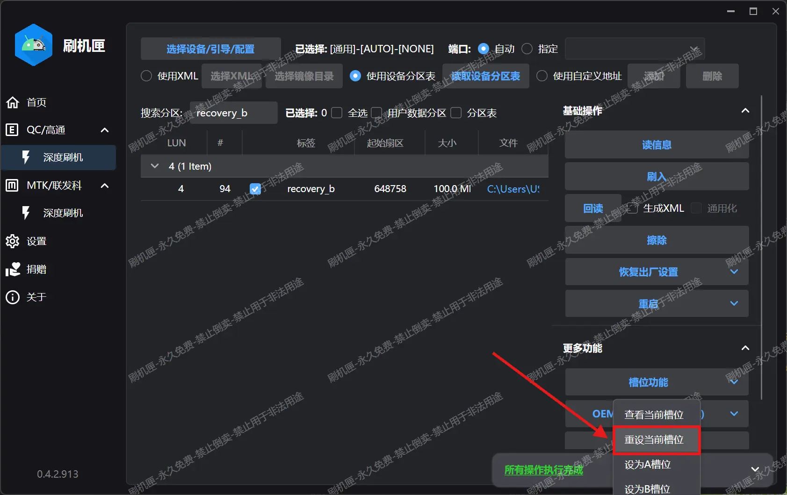

# 欲一键安装 LKM，先刷入 TWRP

> [!warning]
> **重要警告：搞机有风险，流程无问题，请严格比对操作，变砖莫找群友背锅。**
> 
> 1. 强烈建议您准备一条"二代"工程线，一旦需要救砖时有大用。
> 
> 2. 如果任何步骤遇到问题，请先参考[常见问题解答](./faq.md)，实在无法解决再向群友提问。
> 
> 3. 刷写任何分区镜像前请先备份底层！如何备份请移步[刷机前必做](./before_flashing.md)，你的备份十分重要，更新系统时还原`recovery`需要用到你自己备份的`recovery`或者同系统版本的`recovery`，否则更新系统会卡系统升级安装！
> 
> 4. GKI Root 需要刷写的分区文件是`recovery_a`或`recovery_b`，具体根据你机子当前的槽位决定，如果有疑惑，教程有说明。请严格按照教程来一步步操作，请不要自作聪明或者不小心将 TWRP 镜像刷入其他分区，此操作会导致你的机子变砖且很可能无法恢复。如在 Root 途中出现你不确定的问题，请及时寻求群友帮助，不要自己耍小巧思自己害死自己的机子！
> 
> 5. 此 Root 教程使用的工具为——"刷机匣"（如下图片 1），请不要使用其他工具——如"搞机助手"（如下图片 2）等其它工具，使用其他工具出问题者我们不会提供相关帮助（如救砖），届时请自己解决。

 

图片 1                  图片 2

> [!note]
> 下面的教程均建立在你安装好了 9008 驱动的前提下，如果你不会安装，跳转到 [安装驱动](./geekflashtool.md#Install_Driver) 进行学习。

下面开始正式教程：

**Step 1**: 在群文件下载最新的 TWRP 镜像，例如本教程写作时最新镜像为`TWRP-16_HD_2026-01-03.img`，放置到任意你熟悉的目录（不推荐中文目录）：


**Step2**: 平板进入 9008 模式，可以依次试试下面三种方法：

1. 直接使用按键组合进入 9008，部分系统版本和活动槽位可能无效。
   
   - 平板关机，断开数据线。
   
   - 按住平板的“音量+”按钮。
   
   - 保持按钮按住，这时插入数据线。
     
     > [!tip]
     > 不要松开按键！很多用户有意无意的松开了按键导致无法通过此方法进入 9008。
   
   - 成功：平板应当显示一段时间的充电画面之后黑屏，电脑发出设备接入的提示音。
   
   - 失败：平板显示第一屏画面。（恭喜你中奖辣！换用下一种方法）

2. 使用 ADB 命令进入 9008。
   
   - 平板处于操作系统，USB 调试打开。如果是 ZUXOS，将 USB 连接模式切换为“仅充电”或者“不用于数据传输”。
   
   - 电脑端按 Win + R ，输入 cmd 打开命令提示符，然后输入下面的命令：
     
     ```shell
     adb reboot edl
     ```
   
   - 现在平板应该进入了 9008 模式，电脑上能看到对应的设备出现。

3. 使用二代高通工程线进入 9008，我们的终极杀招。
   
   - 情况 1：平板可以完全关机。
     
     - 将平板关机。
     
     - 工程线插入电脑，然后按住工程线上的按钮，插入平板。
     
     - 成功：电脑响起设备接入的提示音，可以松开按钮了。
     
     - 失败：电脑无反应。可能是线材质量不佳，考虑退换。
   
   - 情况 2：平板无法关机。
     
     - 工程线插入电脑，另一头连上平板。
     
     - 同时按住**平板的 电源键** + **平板的 音量- 按钮** + **工程线上的按钮**，等待平板黑屏。
     
     - 成功：电脑响起设备接入的提示音，可以松开全部按钮了。
     
     - 失败：电脑无反应。可能是线材质量不佳，考虑退换。

**Step 3**: 电脑打开刷机匣，执行刷写步骤：

1. 点击“选择设备/引导/配置”：
   

2. 点击红框处的按钮，在弹出的窗口选择从群文件“神秘引导文件”文件夹下载的`xbl_s_devprg_ns.melf`，点击确定。
   

3. 回到主界面，选择“读信息”：
   

4. 观察输出的日志，确定活动槽位（见红框），稍后只需要向活动槽位的 recovery 分区刷入镜像即可：
   
   
   > [!note]
   > 提示“无法在 super 动态分区中找到 system 分区”、“读取 LUN6 的 GPT...失败”和“读取 LUN7 的 GPT...失败”是正常的，不需要理会。

5. 根据刚刚确定的槽位找到对应的 recovery 分区，并选择镜像：
   
   - `当前槽位：A`对应 `recovery_a` 分区，`当前槽位：B`对应 `recovery_b` 分区。
   
   - 在红框框出的搜索栏输入对应的分区名，例如对我来说应当输入 `recovery_b` ，系统会自动找到对应分区：
     
   
   - 点击“选择文件”，选择刚刚下载的 TWRP 镜像：
     
   
   - 文件选择完毕后，点击“刷入”：
     
   
   - 刷入完成，将日志窗口折叠起来，然后点击“槽位功能”打开二级菜单，然后**点击“重设当前槽位”**：
     
     
   
   - 完成后点击“重启”打开二级菜单，重启到 Recovery 或者系统都行：
     
   
   - 至此 TWRP 刷入完毕。
     
     > [!tip]
     > 如果需要刷回原厂 Recovery ，步骤也是类似的。
