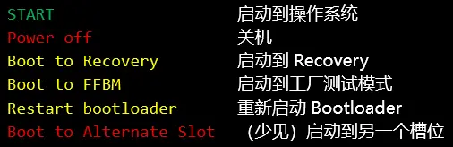
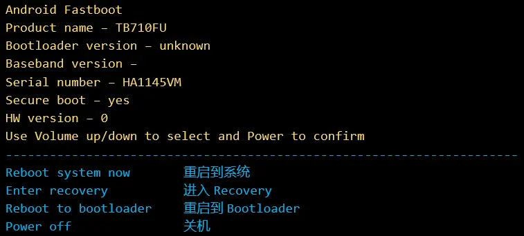
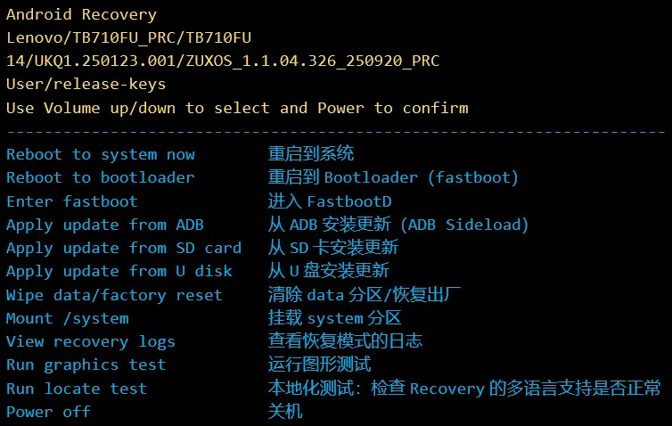
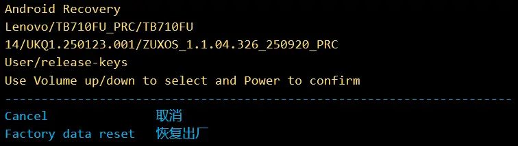

# 一些前置知识和术语

## **（1）** `9008 模式`
指的是高通设备的应急下载模式（EDL, Emergency DownLoad mode），可以通过特定物理按键或者物理按键组合进入，也可以通过工程线，或者在部分设备上使用`adb reboot edl`这条 `USB 调试` 命令进入。

进入 `9008 模式` 后，设备向安装了驱动程序并和它连接的计算机提供一个高速"串口"（实际上能达到 `USB3` 标准，也可能更快，取决于设备端口和线材配置），可以通过这个端口从设备的内置存储器中读写几乎任何内容。

和早期 PC 的 BIOS 类似，`9008 模式` 只包含最基本的初始化代码，而不包含对存储器等组件的初始化和通信协议。因此，在使用 `9008 模式` 的强大功能之前， **必须** 先从电脑（通过 `Sahara` 协议）发送一个小文件，告诉处于 `9008 模式` 的设备应当怎样和闪存通信、怎样建立后续的高速连接，等等。如果在发送此文件前进行了操作，请 `强制重启设备` （按住 `电源键 + 音量下键` ） ，并重新进入 `9008 模式`。

上一段中的文件被俗称为 `引导文件` ，正式的名称是 `Firehose` ，通常的扩展名是 `.melf` ，群文件夹 `神秘引导文件` 中的 `xbl_s_devprg_ns.melf` 就是一个这样的 `引导文件` 。

## **（2）** `900E` 模式
如果刷机过程中出现了意外，设备可能会重启到 `900E` 模式。此模式意为 "设备出现了严重故障"。

此模式被工厂内部测试时用来捕捉内存转储文件，一般用户难以使用。此外，9008 刷机的文件传输功能在这个模式下不可用。要退出此模式，需要设法令设备在重启时进入 `9008 模式` ，通常推荐 `工程线` 。

请注意：进入 `900E` 不代表着设备 "没救了"，只要你能让它进入 9008，一切都会好起来的。

## **（3）** `回读`
这是英文名词 `ReadBack` 的中文直译，意为从等待刷机的设备存储中读取某个或某些文件，传输并存储到运行刷机软件的设备中。这个词的定义有点像平时常说的"备份"。

## **（4）** `槽位`
这是英文名词 "Slot" 的翻译，在 `Android` 设备中指的是 `A` 和 `B` 两个相对独立的，类似于互为备份分区的存在。系统更新会安装到当前未被使用的槽位，如果更新失败，`Android` 会 *自动回滚* 到之前使用的槽位。

对于较新式的设备，采用了比 `AB` 分区（存在 *真实的* 两个系统槽位）更先进的 `VAB` 分区以节省存储固件所占用的空间。

## **（5）** 经常接触的分区名称：

- `init_boot` : 存储有 `Ramdisk` 的分区， `LKM` 模式需要修补的分区名称
- `boot` : 存储有 `Linux` 内核的分区， `GKI` 模式需要替换的分区名称
- `vbmeta`: 存储 `链式验证分区的信息` 的分区，`LKM` 模式需要替换的分区名称
- `super` ：动态分区设备的特性，将 `system` , `vendor_a` , `vendor_b` , `product_a` , `product_b` 几个分区封装在其中，方便系统更新。
- `system` : 顾名思义，存放 `Android 操作系统` 的分区
- `vendor` : 存放厂商驱动程序等内容的分区
- `product` : 类似于 `vendor` ，但更多用于封装非底层软件

## **（6）** 相对不常接触的分区名称：

- `vendor_boot` : 用于存储厂商提供的内核驱动
- `abl` : `Android Bootloader` 的存放位置
- `userdata` : 用户数据分区
- `metadata` : 解密用户数据分区所需密钥的存储位置，想 **保住数据救砖** 不要刷入其他包中的这个文件

如果你对 `Android` 的分区感兴趣，可以试试这个网站：[柚坛wiki - Android 分区详解](https://wiki.uotan.net/index.php?title=Android_%E5%88%86%E5%8C%BA%E8%AF%A6%E8%A7%A3)提供的文章

## **（7）** `LKM`
`可加载内核模块` 的英文简称 (Loadable Kernel Module) ，通过在 `init_boot` 分区注入一个 `Hook` 来实现 `Root` ，优点是方便更新，且不破坏原有内核的功能实现，在存在内核级调度调优的设备上特别有用（？）

## **（8）** `GKI`
`通用内核映像` 的英文简称 (Generic Kernel Image) ，`KernelSU` 最初阶段支持的 `Root` 实现方式，优点是泛用性好，系统更新后不需要做特别的修改便可以直接刷入使用。

> [!tip]
> 可以将 `GKI` 理解为一个镜像绑定一个设备（比如 Pro GT，不管存储组合怎样，都可以使用一个镜像），和一个 `KernelSU` 版本（比如为 `KernelSU 1.0.4` 编译的镜像不能被用于 `KernelSU 2.0.0` ）

因此不管系统版本多少、是否是第三方系统，只要内核版本和你安装的 `KernelSU` 版本不变，可以始终使用同一个镜像。

_2025.11：KernelSU 2.x.x 致力于推进安全性改进，群内的已签名镜像会跟上官方更新节奏。_
_2026.01：KernelSU 3.0 起官方不再建议使用 GKI 镜像，但是和安全性及性能问题无关，单纯是为了加快版本构建速度。_

## **（9）** `ADB`
`Android Debug Bridge` 的英文简称，用于实现和授权了 `USB 调试` 的 `Android 操作系统` 或 `Recovery` 的交互。比如 `adb reboot edl` 可将设备重启到 `9008 模式` 。

## **（10）** `AVB2.0`
`Android 系统`对 *可信启动* 功能的实现，有点像 PC 上的 `Secure Boot`。此功能按照 `vbmeta` 中的信息验证其他分区是否被篡改，并读取含有 `AVB 页脚` 的分区所包含的 `摘要` 信息，以防止设备运行未经制造商验证的代码。

## **（11）** `Fastboot`
社区惯用说法，事实上常常指的是 `BootLoader` 模式。它管理后续启动流程的签名验证，并实现从设备底层引导跳转到启动 `Linux` 内核这一流程的各个操作步骤。在未解锁 `BootLoader` 的情况下，`BootLoader` 禁止刷写系统分区，如果强行通过其他手段刷入，将触发 `AVB2.0` 检测，系统会拒绝启动。

> [!danger]
> 请问有些“开发者”，社区惯用的说法就这么被你踩在脚下吗？

可以使用 `音量键` 浏览 `BootLoader` / `Recovery` / `Fastbootd` 下提供的选项，按电源键确认选项。

## **（12）** `Fastbootd`
用于实现对 `super` 分区内容的操作，需要解锁 `BootLoader` 才能刷写。

下面的四个使用蓝色或白色文字显示的是 `Fastbootd` 模式下提供的选项，依次为：

## **（13）** `Recovery`
`Android 系统` 的恢复模式，类似于 `Windows` 系统的 `WinRE` ，或 `Linux` 系统的 `LiveCD` 。它提供了基础的存储访问功能，能够访问和修改设备中除了底层固件分区以外的多数分区，并和电脑通信，读取和发送文件。

联想使用的是 `AOSP` 的 `原生 Recovery` ，虽然不如 `TWRP` 等 `第三方 Recovery` 友好和强大，但是仍旧能够提供基础的功能。下面是 `Recovery 界面`，中文翻译和英文原文顺序相同。日志内容会出现在 `Recovery 界面的左下角`。

有时候会看到下面的界面，这代表着 `/data` 分区出现了问题，只能格式化（恢复出厂）了。

## **（14）** `第一屏`
指的是含有 Powered by Android 字样和厂商 Logo 的页面，卡在这一步说明 `内核` 等文件有问题。

## **（15）** `第二屏`
指的是显示各大自定义 ROM Logo 的页面，比如 "ZUXOS" ，卡在这一步说明系统配置有问题，或者刷入了不兼容的 `模块`。
