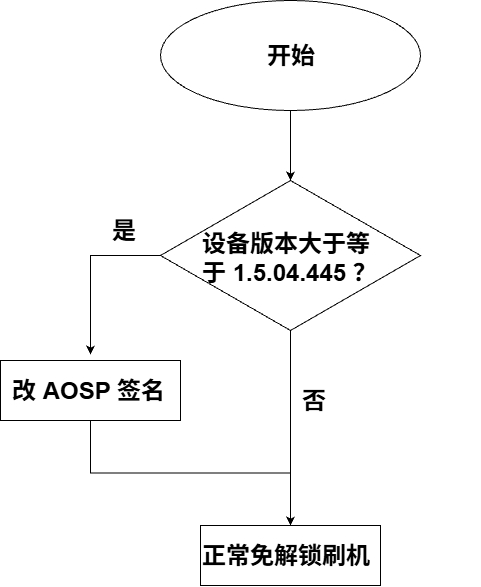

# 免解锁刷机必读

## 概述
1. 免解锁刷机源自联想长期遗留的安全漏洞，该漏洞影响 2023 ~ 2025 年之间发售的绝大多数联想平板电脑。
2. 如果你的动手能力足够强，你可以将本站的经验移植到其它机型，例如 Y700 第四代（TB322FC）。
3. 免解锁的部分操作没有后悔药，详见 [关于免解锁刷机，你至少需要知道这些](./dangerous_things.md)
4. 本教程面向熟悉近年来解锁 Bootloader 刷机操作的用户。如果：
   - 这是你第一次刷机，请遵循 [通用教程](../generic/before_we_start.md) 以熟悉基础操作。
   - 你已经很多年没接触 Android 刷机，也请先快速阅读通用教程了解新动向。
   - 你不熟悉电脑操作，请关闭本网站并跳转到 [《你缺失的那门计算机课》](https://www.criwits.top/missing/) 。
5. 动手操作前请阅读 [重要操作警告](./important_warns.md)。

## 版本差异

请见流程图：

如果你需要改 AOSP 签名，请查看 [高版本概览](./high_versions/overview.md)

如果你可以直接开始免解锁刷机，请从侧栏选择你感兴趣的部分开始操作。