# 刷写 LKM Root - 使用 9008

> [!warning]
> 您是否已经阅读了 [重要警告](./important_warns.md) 和 [解锁 Bootloader 刷机](../generic/flash_unlocked_device.md)？

> [!important] 一个时代结束了...
> [1.5.04.445 修复了免解锁漏洞](../generic/faq.md#注释-3-关于免解锁刷机)，如果可能，请解锁刷机。

## Step 0:

从本站 [下载页](../generic/resource_download.md) 下载下列文件：

1. 签名工具
2. 刷机工具和 9008 引导文件
3. Root 管理器

## Step 1:

将设备重启到 9008 模式并准备好读写。

1. 将平板关机。
2. **按住** 音量加，并插入数据线。设备应当先显示充电符号，并在几秒钟后黑屏，且电脑发出插入设备的提示音。这时可以 **松开音量键** ，准备在电脑端发送引导。

    
   
   > [!tip]
   > 如果无法进入，参考 [常见问题解答 - 进入 9008](../generic/faq.md#问-1怎么进入-9008-模式) 中提供的操作逐个尝试即可。

3. 发送引导：
   - 点击 `选择设备/引导/配置`
    
    
    
    - 在弹出的窗口中，点击 `引导文件` 处右侧的 `...` 按钮。
    
    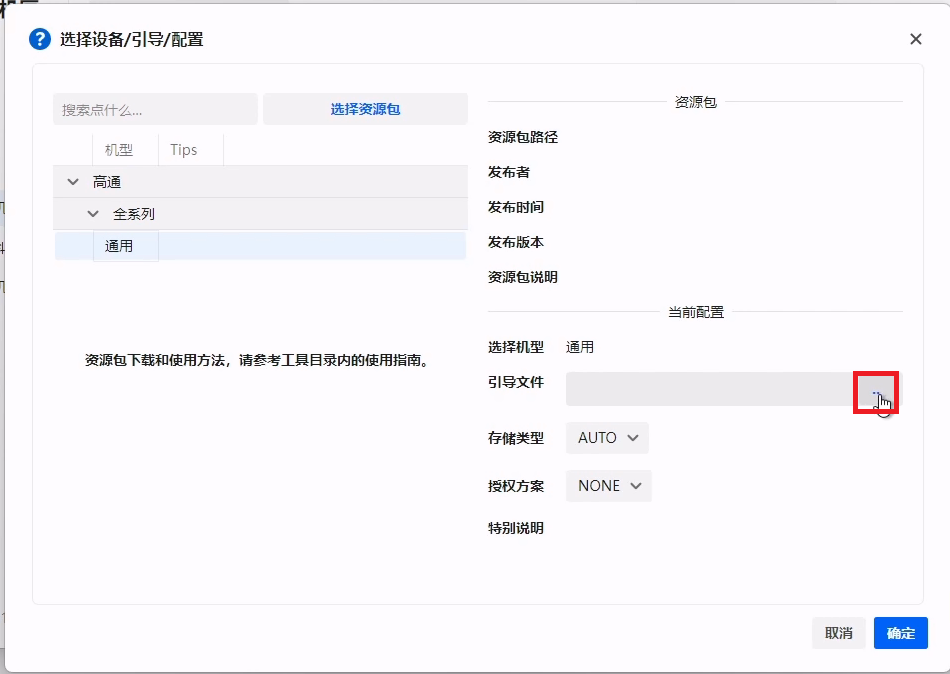

    - 在弹出的对话框选择从下载页下载的引导文件 `xbl_s_devprg_ns.melf` ，并点 `打开` 选择它，最后在刷机匣的对话框点击 `确认` 。

    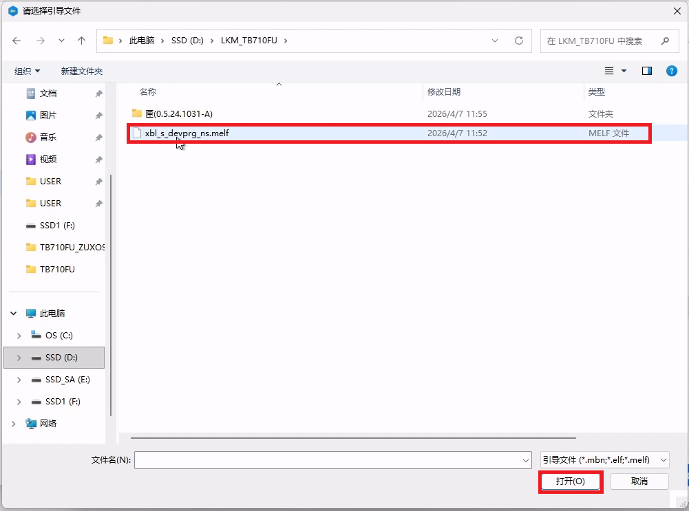

4. 现在点击配置选择页面的蓝色 `确定` 按钮，回到刷机匣的主界面。

    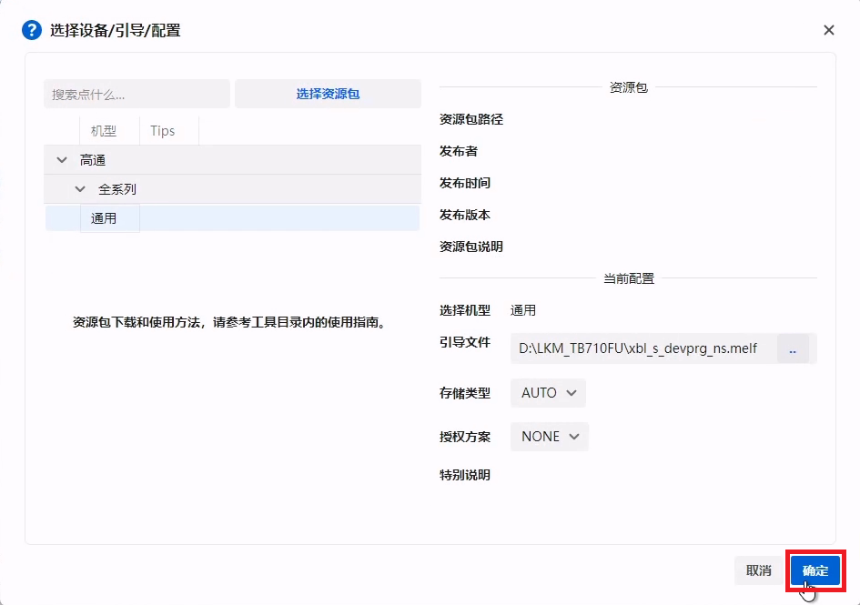

5. 点击 `读信息` ，确认一下设备连接是否正常。

    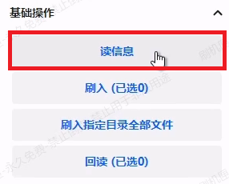

    如果正常，应当能够读取到分区信息，并可能能够正确读取软件信息：

    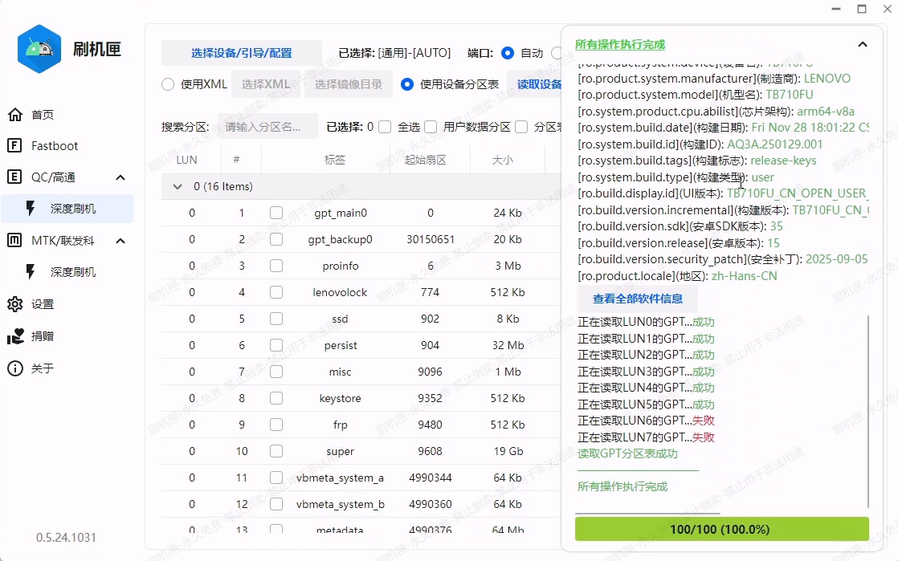

    > [!important]
    > 
    > 日志内有下图所示的的错误信息是正常的：
    >
    > 

6. 查看日志，注意其中有当前活动插槽的信息（下图），**记住此信息，稍后有用**。

    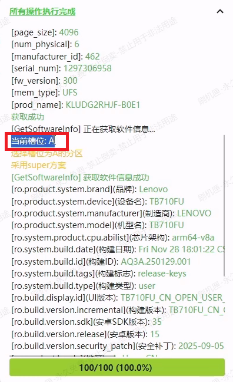

    本例中我们的活动插槽就是 A 槽。

7. 如果以上任何步骤出现问题，请参考 [常见问题解答 - 进入 9008](../generic/faq.md#问-1怎么进入-9008-模式) 、 [常见问题解答 - 忘记选择引导](../generic/faq.md#问-3-这是什么情况) 以及 [常见问题解答 - 从 9008 模式强制重启](../generic/faq.md#问-4-9008-刷机出错后例如忘记发送引导如何强制重启到其他操作模式如-fastboot)

## Step 2:

读取活动插槽的 `vbmeta` 和 `init_boot` 。

1. 在刷机匣的操作页面搜索并勾选**和刚才看到的槽位对应**的 `init_boot` 和 `vbmeta` 两个分区。
   
   > [!note]
   > 活动插槽为 A ，则选择 `init_boot_a` 和 `vbmeta_a` ;
   >
   > 活动插槽为 B ，则选择 `init_boot_b` 和 `vbmeta_b` 。

    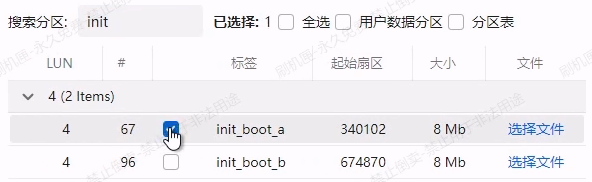

    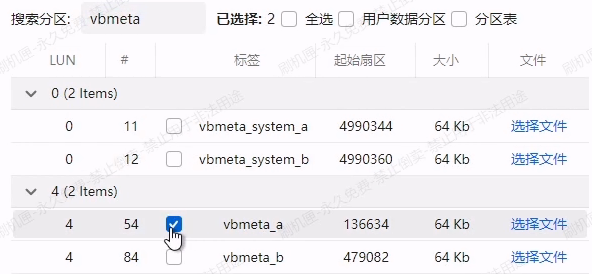

    > [!warning]
    > 选择 `vbmeta` 时，不要错选成 `vbmeta_system` !

2. 按工作界面右侧的 `回读` 按键从设备读出分区，记得选择容易记忆且有区分度的目录，例如选择将回读的文件存储在 `D:\LKM_TB710FU` 中。

    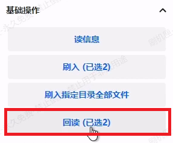

    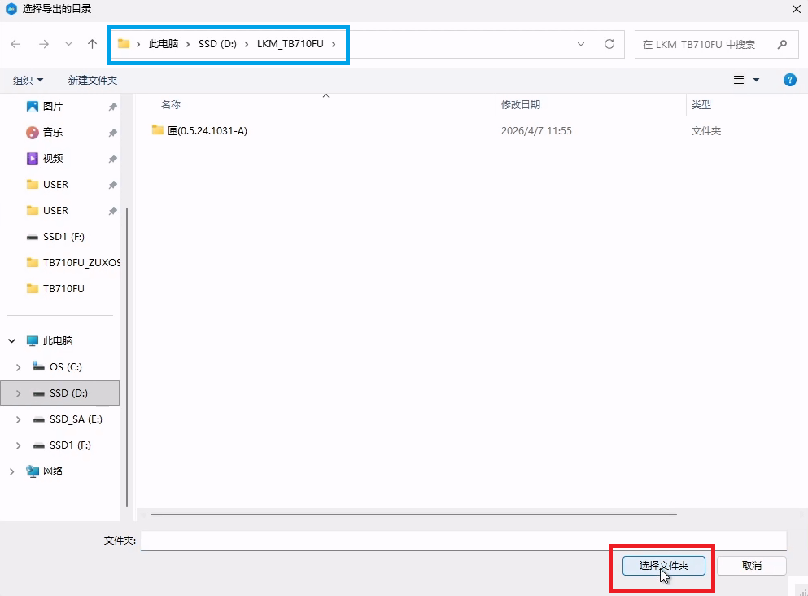

3. 回读完成后点击 `重启至` 按钮，选择重启到 `系统模式` 。

    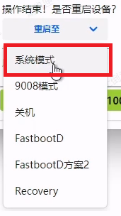

## Step 3:

安装 Root 管理器，修补 `init_boot` 。

1. 将下载好的 Root 管理器传输到平板并安装。将刚刚读取的 `init_boot` 镜像也传输到平板上。

    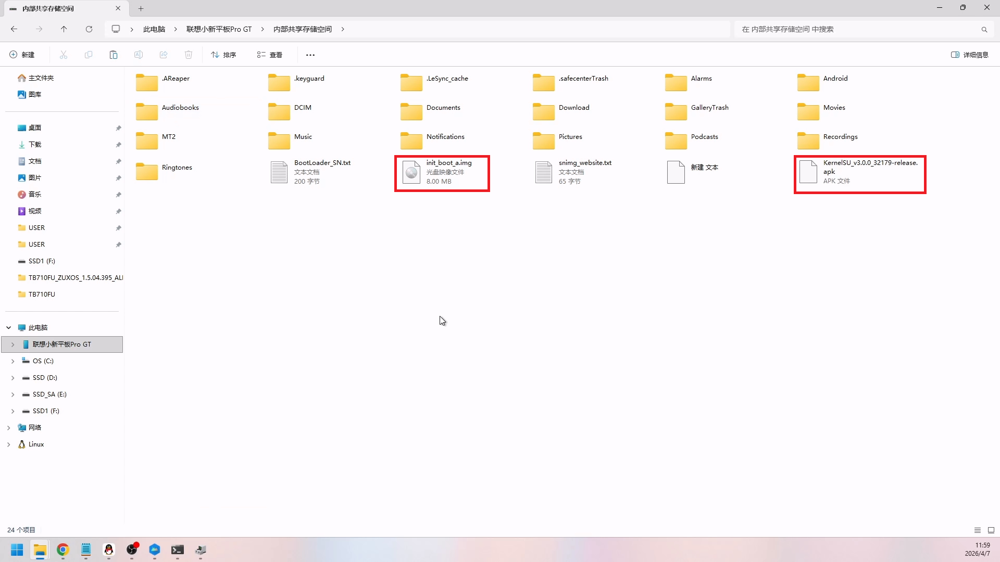

2. 打开 Root 管理器，点击 `未安装` 。

    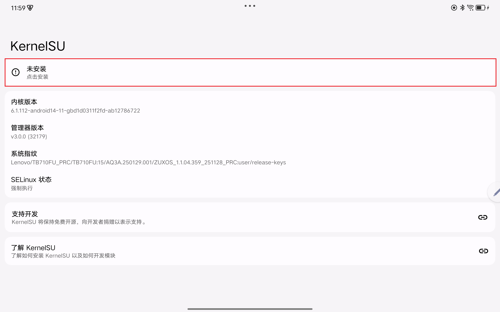

3. 点击“选择一个文件”。
   
   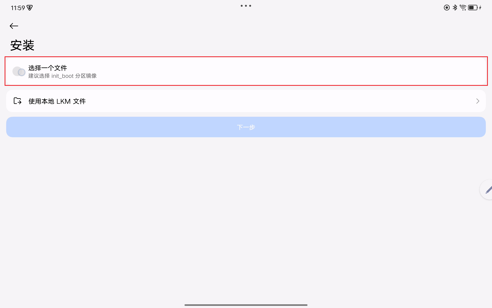

4. 找到并点击刚刚传输到平板的镜像。使用文件选择界面左上角的“三横线”按钮可以选择使用其他文件管理器，或者导航到不同的存储位置。

5. 点击管理器的“下一步”，管理器会自动进行修补。
   
    > [!tip]
    > 如果管理器提示选择 KMI ，则应选择 `android14-6.1` 。

6. 留意修补日志：修补完成的镜像会被重命名并存储到平板内置存储中的 `Download` 文件夹中。在电脑上导航到 `Download` 文件夹，找到这个文件并传输到电脑上。（此文件的名字通常包含 `kernelsu_patched` 或者 `magisk_patched` 等字样，以 `.img` 扩展名结尾）。
   
    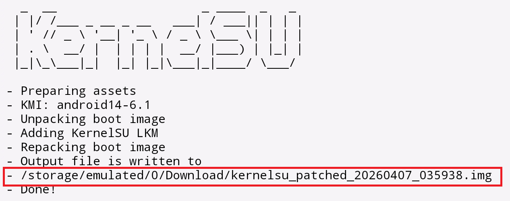

    > [!tip]
    > 如果在电脑上找不到 `Download` 文件夹中对应的 `.img` 文件，重新连接一次平板一般可以解决（~~So \*\*\*\* you, MTP~~）。

## Step 4:

签名 `init_boot` 并重建 `vbmeta` 。

1. 解压一键签名工具。
   
   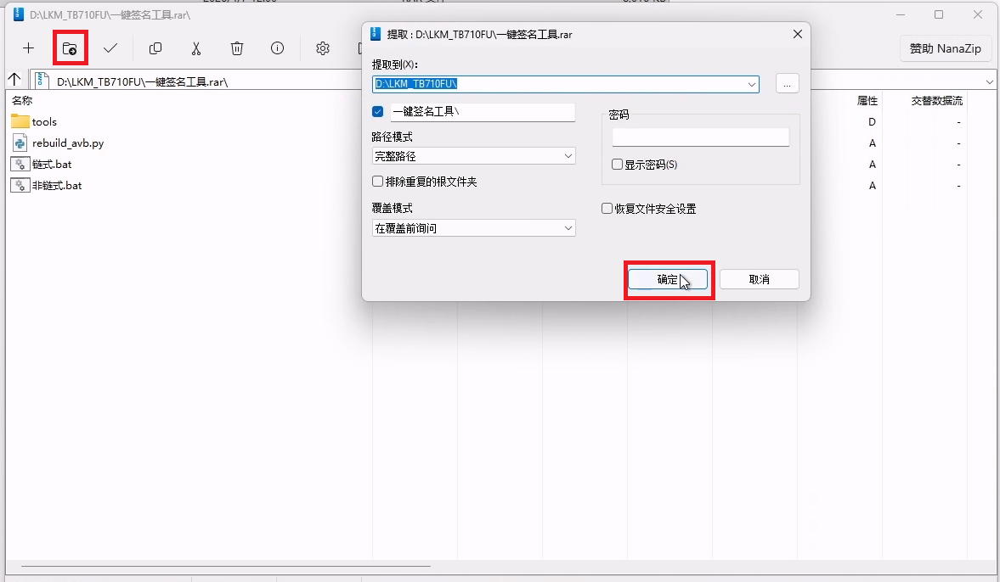

2. 将刚刚**回读的**`vbmeta_a.img` 或者 `vbmeta_b.img` 重命名为 `vbmeta.img` ，放置到工具中含有 *非链式* 字样的 `.bat` 文件的目录中。

3. 将**由你的 Root 管理器修补好的**`init_boot.img` （现在它的名字应该类似于 `kernelsu_patched_20260407_035938.img`）重命名为 `init_boot.img`，放置到和上面的 `vbmeta.img` 相同的目录中。
   
4. 完成上面两步之后签名工具所在的目录大概像这样：
   
    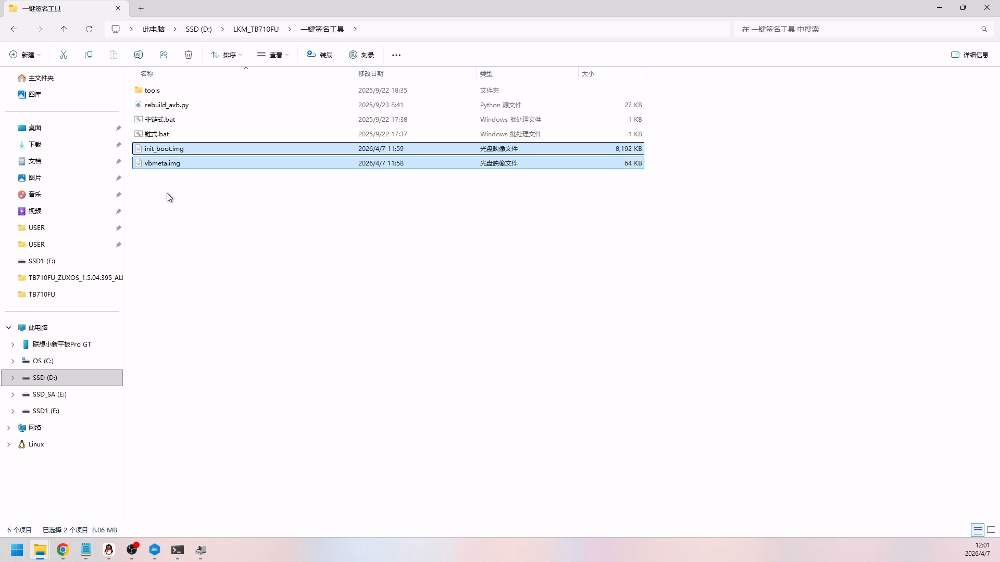

5. 双击 `非链式.bat` ，等待工具自动操作。刚刚放置到 `.bat` 文件相同目录下的两个镜像文件（就是你刚刚移动过来的镜像）现在已经签名完毕。
   
    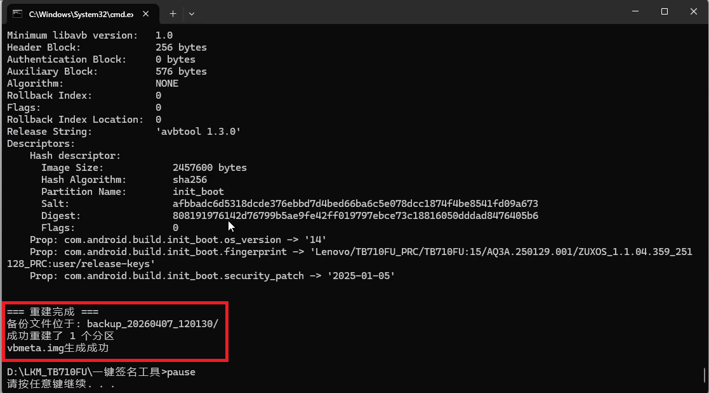

    > [!important]
    > 谨慎检查工具的**完整**结果，确认工具是否正确签名了 `init_boot` 并重建对应的 `vbmeta` 。
    >
    > 

6. 将工具生成的 `backup` 文件夹中的镜像妥善保存，以备后续系统更新时还原使用。

    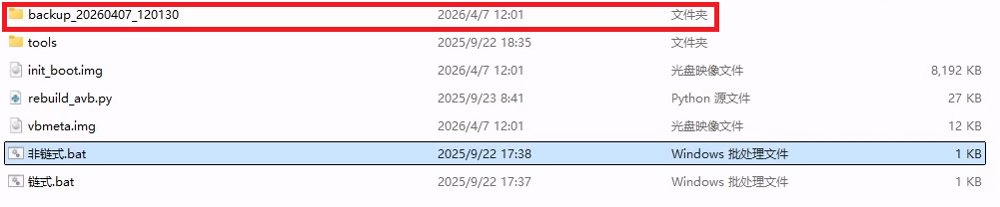

    > [!danger]
    > 系统增量更新时使用的是 `bsdiff / bspatch` 算法。
    >
    > 该算法要求应用补丁的分区摘要和 “分区未修改时的摘要” 保持一致。也就是说安装了 Root 的设备无法进行增量更新。
    >
    > 如果不保存你的备份，我们无法提供任何和系统更新以及救砖相关的帮助。

## Step 5:

刷入 `init_boot` 和 `vbmeta` 。

1. 将平板重启到 9008 模式。在刷机匣中选择正确的引导文件后点击 `读信息` 。这一步的操作和 [第一步](#step-1) 是一样的。

2. 为**活动插槽（就是刚才要求记住的插槽）的** `init_boot` 和 `vbmeta` 分区选择**刚刚签好名的对应文件**。

    

    

3. 点按 `刷入` 按钮，等待工具自动完成操作。

## Step 6 （非常重要）:

> [!danger]
> 不做这步，只能卡在 `BootLoader` 模式！最坏情况甚至可能只能通过工程线进入 9008 救砖！

1. 点击刷机匣右侧界面 `更多功能` 里的 `槽位功能` ，然后**点击"重设当前槽位"**。

    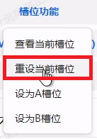

2. 完成上述步骤后，将日志面板折叠起来，在刷机匣找到如下图选项，点击 `重启 -> 系统` 即可重启到系统。

    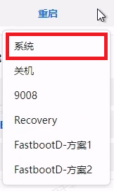

## Step 7:

1. 设备应当正确启动。启动后应当看到管理器中显示工作中\<LKM>，如下图所示：

    

## Step 8:

1. 确认管理器处于工作中后请关闭管理器中的 `检查更新` 选项~~以防忍不住点了直接安装~~。

    

## 注意事项:

> [!danger]
> 严禁使用管理器的 `直接安装` 和 `安装到另一个槽位` 功能。管理器不知道设备没有解锁，不会重建 `vbmeta` 结构。这么做会导致**设备AVB校验不通过，无法开机**，表现为提示红色感叹号，后续启动时只能卡在 `BootLoader模式` 。
>
> 严禁使用管理器 `卸载` （位于“设置”面板最下方，注意：**不是**`卸载模块`）功能。这么做也会破坏 `vbmeta` 结构，造成和上面的行为相同的后果。