# 在 Android 上创建签名配置

签名配置在 AVBDroid 和 AVBPowerTool2 两款软件之间通用，它指导软件如何生成 avbtool.py 签名命令，并提供签名所需的密钥。

## 准备工作

1. 最新版 AVBDroid APP: [GitHub Releases](https://github.com/WASDDestroy/avbtool-android-compose/releases/latest)
2. AOSP 测试密钥对：[蓝奏云](https://wwapb.lanzout.com/iHszl46zv8xi)
3. 下列镜像文件，需要保证**该 ROM 的版本（或者其底包版本）大于等于你曾在你的设备上使用的最高系统版本，也就是这个 ROM 可以在你的未解锁设备上正常开机使用**，你可以寻找救砖包或者使用 9008 从你的设备中读取活动分区镜像：
   - boot
   - dtbo
   - init_boot
   - pvmfw
   - recovery
   - vendor_boot
   - vbmeta
   - vbmeta_system

## 准备文件

1. 创建一个目录，这个目录将用于放置镜像文件：

   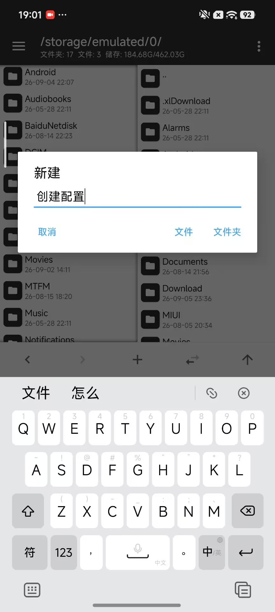

2. 将上述 8 个镜像文件以及测试密钥对 `testkey_rsa2048.pem` 和 `testkey_rsa4096.pem` 都放置到这个文件夹中：
   
   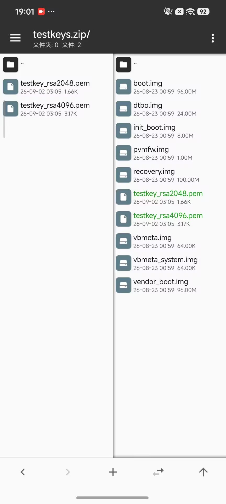

## 创建配置

1. 打开 AVBDroid APP, 切换到 `签名配置` 选项卡后点击 `新增配置` 按钮：
   
   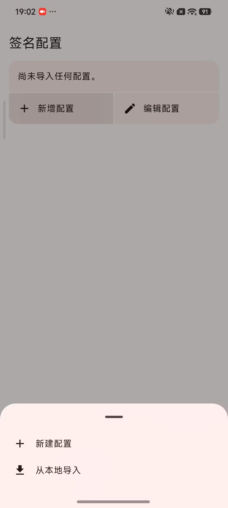

2. 在弹出菜单中选择 `新建配置` 后输入你的配置 ID （大小写字母和英文符号，更准确的讲，配置 ID 只接受 ASCII 符号）和配置名称：
   
   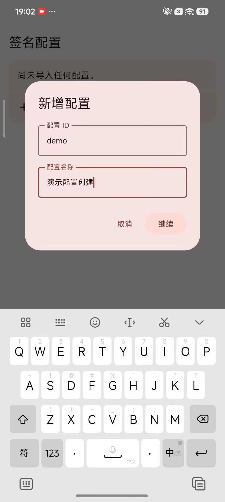

3. 点击 `继续` 后应当可以成功创建配置：
   
   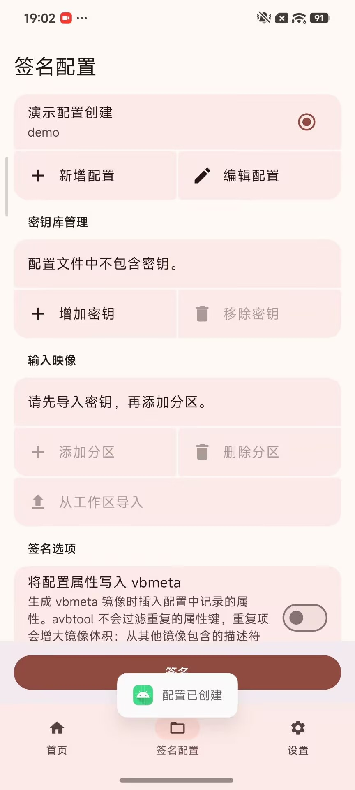

## 导入密钥并复制密钥关键信息

1. 创建配置之后必须先添加密钥再导入分区。点击 `密钥库管理` 中的 `增加密钥` 后导入 `testkey_rsa4096.pem` 和 `testkey_rsa4028.pem`:
   
   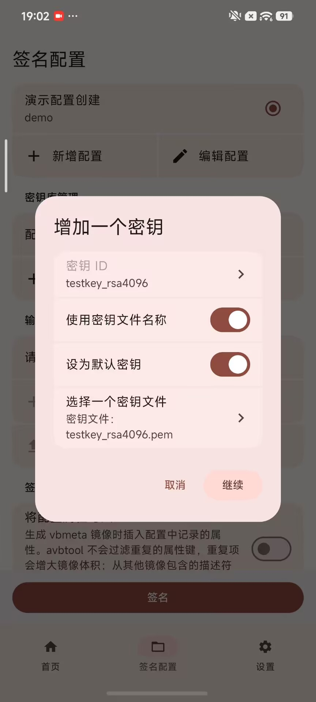
   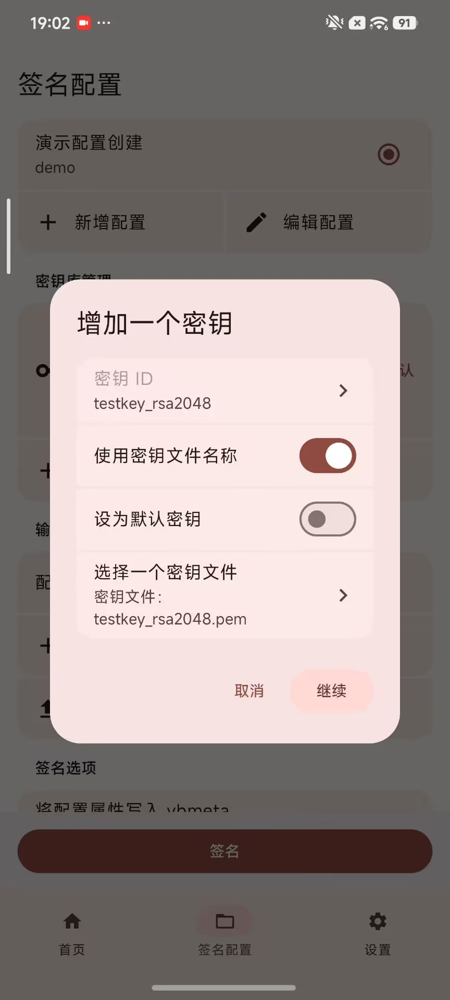

2. 确保当前的默认密钥是 `testkey_rsa4096`, 如果不是，长按 testkey_rsa4096 这个条目后选择 `激活密钥`
3. 长按 testkey_rsa4096 和 testkey_rsa2048, 分别复制下它们的 `公钥文件名`，稍后要用。
   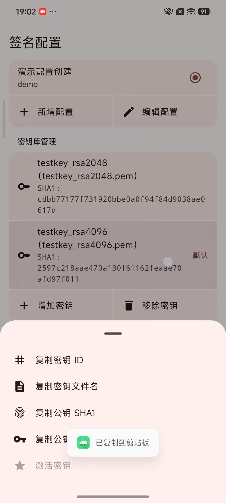
   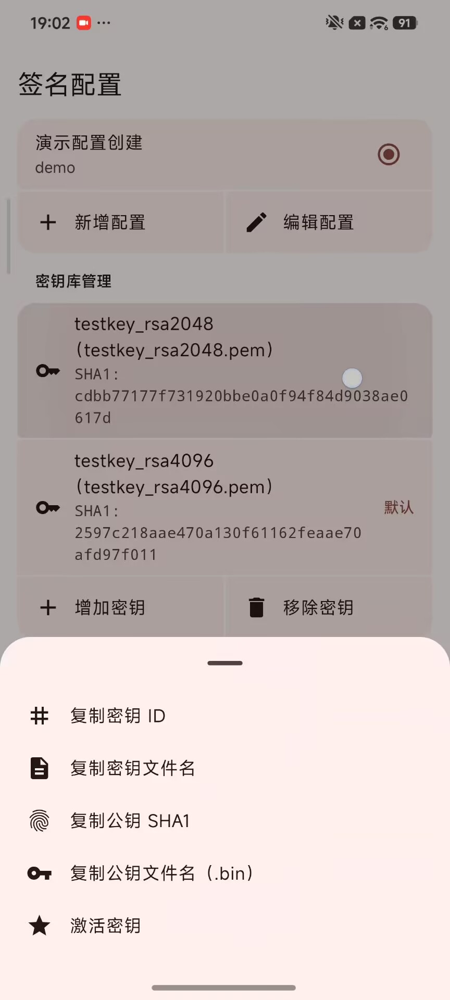

## 导入分区信息

1. 滑动到 `输入映像` 部分，找到 `从工作区导入` 按钮并点击它，阅读并确认下面的提示：
   
   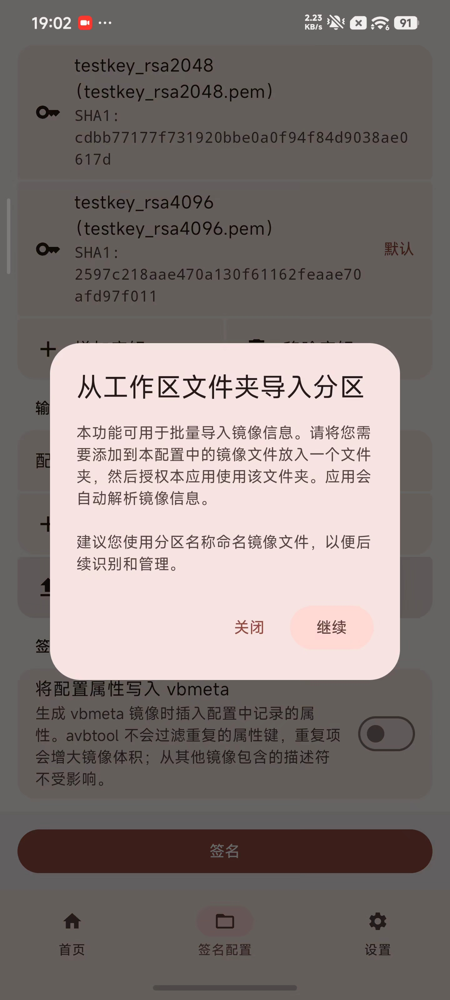

2. 选择刚刚创建的文件夹后点击 `使用此文件夹` ，让应用能够读取其中的镜像信息：
   
   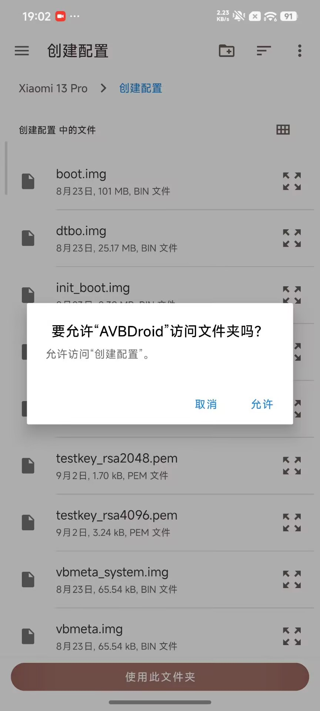

3. 应用应当能自动解析全部镜像包含的 AVB 信息，并呈现下面的界面：
   
   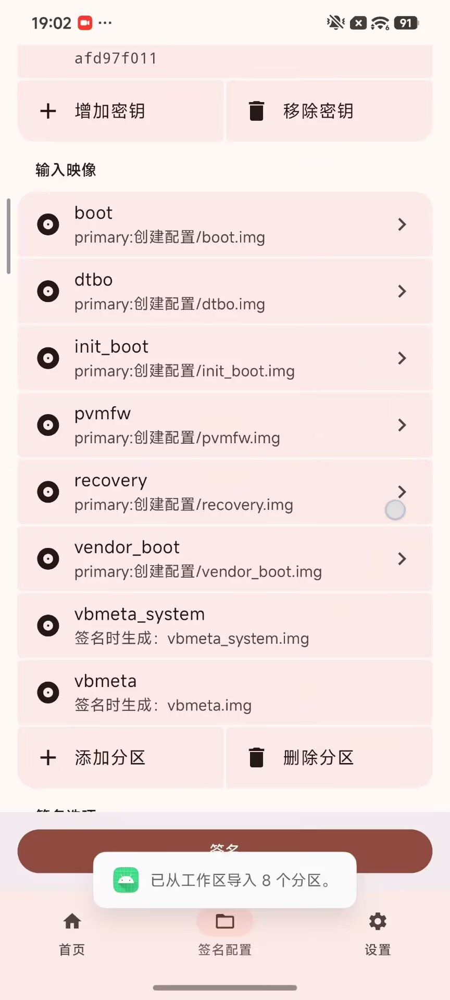

   > [!note]
   > 如果提示有镜像解析失败，可能是这个镜像不具备 AVB 签名，请检查你的镜像是否完好。

## 编辑分区信息

1. 长按对应分区条目可以呼出菜单，点按 `更改镜像配置` 可以更改这个分区的签名配置。
   
   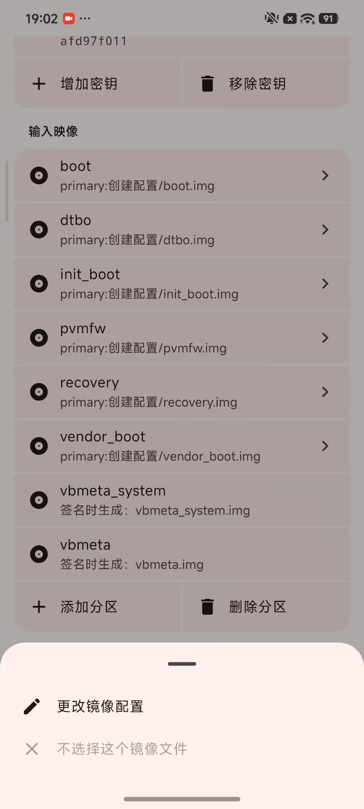

2. 先长按 `vbmeta_system` 分区一行，并打开编辑页面，做下面的更改：
   - 签名算法改为 `SHA256_RSA2048`
   - 签名密钥改为 `testkey_rsa2048`
   
   也就是下面这样：

   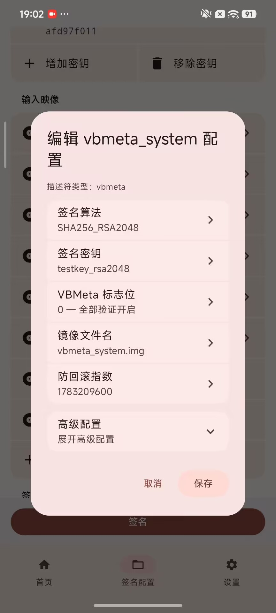

3. 展开 `vbmeta_system` 配置编辑对话框的高级配置并找到 `包含的分区` 一行：
   
   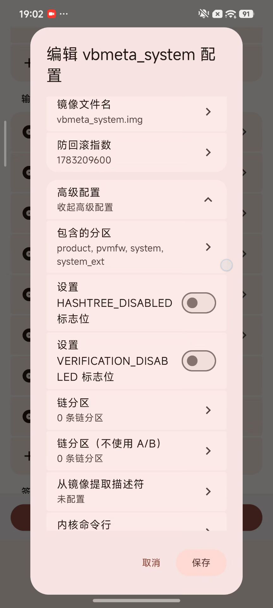

4. 点击 `包含的分区` 一行，像下面这样勾选分区，保证只有 `pvmfw` 分区被勾选后点击确定：
   
   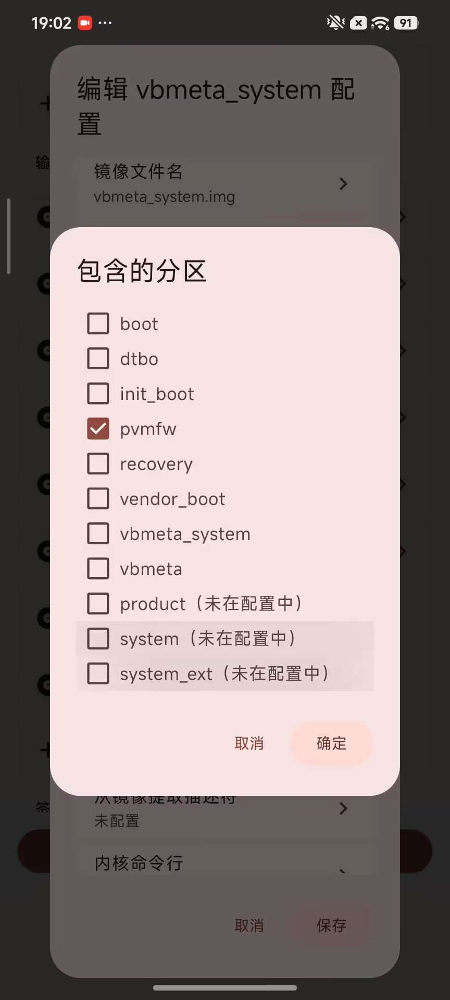

5. 保存 `vbmeta_system` 分区的配置。
6. 长按 `vbmeta` 一行打开它的配置编辑页面，做下面的更改:
   - VBMeta 标志位改为 1
   
   也就是下面这样：

   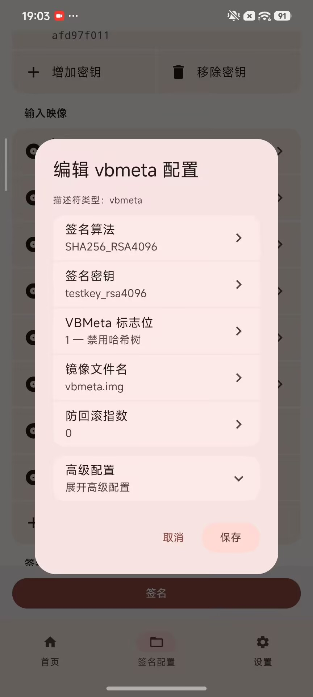

7. 展开 `vbmeta` 配置编辑对话框的高级配置并找到 `包含的分区` 一行。
8. 点击 `包含的分区` 一行，像下面这样勾选分区，保证只有 `dtbo`, `init_boot`, `vendor_boot` 分区被勾选后点击确定：
   
   

9. 找到 `链分区` 一行，点击打开对话框，看到现在三个链式分区都使用默认密钥进行匹配：
    
    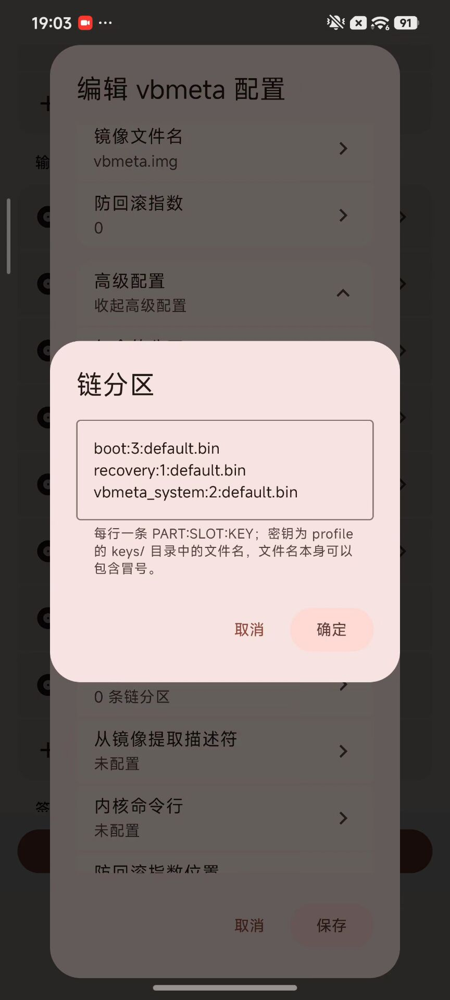

10. 使用刚刚复制的公钥文件名修改链式分区信息后点击确定：
    - `boot` 和 `recovery` 的公钥文件名从 `default.bin` 替换为 `testkey_rsa4096.pem.bin`
    - `vbmeta_system` 的公钥文件名从 `default.bin` 替换为 `testkey_rsa2048.pem.bin`
    - 或者直接使用下面编辑好的配置**整段替换**链式分区配置：
      ```text
      boot:3:testkey_rsa4096.pem.bin
      recovery:1:testkey_rsa4096.pem.bin
      vbmeta_system:2:testkey_rsa2048.pem.bin
      ```

11. 保存 `vbmeta` 分区的配置。

## 检验分区配置

按照下表依次检查分区配置：

| 分区名         | 算法           | 签名密钥             | 回滚索引                     | 标志 |
| ------------- | -------------- | ------------------- | --------------------------- | ---- |
| boot          | SHA256_RSA4096 | `testkey_rsa4096`   | UNIX 时间戳，如 `1736035200` | 0    |
| dtbo          | NONE           | 不签名，任意密钥均可  | 0                           | 0    |
| init_boot     | NONE           | 不签名，任意密钥均可  | 0                           | 0    |
| pvmfw         | NONE           | 不签名，任意密钥均可  | 0                           | 0    |
| recovery      | SHA256_RSA4096 | `testkey_rsa4096`   | 1                           | 0    |
| vendor_boot   | NONE           | 不签名，任意密钥均可  | 0                           | 0    |
| vbmeta        | SHA256_RSA4096 | `testkey_rsa4096`   | 0                           | 1    |
| vbmeta_system | SHA256_RSA2048 | `testkey_rsa2048`   | UNIX 时间戳，如 `1783209600` | 0    |

| 分区名         | 链式分区名:回滚索引位置:公钥 SHA1 | 包含分区 |
| ------------- | ------------------------------- | ------- |
| vbmeta        | recovery:1:`2597c218aae470a130f61162feaae70afd97f011`, vbmeta_system:2:`cdbb77177f731920bbe0a0f94f84d9038ae0617d`, boot:3:`2597c218aae470a130f61162feaae70afd97f011` | dtbo, init_boot, vendor_boot |
| vbmeta_system | / | pvmfw |

## 导出配置

回到签名配置屏幕的最上方，点击 `编辑配置` 按钮，选择 `导出配置` 后导出即可：

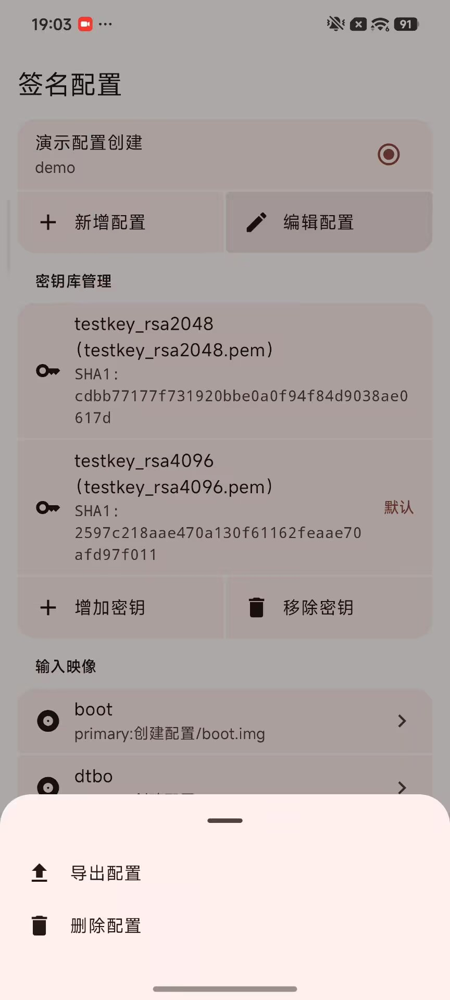