# 在 Android 设备上重建 AOSP 信任链

联想没有阻止降级 abl 固件，因此可以刷入使用 AOSP 测试公钥进行 AVB 鉴权的 abl.img 配合重新签名的镜像组实现恢复 AOSP 信任链。

恢复 AOSP 信任链后，**ZUXOS 版本 1.5.04.445 及以上**的小新平板 Pro GT 设备可以重新使用本站的免解锁教程。

## 开始前须知

1. 本教程适合 ZUXOS (官方系统) 和任何可在此设备上运作的第三方系统。
2. 为了提取原机镜像和刷入镜像，你需要掌握如何使用 9008 端口进行读写。本教程不做说明。
3. 本教程利用的漏洞可能在未来的某个时刻被联想再次封堵，教程恕不对未来系统版本中此漏洞的可用性做任何担保。
4. 操作前必须备份，没有备份的情况下无法进行 OTA 更新。

## 准备文件

你需要准备下面的文件：

1. 一个老版本的 abl 分区镜像。你可以在本站资源下载页的 `高版本免解锁 Root 资源` 板块找到它
2. AVBDroid 安卓 APP, 版本 2.0.0。可以在 [GitHub Releases](https://github.com/WASDDestroy/avbtool-android-compose/releases) 下载
3. 签名配置文件，此文件应当匹配你当前使用的系统版本。可以在本站资源下载页的 `高版本免解锁 Root 资源` 板块找到它们。如果没有符合你系统版本的配置，你需要手动创建配置。
4. 本机当前系统版本的以下镜像，可能是救砖包、第三方 ROM 中的镜像，或者可能需要你使用 9008 从设备中读出。你可以对这些镜像事先进行修补，例如替换一个第三方内核、进行降压超频、刷 LKM Root 等：
   - boot
   - dtbo
   - init_boot
   - pvmfw
   - recovery
   - vendor_boot

## 创建文件夹并放置镜像

创建一个文件夹，例如命名为 `免解锁`：

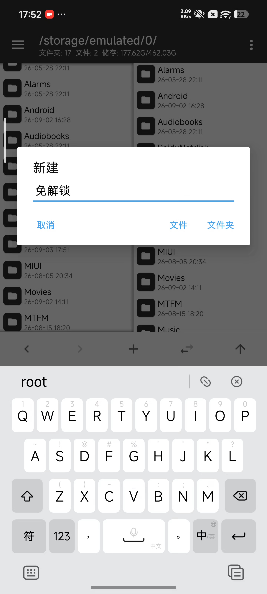

然后将本机镜像放进文件夹中：

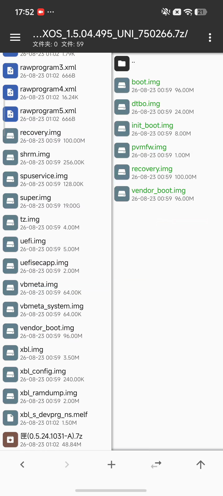

## 导入配置

安装 AVBDroid 后打开 APP 进入 `签名配置` 功能页，这个时候应该还没有任何配置：

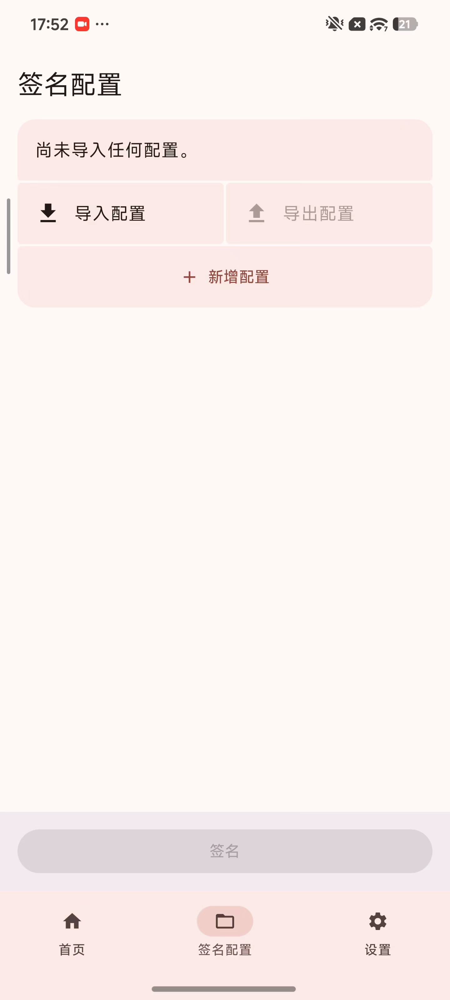

点击 `导入配置`，在文件管理器中选择你刚刚得到的签名配置文件后确定导入，应该能看到下面的成功导入页面：

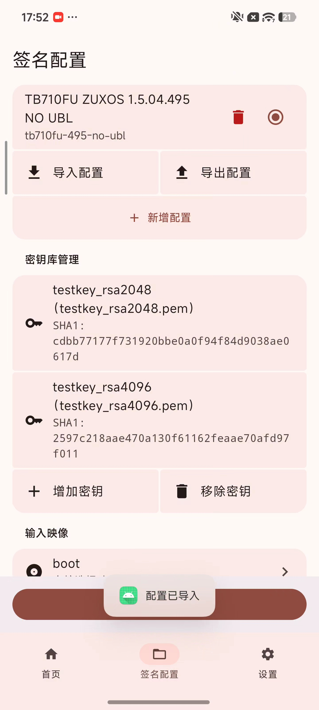

## 签名镜像

滑动页面找到 `输入映像` 部分：

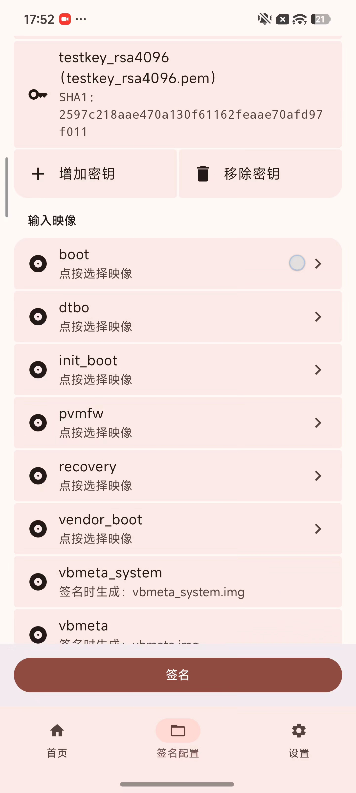

按照配置管理页面的指示，你需要依次用文件管理器选择你得到的六个镜像。选择完毕后界面应当像下面这样：

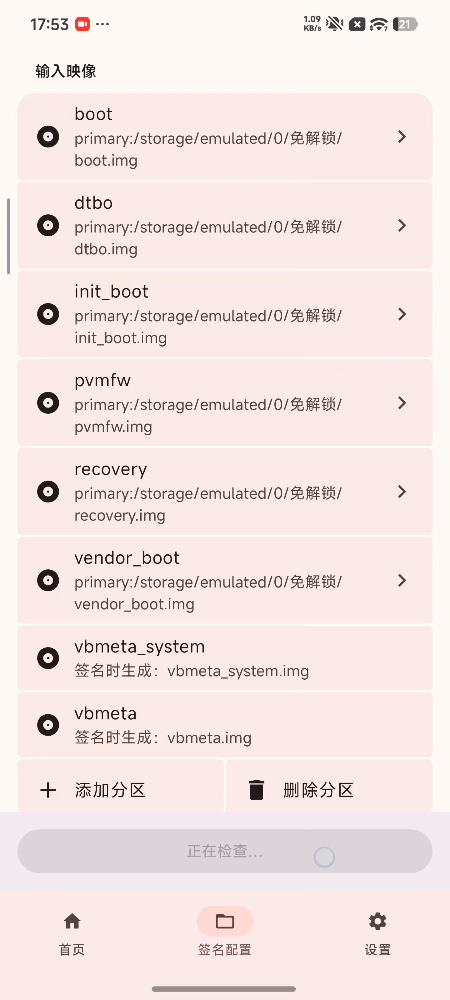

点击页面最下方的 `签名` 按钮，勾选签名作用域为：
- boot
- dtbo
- init_boot
- pvmfw
- recovery
- vendor_boot
- vbmeta_system
- vbmeta

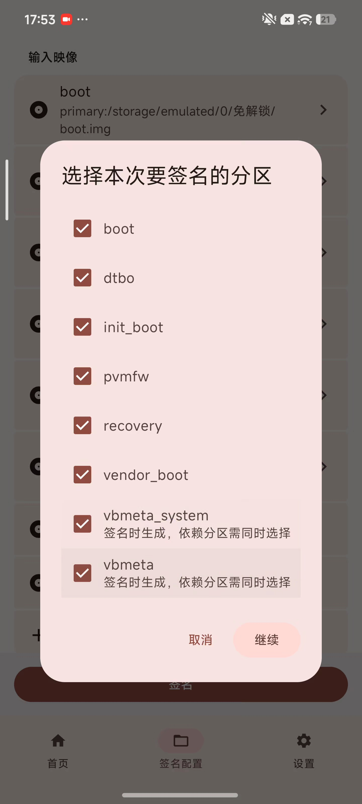

软件将弹出原地改写镜像的提示，点击 `继续` 即可：

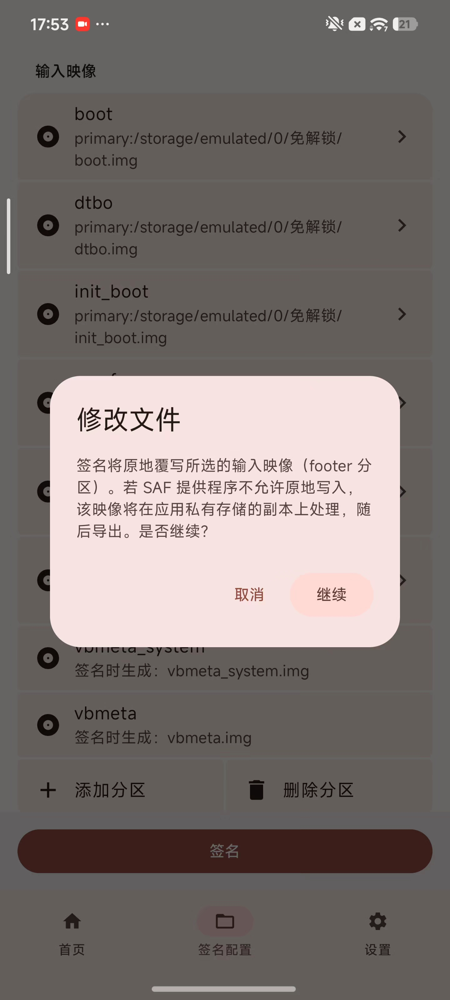

软件会自动完成签名（需要几秒钟）。签名完成后将询问你在何处保存生成的 vbmeta 和 vbmeta_system 镜像：

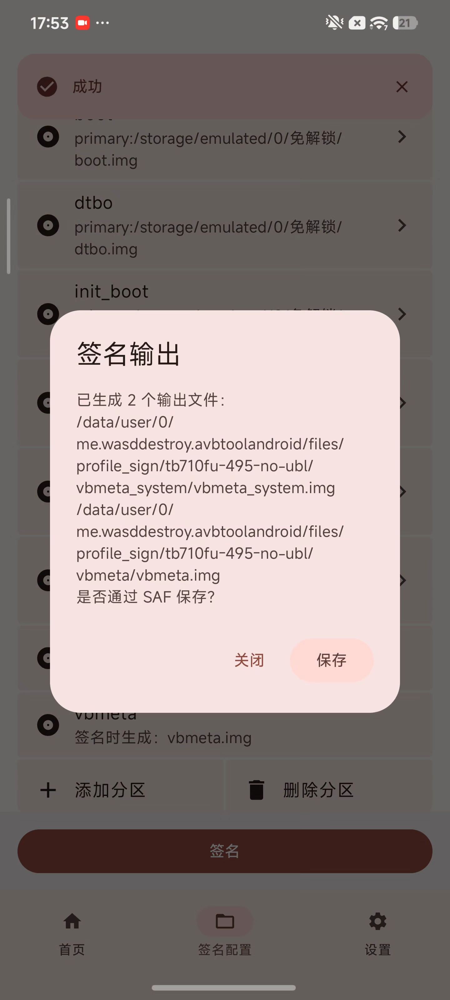

## 保存新镜像

将生成的 `vbmeta` 镜像和 `vbmeta_system` 镜像保存到刚刚创建的免解锁文件夹中：

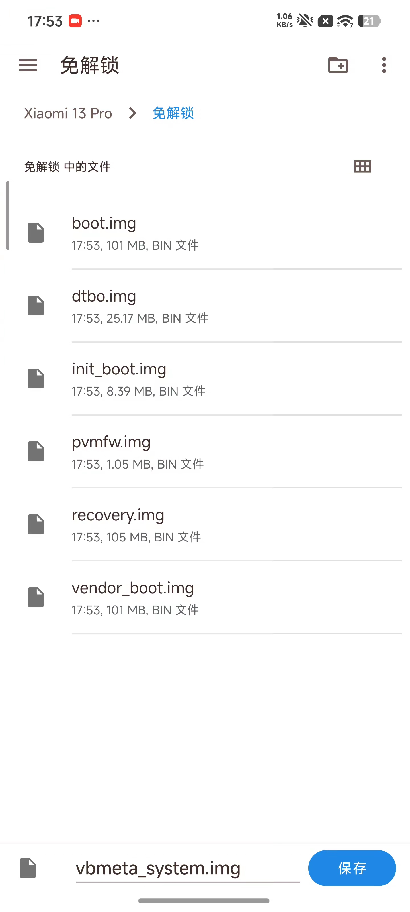
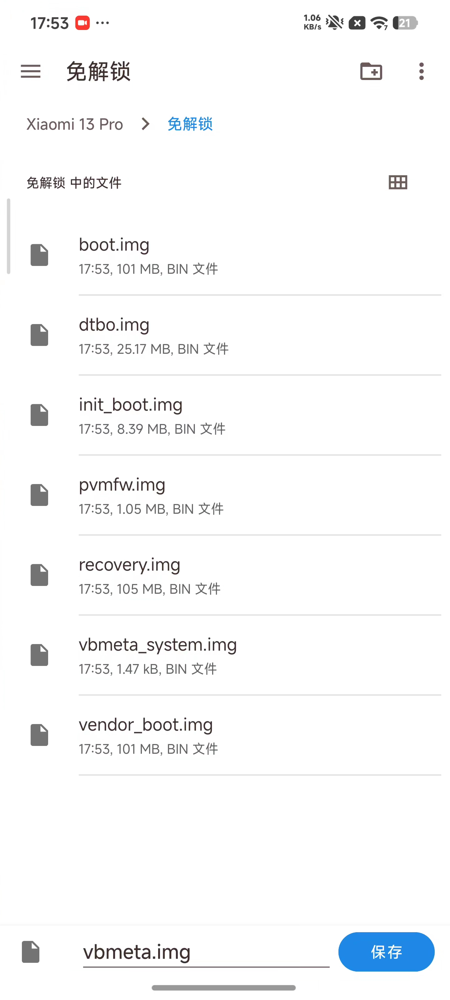

> [!note]
> 生成的 vbmeta 和 vbmeta_system 镜像使用的扩展名在一些品牌的设备上（比如一加）固定为 `.BIN`, 请放心，这对稍后刷入镜像没有影响。

## 验证信息

回到 AVBDroid APP, 切换到 `首页` 屏幕：

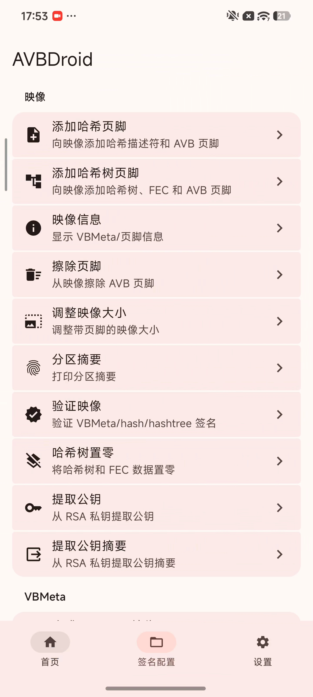

点击 `映像信息` 功能：

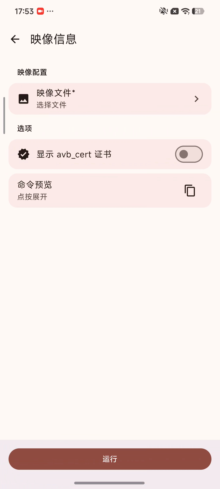

选择文件并点击 `运行` 后，它会自动解析镜像的 AVB 信息：

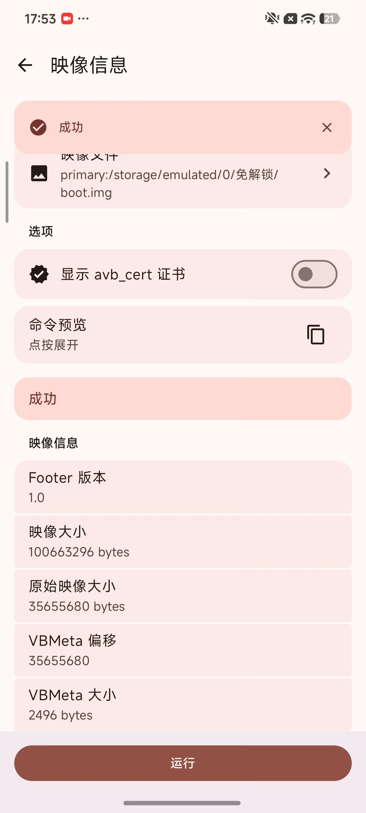

依次读取所有被签名/生成的镜像的信息，要重点关注下面的检查点，如果你签名的镜像没有通过任一检查点，则这些镜像不能再使用。请核查你的配置文件是否来自本站的资源下载页面，或者创建配置时是否使用了错误的信息，然后重试签名：

| 分区名         | 算法           | 公钥 SHA1                                  | 回滚索引                     | 标志 |
| ------------- | -------------- | ------------------------------------------ | --------------------------- | ---- |
| boot          | SHA256_RSA4096 | `2597c218aae470a130f61162feaae70afd97f011` | UNIX 时间戳，如 `1736035200` | 0    |
| dtbo          | NONE           | /                                          | 0                           | 0    |
| init_boot     | NONE           | /                                          | 0                           | 0    |
| pvmfw         | NONE           | /                                          | 0                           | 0    |
| recovery      | SHA256_RSA4096 | `2597c218aae470a130f61162feaae70afd97f011` | 1                           | 0    |
| vendor_boot   | NONE           | /                                          | 0                           | 0    |
| vbmeta        | SHA256_RSA4096 | `2597c218aae470a130f61162feaae70afd97f011` | 0                           | 1    |
| vbmeta_system | SHA256_RSA2048 | `cdbb77177f731920bbe0a0f94f84d9038ae0617d` | UNIX 时间戳，如 `1783209600` | 0    |

*
表： 通用检查点
*

| 分区名         | 链式分区名:回滚索引位置:公钥 SHA1 | 包含分区 |
| ------------- | ------------------------------- | ------- |
| vbmeta        | recovery:1:`2597c218aae470a130f61162feaae70afd97f011`, vbmeta_system:2:`cdbb77177f731920bbe0a0f94f84d9038ae0617d`, boot:3:`2597c218aae470a130f61162feaae70afd97f011` | dtbo, init_boot, vendor_boot |
| vbmeta_system | / | pvmfw |

*
表： vbmeta 分区检查点
*

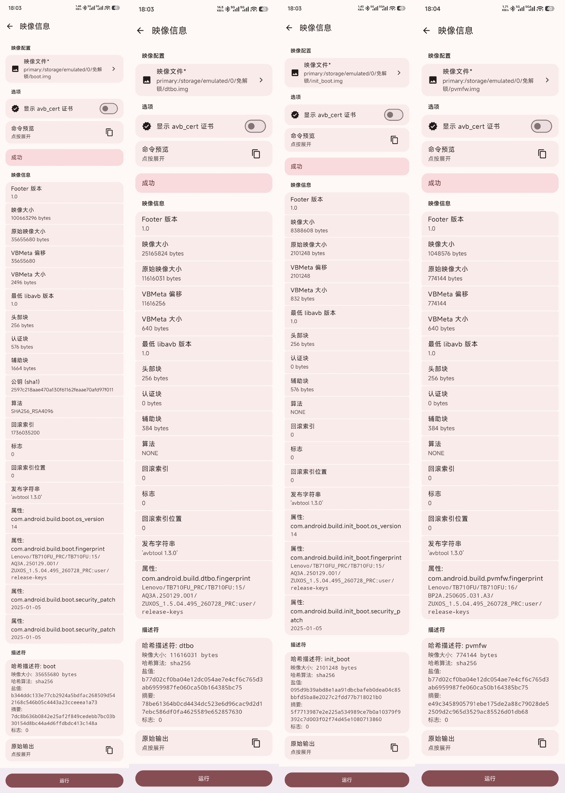

*
上图：boot, dtbo, init_boot 和 pvmfw 镜像
*

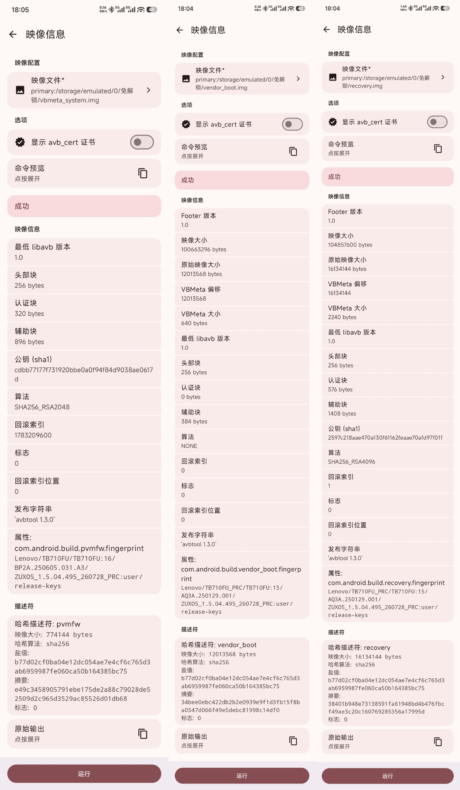

*
上图：recovery, vendor_boot 和 vbmeta_system 镜像
*

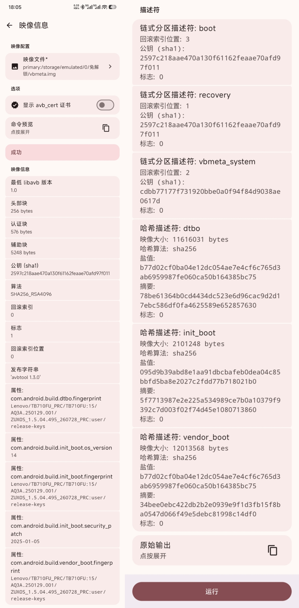

*
上图：vbmeta 镜像
*

如果以上验证均通过，请继续下一步：

## 刷入镜像

将上述新生成的 8 个镜像和 `abl.img` 一起使用 9008 刷入当前设备的活动插槽，开机即恢复 AOSP 信任链。