# 为使用 GKI 方案进行 Root 的设备解除 Root 状态

## **Step 1**: 清理 `/data` 分区

以 `KernelSU` 为例：

1. 在 `KernelSU` 的模块页面关闭所有模块，然后重启一次平板。

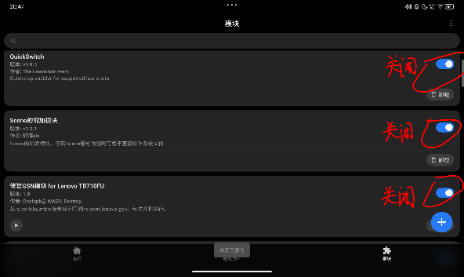

_例如上面这些模块全都要关掉_

1. **（对于 KernelSU 3.0 及更新版本以及对应的分支，不需要执行本步骤）** 重启完成之后，点击 `KernelSU` 主页左上角的设置，然后找到 `最小化稀疏文件` 选项，点击并确认。

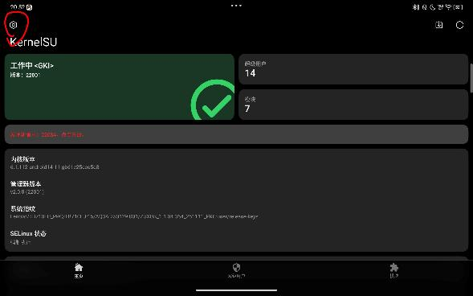

_点击左上角的设置_

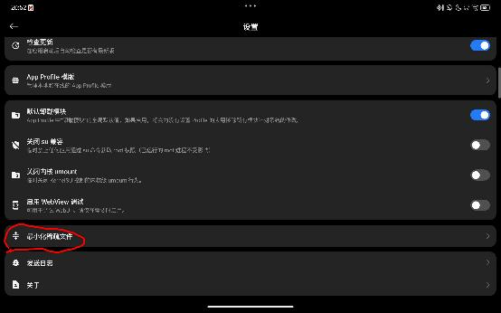

_点击"最小化稀疏文件"_

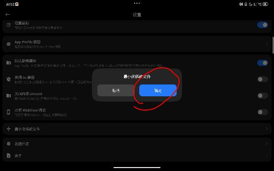

_点击确定，完成最小化稀疏文件_

完成上面的步骤之后，`KernelSU` 的模块镜像会被缩小到最小体积

> 为什么能够最小化这个文件？
>
> 1 TB 大小的 **modules.img** 是一个磁盘镜像文件，不要担心它的大小，它是一种被称之为稀疏文件的文件格式，它的实际大小只有你使用的模块的大小，并且你在删除模块后它会动态缩小；它并不实际占用 1 TB 大小的磁盘空间（实际上你手机可能并没有这么多空间）。 如果你真的对这个文件的大小感到不爽，你可以使用 resize2fs -M 命令让它变成实际大小；但此时模块可能无法正常工作……
>
> (来自 KernelSU 官网 ~~，同样使用 vitePress 构建！~~)

1. 使用 `MT 管理器` 等能够读写 `/data` 的文件管理器访问下面的目录：

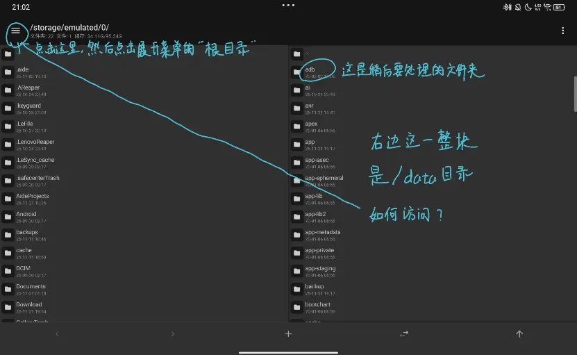

_MT 的界面，左侧为内置存储空间，右侧已经导航到了/data 文件夹_

默认情况下左侧是平时说的 `内置存储空间` ，而右边是 "工作目录"。

先点击工作目录的任何文件夹将输入焦点切换到右边，然后点击 **左上角的三条横线** ，在展开菜单选择 **根目录**。然后在右侧找到 `data 文件夹` ，点进去，现在你应当在自己的 MT 中能看到 `adb 文件夹`。

长按 `adb 文件夹`，弹出选项菜单，直接点击 **删除**。

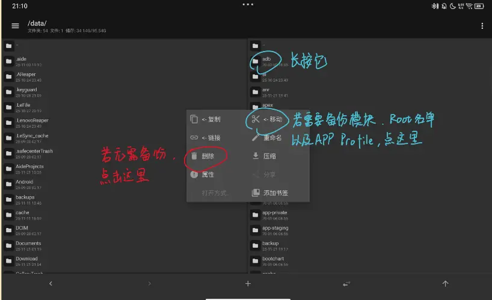

_长按 adb 文件夹，弹出操作菜单_

## **Step 2**: 还原镜像

下载并解压刷机匣，安装9008驱动。最好顺便安装 `ADB` 驱动。

1. 将设备重启到 9008 模式：关机， **按住** 音量加，并插入数据线，设备应当先显示充电符号，并在几秒钟后黑屏，且电脑发出插入设备的提示音。这时可以 **松开音量键** ，准备在电脑端发送引导。

> [!tip]
> 如果无法进入，将平板开机，[打开 USB 调试](../generic/flash_unlocked_device.md#unlock-usb-debugging)，电脑上[安装 ADB 工具](../generic/flash_unlocked_device.md#unlock-install-adb)，然后在电脑上输入命令`adb reboot edl`即可进入 9008 模式。

发送引导方式：

- 点击 `选择设备/引导/配置`

- 在弹出的窗口中，点击 `引导文件` 处右侧的 `...` 按钮，并在弹出的对话框选择从下载页下载的引导文件 `xbl_s_devprg_ns.melf` ，并点 `打开` 选择它，最后在刷机匣的对话框点击 `确认` 。

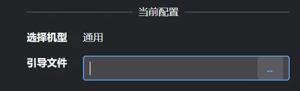

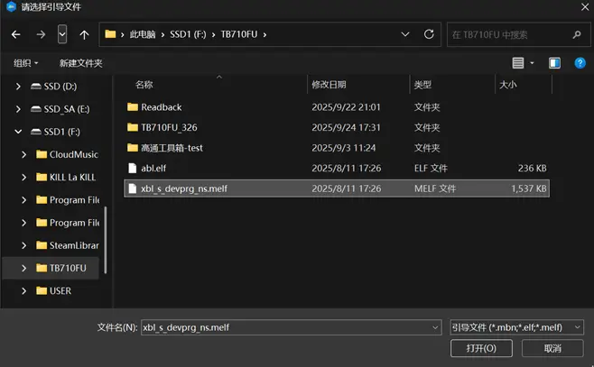

- 现在回到刷机匣的主界面，点击 `读信息` ，确认一下设备连接是否正常，如果正常，应当能够读取到分区信息。

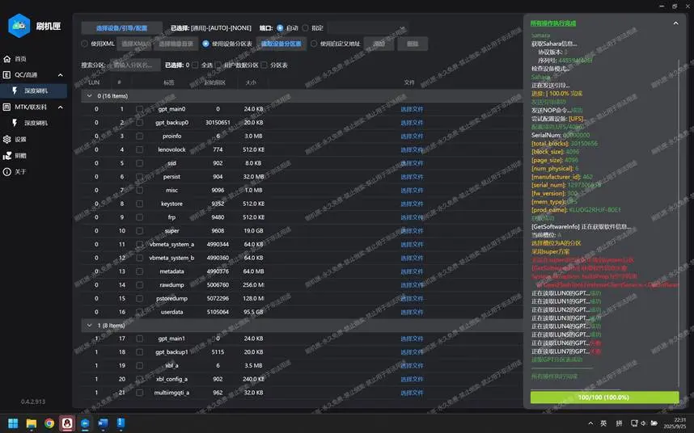

> [!note]
> 日志内有上图所示的错误信息是正常的

1. 使用工具箱的 `槽位功能 -> 查看槽位` 确认活动槽位，记住槽位号。
   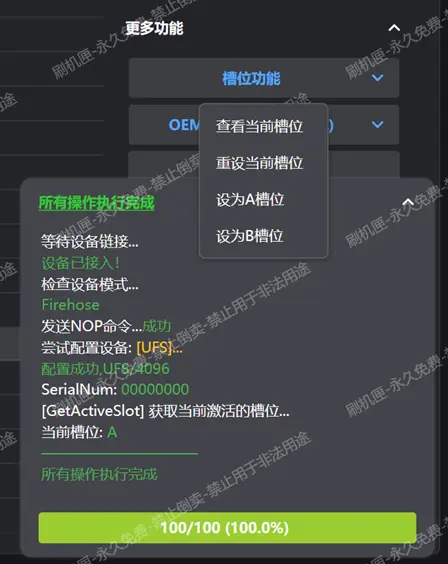

2. 如果槽位为 A，找到`boot_a`分区，反之，找到`boot_b`分区，并勾选分区前的复选框，然后选择之前备份的原`boot`分区文件，如果没有备份，可以尝试下载站提供的“快速取用镜像”链接中的文件，请同样注意槽位号
   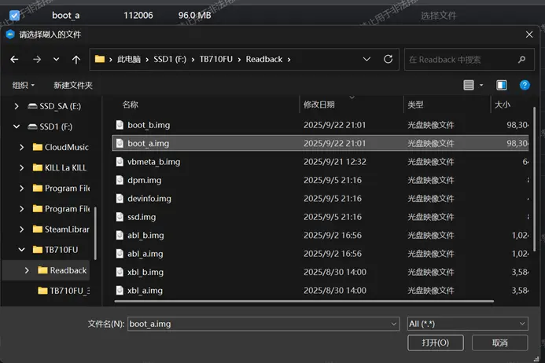

3. 现在，点击 `刷入` ，恢复原始 `boot` 镜像
   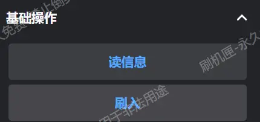

4. **点击“槽位功能”中的“重设当前槽位”**
   

5. 完成后重启设备至系统，确认 Root 管理器中工作状态变为 `未安装` 即完成恢复步骤

   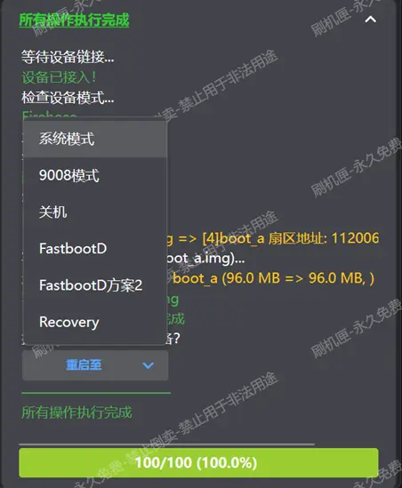
